

**UNIVERSIDADE POSITIVO** 
**CURSO DE ENGENHARIA DE SOFTWARE**

 

Gabriel Silva Vargas Pereira 
Getulio Costa Owsiany 
Guilherme da Costa Ami 
Otavio Carlos Wenzel Junior 
Pedro Nagel Alves 
Vitor Marcelo Barzick Nogueira

 

# SISTEMA DE CONSOLIDAÇÃO DE CARTEIRAS DE INVESTIMENTOS: ativos líquidos e ilíquidos Brasil e offshore

 

Trabalho de Conclusão de Curso apresentado ao Curso de Engenharia de Software da Universidade Positivo, como requisito parcial para a obtenção do título de Bacharel em Engenharia de Software.

Orientador: Prof. Welington Soares.

 

CURITIBA 
2026

---

## RESUMO

O crescimento da base de investidores pessoa física no Brasil e a diversificação das carteiras — que passaram a reunir ativos líquidos domésticos, ativos no exterior e investimentos alternativos ilíquidos, como Private Equity, Venture Capital e imóveis — tornaram mais complexa a obtenção de uma visão patrimonial consolidada. A análise comparativa de cinco plataformas disponíveis no mercado brasileiro (Kinvo, Gorila, Status Invest, Trademap e SmartBrain), complementada por matrizes SWOT, indicou limitações no tratamento de ativos ilíquidos, na conversão multimoeda com taxas históricas e na acessibilidade das soluções mais completas para o investidor que administra o próprio patrimônio. Este trabalho tem como objetivo propor e especificar uma plataforma web de consolidação de carteiras que integre essas classes de ativos em uma visão unificada. Trata-se de pesquisa aplicada, de caráter exploratório, conduzida por análise documental, benchmarking de plataformas e desenvolvimento iterativo e incremental. A solução adota templates padronizados em XLSX como mecanismo principal de ingestão, com validação estrutural e semântica e enriquecimento de preços por APIs públicas apenas para ativos listados; apura a rentabilidade pelas metodologias Time-Weighted Return (TWR) e Money-Weighted Return (MWR); calcula métricas específicas de fundos ilíquidos, como DPI e TVPI; converte posições entre real, dólar e euro; e compara o desempenho com benchmarks de mercado. A arquitetura em camadas, baseada em Python, Streamlit e SQLite, é documentada por requisitos funcionais e não funcionais, regras de negócio, vinte casos de uso, diagramas UML, modelo entidade-relacionamento, nove processos em BPMN e protótipos de interface, com mecanismos de segurança e de conformidade com a Lei Geral de Proteção de Dados Pessoais. Como resultado desta etapa, obteve-se a especificação rastreável do sistema, que constitui a base para a implementação e para a validação junto ao público-alvo, prevista para a etapa seguinte do trabalho por meio de questionários, entrevistas e indicadores objetivos.

**Palavras-chave:** consolidação de carteiras; ativos ilíquidos; engenharia de software; rentabilidade de investimentos; LGPD.

---

## LISTA DE QUADROS

- Quadro 1 — Funcionalidades em plataformas de consolidação de carteiras
- Quadro 2 — Diferencial competitivo da solução proposta
- Quadro 3 — Matriz SWOT — Kinvo
- Quadro 4 — Matriz SWOT — Gorila
- Quadro 5 — Matriz SWOT — Status Invest
- Quadro 6 — Matriz SWOT — Trademap
- Quadro 7 — Matriz SWOT — SmartBrain
- Quadro 8 — Matriz SWOT — Sistema proposto
- Quadro 9 — Matriz SWOT cruzada (TOWS) — Sistema proposto
- Quadro 10 — Exemplo de mapeamento de identificadores
- Quadro 11 — Comparação entre TWR e MWR
- Quadro 12 — Benchmarks suportados pelo sistema
- Quadro 13 — Métodos de entrada de dados por classe de ativo
- Quadro 14 — Funcionalidades do sistema por módulo e prioridade
- Quadro 15 — Cronograma macro do TCC
- Quadro 16 — Riscos e mitigações do projeto
- Quadro 17 — Stack tecnológica do sistema
- Quadro 18 — Entidades principais do modelo de dados
- Quadro 19 — Requisitos funcionais do sistema
- Quadro 20 — Requisitos não funcionais (ISO/IEC 25010)
- Quadro 21 — Catálogo de Regras de Negócio (RN)
- Quadro 22 — Matriz de Rastreabilidade RF × UC × Tabela × Tela
- Quadro 23 — Especificação do caso de uso UC-01 (Criar Conta)
- Quadro 24 — Especificação do caso de uso UC-02 (Realizar Login)
- Quadro 25 — Especificação do caso de uso UC-03 (Recuperar Senha)
- Quadro 26 — Especificação do caso de uso UC-04 (Importar Carteira via Template Padronizado XLSX)
- Quadro 27 — Especificação do caso de uso UC-05 (Cadastrar Ativo Líquido Manualmente)
- Quadro 28 — Especificação do caso de uso UC-06 (Registrar Transação)
- Quadro 29 — Especificação do caso de uso UC-07 (Buscar Preço de Mercado)
- Quadro 30 — Especificação do caso de uso UC-08 (Cadastrar Ativo Ilíquido (PE/VC/RE))
- Quadro 31 — Especificação do caso de uso UC-09 (Registrar Capital Call em Fundo PE/VC)
- Quadro 32 — Especificação do caso de uso UC-10 (Registrar Distribuição)
- Quadro 33 — Especificação do caso de uso UC-11 (Atualizar NAV)
- Quadro 34 — Especificação do caso de uso UC-12 (Visualizar Dashboard Consolidado)
- Quadro 35 — Especificação do caso de uso UC-13 (Calcular Rentabilidade (TWR/MWR))
- Quadro 36 — Especificação do caso de uso UC-14 (Comparar com Benchmark)
- Quadro 37 — Especificação do caso de uso UC-15 (Calcular Métricas PE/VC (MOIC/DPI/TVPI))
- Quadro 38 — Especificação do caso de uso UC-16 (Exportar Relatório Excel/CSV)
- Quadro 39 — Especificação do caso de uso UC-17 (Exportar Dados (Portabilidade LGPD))
- Quadro 40 — Especificação do caso de uso UC-18 (Excluir Conta (Esquecimento LGPD))
- Quadro 41 — Especificação do caso de uso UC-19 (Gerenciar Usuários)
- Quadro 42 — Especificação do caso de uso UC-20 (Consultar Logs de Auditoria)
- Quadro 43 — Dicionário de Dados (entidade USUARIO)
- Quadro 44 — Estrutura do Template Padronizado XLSX (Líquidos)
- Quadro 45 — Estrutura do Template Padronizado XLSX (PE/VC)
- Quadro 46 — Estrutura do Template Padronizado XLSX (Imóveis)

## LISTA DE FIGURAS

- Figura 1 — Interface da plataforma Kinvo
- Figura 2 — Interface da plataforma Gorila
- Figura 3 — Interface da plataforma Status Invest
- Figura 4 — Interface da plataforma Trademap
- Figura 5 — Interface da plataforma SmartBrain
- Figura 6 — Exemplo de fricção na entrada manual de dados em plataformas concorrentes
- Figura 7 — Diagrama de Casos de Uso (visão geral)
- Figura 8 — Diagrama de Classes do Domínio
- Figura 9 — Diagrama de Sequência: Importação via Template
- Figura 10 — Diagrama de Sequência: Registrar Capital Call
- Figura 11 — Diagrama de Sequência: Dashboard Consolidado
- Figura 12 — Diagrama de Atividades: Importação via Template
- Figura 13 — Diagrama de Componentes
- Figura 14 — Diagrama de Implantação
- Figura 15 — Modelo Entidade-Relacionamento (MER)
- Figura 16 — BPMN: Onboarding do Cliente (UC-01)
- Figura 17 — BPMN: Autenticação e Controle de Acesso (UC-02, UC-03, RN-001, RN-013)
- Figura 18 — BPMN: Importação de Carteira via Template Padronizado (UC-04, UC-07)
- Figura 19 — BPMN: Cálculo de Rentabilidade Consolidada (UC-12 a UC-15)
- Figura 20 — BPMN: Gestão de Eventos em Fundo PE/VC (UC-08 a UC-11, UC-15)
- Figura 21 — BPMN: Cadastro Manual de Ativo e Registro de Transação (UC-05, UC-06, UC-08)
- Figura 22 — BPMN: Geração e Exportação de Relatórios (UC-16)
- Figura 23 — BPMN: Atendimento a Solicitação LGPD (UC-17, UC-18)
- Figura 24 — BPMN: Administração de Usuários e Auditoria (UC-19, UC-20)
- Figura 25 — Wireframe: Tela de Login e Privacidade (LGPD)
- Figura 26 — Wireframe: Tela de Importação de Carteira
- Figura 27 — Wireframe: Dashboard Principal
- Figura 28 — Wireframe: Tela de Fundo PE/VC

## LISTA DE ABREVIATURAS E SIGLAS

| Sigla | Significado |
|---|---|
| 2FA | Two-Factor Authentication (autenticação em dois fatores) |
| 3FN | Terceira Forma Normal |
| ABNT | Associação Brasileira de Normas Técnicas |
| ACID | Atomicity, Consistency, Isolation, Durability |
| AES | Advanced Encryption Standard |
| ANBIMA | Associação Brasileira das Entidades dos Mercados Financeiro e de Capitais |
| API | Application Programming Interface |
| B2B | Business to Business |
| B2C | Business to Consumer |
| B3 | Brasil, Bolsa, Balcão |
| BCB | Banco Central do Brasil |
| BPMN | Business Process Model and Notation |
| CDI | Certificado de Depósito Interbancário |
| CEI | Canal Eletrônico do Investidor |
| CNPJ | Cadastro Nacional da Pessoa Jurídica |
| CPF | Cadastro de Pessoas Físicas |
| CSV | Comma-Separated Values |
| CVM | Comissão de Valores Mobiliários |
| DDL | Data Definition Language |
| DPI | Distributions to Paid-In |
| ETF | Exchange-Traded Fund |
| FA | Fluxo Alternativo |
| EX | Exceção (fluxo de exceção) |
| FII | Fundo de Investimento Imobiliário |
| FK | Foreign Key (chave estrangeira) |
| HTTP | Hypertext Transfer Protocol |
| HTTPS | Hypertext Transfer Protocol Secure |
| IFIX | Índice de Fundos de Investimentos Imobiliários |
| IPCA | Índice Nacional de Preços ao Consumidor Amplo |
| IRR | Internal Rate of Return |
| JSON | JavaScript Object Notation |
| JWT | JSON Web Token |
| KPI | Key Performance Indicator |
| LGPD | Lei Geral de Proteção de Dados Pessoais |
| MER | Modelo Entidade-Relacionamento |
| MOIC | Multiple on Invested Capital |
| MVP | Minimum Viable Product (Produto Mínimo Viável) |
| MWR | Money-Weighted Return |
| NAV | Net Asset Value |
| ORM | Object-Relational Mapping |
| PE | Private Equity |
| PF | Pessoa Física |
| PJ | Pessoa Jurídica |
| PK | Primary Key (chave primária) |
| P/VP | Preço sobre Valor Patrimonial |
| RBAC | Role-Based Access Control |
| RE | Real Estate |
| REST | Representational State Transfer |
| RF | Requisito Funcional |
| RN | Regra de Negócio |
| RNF | Requisito Não Funcional |
| RVPI | Residual Value to Paid-In |
| SWOT | Strengths, Weaknesses, Opportunities, Threats |
| TCC | Trabalho de Conclusão de Curso |
| TIR | Taxa Interna de Retorno |
| TLS | Transport Layer Security |
| TOWS | Matriz SWOT cruzada (Threats, Opportunities, Weaknesses, Strengths) |
| TVPI | Total Value to Paid-In |
| TWR | Time-Weighted Return |
| UC | Use Case (caso de uso) |
| UML | Unified Modeling Language |
| UUID | Universally Unique Identifier |
| UX | User Experience (experiência do usuário) |
| VC | Venture Capital |
| VPS | Virtual Private Server |
| WAL | Write-Ahead Logging |
| XLSX | Office Open XML Spreadsheet |
| XP | Extreme Programming |

## SUMÁRIO

- [1 INTRODUÇÃO](#1-introdução)
  - [1.1 Contextualização do mercado](#11-contextualização-do-mercado)
  - [1.2 Justificativa](#12-justificativa)
  - [1.3 Objetivos](#13-objetivos)
  - [1.4 Estrutura do trabalho](#14-estrutura-do-trabalho)
- [2 FUNDAMENTAÇÃO TEÓRICA](#2-fundamentação-teórica)
  - [2.1 Análise de plataformas de consolidação](#21-análise-de-plataformas-de-consolidação)
  - [2.2 Benchmarking de concorrentes](#22-benchmarking-de-concorrentes)
  - [2.3 Arquitetura de fluxo de dados](#23-arquitetura-de-fluxo-de-dados)
  - [2.4 Regras de negócio e cálculos financeiros](#24-regras-de-negócio-e-cálculos-financeiros)
  - [2.5 Estudo de UX e jornada do usuário](#25-estudo-de-ux-e-jornada-do-usuário)
  - [2.6 Restrições legais e de segurança](#26-restrições-legais-e-de-segurança)
- [3 METODOLOGIA](#3-metodologia)
- [4 PLANEJAMENTO](#4-planejamento)
- [5 ESPECIFICAÇÃO TÉCNICA](#5-especificação-técnica)
- [6 MODELAGEM UML](#6-modelagem-uml)
- [7 MODELO DE DADOS](#7-modelo-de-dados)
- [8 FLUXOS DE PROCESSO (BPMN)](#8-fluxos-de-processo-bpmn)
- [9 TEMPLATES PADRONIZADOS](#9-templates-padronizados)
- [10 PROTÓTIPOS DE INTERFACE (WIREFRAMES)](#10-protótipos-de-interface-wireframes)
- [11 CONSIDERAÇÕES FINAIS](#11-considerações-finais)
- [REFERÊNCIAS](#referências)

---

# 1 INTRODUÇÃO

## 1.1 CONTEXTUALIZAÇÃO DO MERCADO

O mercado de investimentos brasileiro atravessa uma fase de transformação significativa. Segundo dados da B3 (2026), o número de investidores pessoa física na bolsa brasileira saltou de aproximadamente 800 mil em 2018 para mais de 5 milhões em 2023, representando um crescimento superior a 500% em cinco anos.

Essa democratização do acesso aos investimentos, impulsionada pela queda histórica das taxas de juros entre 2019 e 2021 e pela digitalização dos serviços financeiros, criou um novo perfil de investidor: mais diversificado, mais informado e mais exigente quanto às ferramentas de gestão patrimonial (ANBIMA, 2026).

Paralelamente a esse crescimento, observa-se uma crescente sofisticação nas estratégias de alocação (ASSAF NETO, 2021). O investidor brasileiro contemporâneo não se limita mais à tradicional caderneta de poupança ou aos fundos DI. A diversificação entre classes de ativos, base dessa sofisticação, remonta à teoria moderna de carteiras, que formalizou a relação entre risco e retorno na composição de portfólios (MARKOWITZ, 1952).

Sua carteira típica pode incluir ações listadas na B3, fundos de investimento imobiliário (FIIs), títulos públicos via Tesouro Direto, fundos de ações e multimercados, além de uma parcela crescente alocada em ativos internacionais — fenômeno conhecido como *offshore*[^1] — que inclui ações americanas, ETFs globais e bonds corporativos.

Para o investidor pessoa física ou jurídica (PF/PJ) de alta renda, essa complexidade se amplifica com a inclusão de ativos alternativos e ilíquidos: participações em fundos de *Private Equity*[^2], aportes em *Venture Capital*[^3] para startups em estágio inicial e investimentos diretos em imóveis comerciais e residenciais (METRICK; YASUDA, 2011; DAMODARAN, 2012).

[^1]: O termo offshore refere-se a investimentos realizados em mercados financeiros internacionais, fora do país de residência do investidor, geralmente envolvendo ativos denominados em moeda estrangeira e custodiados no exterior.

[^2]: Private Equity (PE) refere-se a investimentos em participações de empresas não listadas em bolsa de valores, com horizonte de longo prazo (8–12 anos) e retorno via venda da participação (exit) ou distribuições periódicas (METRICK; YASUDA, 2011).

[^3]: Venture Capital (VC) é uma modalidade de Private Equity voltada para empresas em estágio inicial (startups), com alto potencial de crescimento e perfil de risco elevado, em que o investidor recebe participação acionária em troca do aporte financeiro.

Esses ativos possuem características fundamentalmente diferentes dos ativos líquidos tradicionais: não possuem cotação diária em bolsa, são avaliados trimestralmente (ou com frequência ainda menor), envolvem chamadas de capital (*capital calls*) ao longo do tempo e retornam recursos aos investidores por meio de distribuições periódicas.

Diante desse cenário de crescente complexidade, surge uma lacuna crítica: a ausência de ferramentas integradas que permitam ao investidor visualizar, de forma consolidada e unificada, todo o seu patrimônio financeiro.

As soluções existentes no mercado brasileiro tendem a focar em nichos específicos — algumas excelentes para ações e fundos listados, outras especializadas em ativos offshore, poucas com capacidade real de tratar ativos ilíquidos —, mas não foi identificada, dentre as plataformas avaliadas, uma solução que consolidasse todas essas classes simultaneamente.

Este Trabalho de Conclusão de Curso propõe o desenvolvimento de um sistema de consolidação de carteiras de investimentos que preencha essa lacuna, oferecendo uma plataforma capaz de agregar, normalizar e apresentar posições em ativos líquidos e ilíquidos, tanto no mercado brasileiro quanto em mercados internacionais.

O modelo de ingestão adotado é centrado em templates padronizados em formato XLSX, oferecendo ao usuário um meio estruturado e auditável de carregar suas posições, com enriquecimento automático de preços de mercado via APIs externas para ativos que possuem ticker listado (AMAZON WEB SERVICES, 2026).

Nesse contexto, o problema que orienta este trabalho pode ser formulado na seguinte questão: como estruturar um sistema de software que consolide, em uma visão patrimonial única e com métricas de rentabilidade adequadas a cada classe, os ativos líquidos e ilíquidos, nacionais e offshore, de um investidor que administra o próprio patrimônio?

Delimita-se o estudo à concepção, especificação e modelagem dessa solução — requisitos, regras de negócio, arquitetura, modelo de dados, processos e protótipos de interface —, voltada ao investidor pessoa física ou jurídica (PF/PJ) que gerencia o próprio patrimônio, conforme o escopo definido no capítulo 4. A validação junto ao público-alvo está prevista para a etapa seguinte do trabalho (TCC II), nos termos da seção 3.4.

## 1.2 JUSTIFICATIVA

A fragmentação das informações patrimoniais representa um desafio concreto para investidores com carteiras diversificadas (BODIE; KANE; MARCUS, 2015). Um investidor típico de alta renda pode manter posições em três ou quatro corretoras diferentes, além de investimentos diretos em imóveis, participações em fundos de Private Equity administrados por gestoras independentes e aportes em startups via plataformas de *equity crowdfunding*.

Cada uma dessas posições possui seu próprio sistema de acompanhamento, sua própria metodologia de reporte e sua própria periodicidade de atualização.

O resultado dessa fragmentação é uma visão incompleta e frequentemente desatualizada do patrimônio total. O investidor que deseja responder a uma pergunta aparentemente simples — "Qual é minha alocação percentual em renda variável?" — precisa consolidar manualmente informações de múltiplas fontes, converter moedas, ajustar datas de referência e padronizar nomenclaturas. Esse processo manual é não apenas trabalhoso, mas também propenso a erros e inconsistências.

As ferramentas disponíveis no mercado brasileiro, embora competentes em seus nichos específicos, apresentam limitações importantes para esse perfil de investidor. Os consolidadores tradicionais (Kinvo, Gorila, Trademap) são excelentes para ativos líquidos listados em bolsa e fundos registrados na CVM, mas possuem suporte limitado ou inexistente para ativos ilíquidos como Private Equity e Venture Capital.

As plataformas de análise (Status Invest, Fundamentus) são focadas em análise fundamentalista de ações, sem funcionalidade de consolidação de carteira multi-ativo. Os sistemas de *family offices* (SmartBrain, Britech) são robustos e completos, mas voltados para o mercado B2B com custos elevados, inacessíveis para o investidor pessoa física ou jurídica (PF/PJ) que gerencia o próprio patrimônio.

Essa lacuna de mercado — a ausência de uma ferramenta acessível que consolide ativos líquidos e ilíquidos, domésticos e offshore, em uma única visão — constitui a oportunidade que este projeto busca endereçar.

Cabe explicitar o diferencial do sistema, que reside na combinação de quatro atributos que, isoladamente, já existem no mercado, mas não de forma integrada: consolidação multi-ativo de líquidos, ilíquidos (Private Equity, Venture Capital, Real Estate) e imóveis diretos, em âmbito nacional e offshore; ingestão padronizada via template XLSX, que desacopla o sistema de integrações proprietárias; modelo local/white-label, em que os dados permanecem no ambiente do próprio usuário; e privacidade desde a concepção, sem integração ao Open Finance e sem trânsito de dados patrimoniais sensíveis a terceiros. Como o processamento ocorre no ambiente do próprio usuário, reduz-se a necessidade de confiar dados patrimoniais a um prestador de serviço.

Nesta etapa, a necessidade do sistema foi inferida da análise comparativa das plataformas existentes (capítulo 2) e de dados públicos sobre o crescimento da base de investidores pessoa física (B3, 2026; ANBIMA, 2026). Reconhece-se que essa evidência é indireta: a confirmação empírica da dor da fragmentação patrimonial junto ao público-alvo — por meio de questionário e entrevistas semiestruturadas com investidores de carteira diversificada — está planejada para o TCC II, conforme a seção 3.4.

## 1.3 OBJETIVOS

### 1.3.1 Objetivo Geral

Desenvolver uma plataforma web de consolidação de carteiras de investimentos que integre dados de múltiplas fontes, suporte diferentes classes de ativos líquidos e ilíquidos e ofereça uma visão unificada do patrimônio do investidor, com apuração automática de rentabilidade e comparação com benchmarks de mercado, utilizando como mecanismo principal de ingestão de dados um modelo de templates padronizados em XLSX.

### 1.3.2 Objetivos Específicos

São objetivos específicos deste trabalho:

- Implementar módulo de cadastro e gestão de ativos líquidos, incluindo ações, fundos de investimento, títulos públicos e privados, tanto no mercado brasileiro quanto internacional;
- Implementar módulo de investimentos ilíquidos com suporte a Private Equity, Venture Capital e Real Estate, incluindo controle de chamadas de capital, distribuições e atualização periódica de NAV;
- Desenvolver templates padronizados em XLSX como mecanismo principal de ingestão de dados, com validação automática estrutural e semântica;
- Integrar APIs externas (Yahoo Finance e PTAX do BCB) para enriquecimento automático de preços de mercado, aplicável aos ativos que possuem ticker listado, e de taxas de câmbio;
- Desenvolver mecanismo de consolidação multi-moeda com conversão automática entre BRL, USD e EUR, utilizando taxas de câmbio históricas para cálculos retroativos;
- Implementar motor de cálculo de rentabilidade utilizando as metodologias TWR (Time-Weighted Return) e MWR (Money-Weighted Return), conforme apropriado para cada classe de ativo;
- Construir interface interativa com dashboards de visualização, incluindo alocação por classe, setor e geografia, evolução patrimonial e comparação com benchmarks;
- Garantir conformidade com a Lei Geral de Proteção de Dados (LGPD) para tratamento de dados financeiros sensíveis.

## 1.4 ESTRUTURA DO TRABALHO

Além desta introdução, o trabalho organiza-se em dez capítulos. O capítulo 2 apresenta a fundamentação teórica e a análise das plataformas existentes, incluindo a identificação de lacunas, a análise SWOT e os conceitos financeiros adotados. O capítulo 3 descreve a metodologia, a estratégia de validação e o plano de testes. O capítulo 4 trata do planejamento — escopo, cronograma e riscos —, e o capítulo 5, da especificação técnica, com requisitos, regras de negócio e decisões de arquitetura. Os capítulos 6, 7 e 8 apresentam, respectivamente, a modelagem UML, o modelo de dados e os fluxos de processo em BPMN. O capítulo 9 detalha os templates padronizados de ingestão, e o capítulo 10, os protótipos de interface. Por fim, o capítulo 11 reúne as considerações finais, as limitações e os trabalhos futuros.

---

# 2 FUNDAMENTAÇÃO TEÓRICA

## 2.1 ANÁLISE DE PLATAFORMAS DE CONSOLIDAÇÃO

Com o objetivo de compreender o estado atual das soluções de consolidação de carteiras disponíveis no mercado brasileiro e identificar oportunidades de diferenciação, foi realizada uma análise sistemática das principais plataformas existentes. A metodologia adotada consistiu na investigação documental das funcionalidades anunciadas, avaliação das interfaces públicas e estudo dos modelos de negócio de cada plataforma.

### 2.1.1 Critérios de Seleção

Foram selecionadas plataformas que atendessem a pelo menos um dos seguintes critérios:

- Consolidadores de carteira com foco em pessoa física (B2C);
- Plataformas de análise com funcionalidade de acompanhamento de carteira;
- Sistemas profissionais utilizados por assessores de investimento e family offices (B2B).

### 2.1.2 Plataformas Analisadas

#### Kinvo

O Kinvo (disponível em: https://www.kinvo.com.br/) é uma das plataformas de consolidação mais populares do Brasil, com foco no investidor pessoa física. Oferece integração automática com as principais corretoras brasileiras via CEI (Canal Eletrônico do Investidor) da B3, permitindo importação automática de posições em ações, fundos imobiliários e títulos do Tesouro Direto.

**Pontos fortes:** interface intuitiva, integração automática com corretoras, bom suporte a fundos de investimento registrados na CVM, funcionalidade de comparação com benchmarks.

**Pontos fracos:** suporte limitado a ativos offshore (requer entrada manual), sem funcionalidade para ativos ilíquidos como Private Equity ou Venture Capital, ausência de controle de capital calls e distribuições.

**Figura 1 — Interface da plataforma Kinvo**

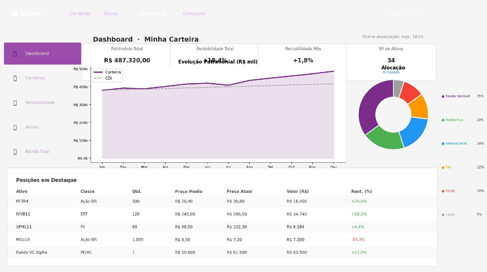

*Fonte: Adaptado de Kinvo (2026).*

#### Gorila

O Gorila (disponível em: https://www.gorila.com.br/) posiciona-se como uma plataforma de consolidação patrimonial completa, atendendo tanto investidores individuais quanto assessores e gestores de patrimônio. Oferece funcionalidades avançadas de relatórios e suporte a múltiplas carteiras.

**Pontos fortes:** suporte multi-carteira, relatórios detalhados de rentabilidade, interface profissional, API disponível para integrações.

**Pontos fracos:** curva de aprendizado mais elevada, funcionalidades premium requerem assinatura paga, suporte a ativos ilíquidos ainda em desenvolvimento.

**Figura 2 — Interface da plataforma Gorila**

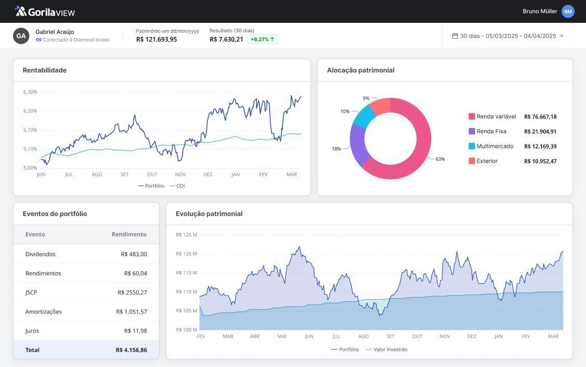

*Fonte: Adaptado de Gorila (2026).*

#### Status Invest

O Status Invest (disponível em: https://statusinvest.com.br/) é primariamente uma plataforma de análise fundamentalista, mas oferece funcionalidade de acompanhamento de carteira. Popular entre investidores focados em análise de valor e dividendos. Seus pontos fortes incluem excelente base de dados fundamentalistas, gratuidade nas funcionalidades básicas e comunidade ativa de usuários.

Por outro lado, possui foco em análise — não em consolidação patrimonial —, não oferece suporte a fundos de investimento, e a funcionalidade de carteira é secundária.

**Figura 3 — Interface da plataforma Status Invest**

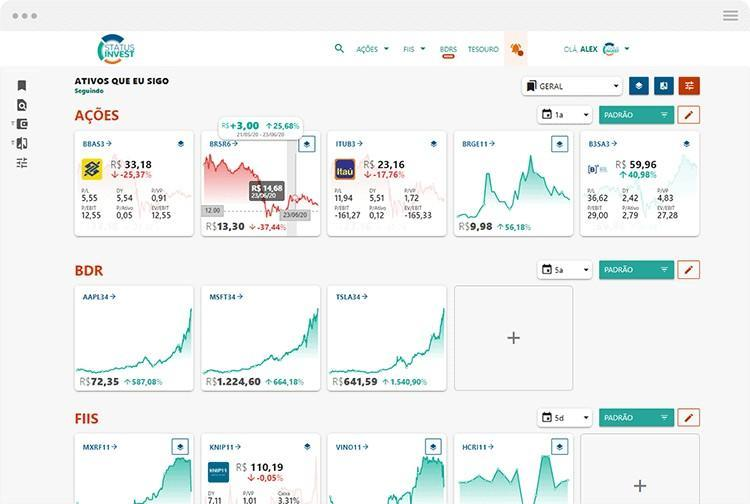

*Fonte: Adaptado de Status Invest (2026).*

#### Trademap

O Trademap (disponível em: https://trademap.com.br/) oferece consolidação de carteira com foco em integração com corretoras e acompanhamento em tempo real. Popular entre traders e investidores ativos. Como pontos fortes destacam-se a integração com múltiplas corretoras, acompanhamento em tempo real e interface moderna.

Já como limitações, observa-se foco em ativos líquidos de curto prazo, ausência de suporte a ativos ilíquidos e funcionalidades avançadas que requerem assinatura.

**Figura 4 — Interface da plataforma Trademap**

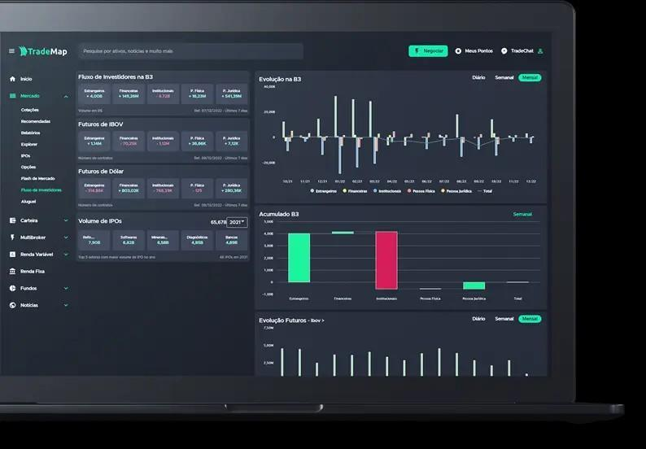

*Fonte: Adaptado de Trademap (2026).*

#### SmartBrain

O SmartBrain (disponível em: https://www.smartbrain.com.br/) é uma plataforma profissional voltada para assessores de investimento, escritórios de agentes autônomos e family offices. Oferece funcionalidades completas de consolidação e relatórios. Apresenta como pontos fortes funcionalidades profissionais completas, suporte a múltiplos clientes, relatórios personalizáveis e suporte a algumas classes de ativos alternativos.

Em contrapartida, é voltado exclusivamente para o mercado B2B, com custos elevados, não sendo acessível para investidores individuais, e possui interface considerada complexa.

**Figura 5 — Interface da plataforma SmartBrain**

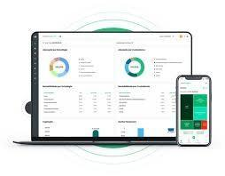

*Fonte: Adaptado de SmartBrain (2026).*

## 2.2 BENCHMARKING DE CONCORRENTES

A análise comparativa das plataformas permitiu identificar padrões de funcionalidades e lacunas de mercado. O Quadro 1 sintetiza as principais características avaliadas.

**Quadro 1 — Funcionalidades em plataformas de consolidação de carteiras**

| Funcionalidade | Kinvo | Gorila | Status Invest | Trademap | SmartBrain |
|---|:---:|:---:|:---:|:---:|:---:|
| Ações Brasil (B3) | ✓ | ✓ | ✓ | ✓ | ✓ |
| Fundos de Investimento | ✓ | ✓ | ✗ | ✓ | ✓ |
| Tesouro Direto | ✓ | ✓ | ✗ | ✓ | ✓ |
| FIIs | ✓ | ✓ | ✓ | ✓ | ✓ |
| Ações Offshore | Manual | Manual | ✗ | Manual | ✓ |
| ETFs Internacionais | Manual | Manual | ✗ | Manual | ✓ |
| Private Equity | ✗ | Parcial | ✗ | ✗ | Parcial |
| Venture Capital[^3] | ✗ | ✗ | ✗ | ✗ | Parcial |
| Imóveis Diretos | ✗ | Manual | ✗ | ✗ | ✓ |
| Multi-moeda automático | ✗ | Parcial | ✗ | ✗ | ✓ |
| Capital Calls / Distribuições | ✗ | ✗ | ✗ | ✗ | Parcial |
| Integração CEI/B3 | ✓ | ✓ | ✗ | ✓ | ✓ |
| Importação CSV/XLSX | ✓ | ✓ | ✗ | ✓ | ✓ |
| Comparação Benchmark | ✓ | ✓ | ✓ | ✓ | ✓ |
| Alocação por Classe | ✓ | ✓ | Parcial | ✓ | ✓ |
| Alocação Geográfica | ✗ | Parcial | ✗ | ✗ | ✓ |
| Modelo de Negócio | Freemium | Freemium | Gratuito | Freemium | B2B Pago |

*Fonte: Elaborado pelos autores (2026).*

### 2.2.1 Identificação de Lacunas

A análise do quadro comparativo revela três lacunas significativas nas soluções existentes.

**Lacuna 1 — Ativos Ilíquidos:** nenhuma das plataformas analisadas oferece suporte completo a ativos ilíquidos como Private Equity e Venture Capital. O controle de capital calls, distribuições e atualização de NAV — elementos fundamentais para essa classe de ativos — está ausente ou é apenas parcialmente suportado.

**Lacuna 2 — Consolidação Multi-moeda Real:** embora algumas plataformas permitam o cadastro de ativos em moeda estrangeira, a conversão automática com taxas históricas para cálculo de rentabilidade em moeda base é limitada ou inexistente.

**Lacuna 3 — Acessibilidade com Funcionalidade Completa:** as plataformas que oferecem funcionalidades mais completas (como SmartBrain) são voltadas para o mercado B2B com custos que inviabilizam o uso por investidores individuais. As plataformas acessíveis (Kinvo, Gorila) não cobrem todas as classes de ativos.

Essas lacunas definem o espaço de oportunidade que o sistema proposto neste TCC busca ocupar.

O Quadro 2 sintetiza o diferencial competitivo da solução, relacionando as limitações observadas nas plataformas existentes às respostas propostas e aos benefícios esperados para o investidor.

**Quadro 2 — Diferencial competitivo da solução proposta**

| Funcionalidade existente no mercado | Limitação encontrada | Solução proposta | Benefício esperado |
|---|---|---|---|
| Consolidação de ativos líquidos (ações, FIIs, renda fixa) | Tratamento limitado de ativos ilíquidos (PE/VC e imóveis) | Modelo de ingestão por template que abrange líquidos e ilíquidos | Visão patrimonial única, sem planilhas paralelas |
| Atualização automática de preços de ativos listados | Dependência de integrações fechadas e cobertura restrita | Enriquecimento via APIs públicas, com o valor manual como fonte primária | Continuidade de uso mesmo com indisponibilidade de fontes externas |
| Cálculo de rentabilidade da carteira | Métrica única (em geral TWR), sem distinguir o efeito dos aportes | Cálculo por TWR e MWR, além de TVPI e DPI para ativos ilíquidos | Avaliação de desempenho adequada a cada classe de ativo |
| Conversão de moedas | Conversão pela cotação corrente, sem séries históricas | Conversão multi-moeda (BRL, USD e EUR) com taxas históricas | Comparação fiel entre carteiras no Brasil e no exterior |
| Visualização consolidada do patrimônio | Cada plataforma cobre apenas parte das classes de ativos | Dashboard que reúne todas as classes em um só lugar | Decisão patrimonial apoiada em informação completa |

*Fonte: Elaborado pelos autores (2026).*

### 2.2.2 Análise SWOT das Plataformas e do Sistema Proposto

A análise SWOT (Strengths, Weaknesses, Opportunities, Threats) complementa o benchmarking do Quadro 1 ao separar, para cada plataforma, os fatores internos (forças e fraquezas, próprios do produto) dos fatores externos (oportunidades e ameaças, do ambiente de mercado). As forças e fraquezas derivam diretamente da análise documental da seção 2.1; oportunidades e ameaças refletem a leitura dos autores sobre o contexto competitivo e regulatório brasileiro. Ao final, a mesma ferramenta é aplicada ao sistema proposto, e uma matriz cruzada (TOWS) converte o diagnóstico em diretrizes de projeto.

**Quadro 3 — Matriz SWOT — Kinvo**

*Modelo de negócio: freemium, com foco no investidor pessoa física (B2C).*

| Forças (Strengths) | Fraquezas (Weaknesses) |
|---|---|
| • Interface intuitiva, com baixa barreira de entrada para o investidor iniciante. • Integração automática com corretoras brasileiras via CEI/B3, dispensando entrada manual para ações, FIIs e Tesouro Direto. • Bom suporte a fundos de investimento registrados na CVM. • Comparação de rentabilidade com benchmarks já disponível. • Base de usuários ampla, o que sustenta o modelo freemium. | • Ativos offshore exigem entrada manual e não têm conversão multi-moeda automática. • Ausência de suporte a Private Equity, Venture Capital e imóveis diretos. • Sem controle de capital calls, distribuições ou NAV. • Sem alocação geográfica, o que limita a visão do investidor com patrimônio no exterior. • Dependência estrutural da integração CEI/B3: mudanças de contrato afetam o núcleo do produto. |
| **Oportunidades (Opportunities)** | **Ameaças (Threats)** |
| • Ampliar a cobertura para ativos internacionais, acompanhando a diversificação do investidor pessoa física. • Evoluir o módulo de fundos para veículos fechados, capturando o público de alta renda. • Aproveitar o Open Finance para reduzir a dependência do CEI. | • Plataformas B2B (SmartBrain) e híbridas (Gorila) avançando sobre o público de alta renda que o Kinvo não atende. • Alterações nas APIs da B3 ou nos limites de consulta do CEI. • Elevação das exigências de proteção de dados (LGPD) sobre a coleta automática de posições. |

*Fonte: Elaborado pelos autores (2026).*

**Quadro 4 — Matriz SWOT — Gorila**

*Modelo de negócio: freemium, atende investidores individuais e assessores.*

| Forças (Strengths) | Fraquezas (Weaknesses) |
|---|---|
| • Suporte a múltiplas carteiras, útil para famílias e assessores. • Relatórios detalhados de rentabilidade e interface de acabamento profissional. • API disponível para integrações externas. • Multi-moeda parcialmente automatizado, à frente dos demais consolidadores B2C. • Suporte parcial a Private Equity e imóveis (entrada manual). | • Curva de aprendizado mais elevada que a dos concorrentes B2C. • Funcionalidades avançadas restritas a assinatura paga. • Suporte a ativos ilíquidos ainda em desenvolvimento: sem capital calls, distribuições ou métricas DPI/TVPI. • Venture Capital não contemplado. |
| **Oportunidades (Opportunities)** | **Ameaças (Threats)** |
| • Concluir o módulo de ilíquidos e posicionar-se como opção B2C completa para alta renda. • Explorar a API como canal para family offices e escritórios de assessoria. • Crescimento do número de investidores com patrimônio distribuído entre Brasil e exterior. | • Entrada de soluções especializadas em ilíquidos antes da conclusão do próprio módulo. • Concorrência de preço com plataformas gratuitas no segmento de entrada. • Complexidade crescente do produto pode afastar o investidor não profissional. |

*Fonte: Elaborado pelos autores (2026).*

**Quadro 5 — Matriz SWOT — Status Invest**

*Modelo de negócio: gratuito; plataforma de análise fundamentalista.*

| Forças (Strengths) | Fraquezas (Weaknesses) |
|---|---|
| • Base de dados fundamentalistas de alta qualidade sobre empresas listadas. • Gratuidade nas funcionalidades básicas. • Comunidade ativa de usuários, com efeito de rede. • Comparação com benchmarks disponível. | • Foco em análise, não em consolidação patrimonial: a carteira é funcionalidade secundária. • Sem suporte a fundos de investimento, Tesouro Direto, ativos offshore ou ilíquidos. • Sem importação por planilha nem integração CEI/B3. • Alocação por classe apenas parcial e sem visão geográfica. |
| **Oportunidades (Opportunities)** | **Ameaças (Threats)** |
| • Converter a base de usuários analíticos em usuários de consolidação, ampliando o produto. • Monetizar a comunidade com funcionalidades premium de carteira. | • Perda de usuários para consolidadores completos à medida que o patrimônio deles se diversifica. • Sustentabilidade do modelo gratuito diante do custo de manter dados fundamentalistas atualizados. • Concorrência de corretoras que passam a oferecer análise fundamentalista integrada. |

*Fonte: Elaborado pelos autores (2026).*

**Quadro 6 — Matriz SWOT — Trademap**

*Modelo de negócio: freemium, com foco em traders e investidores ativos.*

| Forças (Strengths) | Fraquezas (Weaknesses) |
|---|---|
| • Integração com múltiplas corretoras. • Acompanhamento de cotações em tempo real. • Interface moderna, orientada ao uso frequente. • Cobertura completa de ativos líquidos brasileiros (ações, fundos, Tesouro Direto, FIIs). | • Foco em ativos líquidos de curto prazo, distante da lógica patrimonial de longo prazo. • Ausência de suporte a ativos ilíquidos e imóveis. • Ativos offshore apenas por entrada manual, sem multi-moeda automático. • Funcionalidades avançadas dependem de assinatura. |
| **Oportunidades (Opportunities)** | **Ameaças (Threats)** |
| • Ampliar o público de traders para investidores patrimoniais, reaproveitando a infraestrutura de integração. • Oferecer módulo de renda variável internacional com cotação em tempo real, diferencial frente ao Kinvo. | • Corretoras incorporando painéis de acompanhamento em tempo real nos próprios aplicativos. • Público de traders sensível a preço e propenso a migrar entre ferramentas. • Baixa aderência ao investidor de alta renda, cujo patrimônio tende a incluir parcela relevante de ativos ilíquidos. |

*Fonte: Elaborado pelos autores (2026).*

**Quadro 7 — Matriz SWOT — SmartBrain**

*Modelo de negócio: B2B pago, voltado a assessores, escritórios e family offices.*

| Forças (Strengths) | Fraquezas (Weaknesses) |
|---|---|
| • Funcionalidades profissionais completas de consolidação e relatórios. • Suporte a múltiplos clientes por operador, com relatórios personalizáveis. • Cobertura de ativos offshore, multi-moeda automático e alocação geográfica. • Suporte parcial a Private Equity, Venture Capital e capital calls. • Imóveis diretos contemplados. | • Exclusivamente B2B: inacessível ao investidor individual que administra o próprio patrimônio. • Custo elevado, compatível apenas com operação profissional. • Interface considerada complexa, com curva de aprendizado longa. • Suporte a ilíquidos ainda parcial, sem cobertura completa de eventos e métricas. |
| **Oportunidades (Opportunities)** | **Ameaças (Threats)** |
| • Lançar uma versão de entrada para investidores individuais de alta renda. • Consolidar-se como padrão dos family offices, público que mais demanda ilíquidos. | • Soluções mais simples e acessíveis capturando o investidor de alta renda que dispensa intermediários. • Pressão de preço à medida que consolidadores B2C evoluem para o segmento profissional. • Dependência da rede de assessores, sujeita à regulação da atividade de assessoria. |

*Fonte: Elaborado pelos autores (2026).*

**Quadro 8 — Matriz SWOT — Sistema proposto**

*Modelo: aplicação web local e gratuita, destinada ao investidor pessoa física de alta renda que administra o próprio patrimônio.*

| Forças (Strengths) | Fraquezas (Weaknesses) |
|---|---|
| • Cobertura de ativos ilíquidos: capital calls, distribuições, NAV, dry powder e métricas DPI, RVPI, TVPI e IRR (Lacuna 1). • Imóveis diretos como classe própria, com valorização, yield líquido e reavaliação versionada. • Consolidação multi-moeda com taxa histórica da data da posição (RN-009), sem entrada manual de câmbio. • Privacidade desde a concepção: dados armazenados localmente, CPF cifrado em repouso, portabilidade e exclusão (LGPD) nativas. • Templates XLSX padronizados com validação em duas etapas, que tornam a ingestão previsível e auditável. • Metodologia de cálculo única e documentada (TWR por unitização; MWR por Newton-Raphson), verificável contra valores de referência. • Custo de operação nulo: banco embarcado e fontes de dados públicas. | • Ingestão exclusivamente manual por template: sem integração CEI/B3, o esforço inicial de preenchimento é do usuário. • Instância local e monousuário em SQLite, inadequada para operação concorrente ou em nuvem sem migração. • Dependência de APIs gratuitas (Yahoo Finance, PTAX) sujeitas a limites e mudanças de contrato. • Escopo de MVP: recuperação de senha, coleta agendada de preços e cadastro manual de ativos ficaram para a iteração seguinte. • Sem aplicativo mobile e sem validação empírica com o público-alvo até o TCC II. |
| **Oportunidades (Opportunities)** | **Ameaças (Threats)** |
| • Nenhuma das cinco plataformas analisadas oferece suporte completo a ilíquidos, o que indica espaço não ocupado no segmento de alta renda. • Crescimento do investidor pessoa física com patrimônio distribuído entre Brasil, exterior, fundos fechados e imóveis. • Evolução prevista para PostgreSQL e autenticação stateless permite escalar para uso multiusuário sem refazer a arquitetura. • Perfil Colaborador já modelado abre caminho para uso por assessores e family offices, caso o escopo seja revisto. • O Open Finance pode, futuramente, substituir parte da ingestão manual. | • Gorila (ilíquidos "em desenvolvimento") e SmartBrain (suporte "parcial") podem fechar a lacuna antes da consolidação do produto. • Alteração ou descontinuidade das fontes gratuitas de cotação e câmbio. • Baixa adesão ao preenchimento manual de templates por usuários habituados à integração automática. • Incidentes de segurança com dados financeiros sensíveis, de impacto reputacional elevado. • Eventual enquadramento regulatório de plataformas de consolidação pela CVM. |

*Fonte: Elaborado pelos autores (2026).*

### 2.2.3 Matriz SWOT Cruzada (TOWS) do Sistema Proposto

A matriz cruzada combina os quadrantes do Quadro 8 em quatro tipos de diretriz: usar forças para aproveitar oportunidades (SO), usar forças para neutralizar ameaças (ST), reduzir fraquezas por meio de oportunidades (WO) e conter fraquezas diante de ameaças (WT). As diretrizes orientaram decisões concretas do projeto, indicadas entre parênteses no Quadro 9.

**Quadro 9 — Matriz SWOT cruzada (TOWS) — Sistema proposto**

| Estratégias SO — usar forças para explorar oportunidades | Estratégias WO — superar fraquezas aproveitando oportunidades |
|---|---|
| • Posicionar o módulo de ilíquidos como núcleo do produto e critério de diferenciação, e não como complemento (capítulo 9: template PE/VC com abas Fundos e Eventos; RN-004, RN-005, RN-012). • Tratar a consolidação multi-moeda e a alocação geográfica como visão padrão do dashboard, e não como filtro opcional (RF-014, RF-021). • Manter o perfil Colaborador na modelagem RBAC para viabilizar, sem retrabalho, a extensão a assessores (RN-013). | • Reduzir o custo da ingestão manual com templates que validam no preenchimento (listas suspensas, formatação, exemplos) e reportam erros linha a linha em vez de rejeitar o arquivo (RN-002, RN-003). • Preservar a portabilidade para PostgreSQL mediando toda a persistência pelo ORM, de modo que a limitação do SQLite seja de implantação, e não de arquitetura (seção 5.1). • Planejar a validação com o público-alvo no TCC II com métricas objetivas — tempo de consolidação, precisão dos cálculos e satisfação (seção 3.4). |
| **Estratégias ST — usar forças para neutralizar ameaças** | **Estratégias WT — conter fraquezas diante de ameaças** |
| • Isolar cada fonte externa atrás de um contrato único, de modo que a troca de provedor não afete as demais camadas (seção 5.8). • Manter o preço informado pelo usuário como fonte primária e a API como complementar, para que a indisponibilidade de fontes gratuitas não interrompa a consolidação (RN-007). • Adotar criptografia em repouso, reautenticação para operações sensíveis e trilha de auditoria anonimizável como resposta preventiva ao risco reputacional (RNF-004, RN-014, RN-015). | • Restringir o escopo do MVP aos requisitos Must e documentar explicitamente os Should adiados, evitando dispersão diante da pressão competitiva (seção 4.2; MoSCoW). • Não competir em integração automática com corretoras — território dos concorrentes —, e sim em profundidade de cobertura patrimonial. • Manter a operação local e gratuita como proteção contra custos de infraestrutura e exposição regulatória enquanto o produto tiver caráter acadêmico. |

*Fonte: Elaborado pelos autores (2026).*

A leitura conjunta dos quadros confirma o posicionamento escolhido: o sistema não disputa com os consolidadores B2C a integração automática com corretoras, terreno em que Kinvo, Trademap e Gorila são superiores, e sim a profundidade de cobertura patrimonial — ilíquidos, imóveis e multi-moeda —, em que nenhuma das plataformas analisadas se mostrou completa e apenas a solução B2B paga (SmartBrain) se aproxima. As diretrizes WO e WT registram os limites do MVP e o caminho previsto para superá-los.

## 2.3 ARQUITETURA DE FLUXO DE DADOS

O funcionamento de um sistema de consolidação de carteiras pode ser compreendido como um pipeline de dados que transforma informações brutas de múltiplas fontes em uma visão unificada e calculada do patrimônio. Este pipeline é composto por quatro camadas principais: Ingestão, Normalização, Cálculo e Apresentação.

### 2.3.1 Camada de Ingestão

A camada de ingestão é responsável por coletar e persistir dados das diferentes classes de ativos. O modelo adotado pelo sistema proposto neste TCC é centrado no uso de templates padronizados em XLSX como mecanismo principal de entrada, oferecendo ao usuário um meio estruturado, auditável e desacoplado de integrações em tempo real.

Esse desenho equilibra a usabilidade — permitindo que o cliente prepare suas informações offline — com a confiabilidade — uma vez que cada importação passa por validação estrutural e semântica antes de ser persistida.

A escolha de centrar a ingestão em templates XLSX padronizados promove o desacoplamento em relação a sistemas de terceiros: o sistema não depende de APIs proprietárias, robôs de captura ou integrações exclusivas. Essa decisão arquitetural sustenta a privacidade e a independência do usuário de varejo, que preenche e mantém seus próprios dados de forma autônoma e offline.

Cabe destacar uma limitação de interoperabilidade: o sistema não importa qualquer planilha Excel arbitrária, mas sim o template padronizado definido pelo projeto. Cabe ao usuário mapear seus dados para esse modelo — etapa que, reconhecidamente, não elimina por completo o trabalho manual de organização inicial.

Essa rigidez constitui uma decisão de projeto deliberada: a padronização da entrada favorece o desacoplamento em relação a sistemas de terceiros, o rigor dos cálculos e a privacidade do usuário. Arquivos fora do padrão são rejeitados pela camada de validação, com mensagens orientando a correção.

As fontes externas (Yahoo Finance, para cotações, e PTAX do Banco Central, para taxas de câmbio) são utilizadas como mecanismo complementar para enriquecimento dos preços de mercado dos ativos que possuem ticker listado. Ou seja, para cada posição informada pelo cliente via template, o sistema verifica se o ativo possui ticker listado e, em caso afirmativo, busca automaticamente o preço de tela atual e o persiste na tabela de preços, vinculando-o à posição.

Para ativos sem ticker listado (notadamente PE, VC e Real Estate), o preço é integralmente derivado do template, alimentado pelo preço médio e pelo valor financeiro informados pelo cliente.

#### Ativos com ticker listado (líquidos)

Para ações listadas na B3 e em bolsas internacionais, a principal fonte de enriquecimento é a API do Yahoo Finance, acessível via biblioteca Python `yfinance` (YAHOO FINANCE, 2026). Esta API fornece cotações históricas, preços de abertura e fechamento, volume negociado e informações corporativas. A identificação dos ativos é feita por meio do ticker (por exemplo, `PETR4.SA` para ações brasileiras e `AAPL` para ações americanas).

Para fundos de investimento e títulos públicos federais também existem fontes públicas oficiais. O Portal de Dados Abertos da CVM (CVM, 2026) divulga o valor da cota diária, o patrimônio líquido e a composição da carteira de cada fundo, identificado pelo CNPJ, e o Tesouro Nacional disponibiliza preços e taxas em arquivos CSV atualizados diariamente (TESOURO NACIONAL, 2026). Essas duas fontes não são integradas nesta versão: quando a cotação de um ativo não é encontrada no Yahoo Finance, permanece valendo o preço informado pelo cliente no template. A integração com ambas fica registrada como trabalho futuro no capítulo de conclusão.

#### Ativos sem ticker listado (ilíquidos)

Por sua natureza, ativos ilíquidos não possuem fontes de dados automatizadas. A ingestão para essa classe ocorre exclusivamente via templates padronizados em XLSX especializados, que guiam o usuário na inserção de informações específicas (commitment, paid-in, eventos de capital call, distribuições e atualizações de NAV), garantindo um histórico auditável e rastreável.

### 2.3.2 Camada de Normalização

A camada de normalização é responsável por padronizar os dados coletados de diferentes fontes, garantindo consistência para os cálculos subsequentes. Os principais processos são a normalização de identificadores, a conversão multi-moeda e o tratamento de lacunas de dados.

#### Normalização de Identificadores

Diferentes fontes podem utilizar identificadores distintos para o mesmo ativo. Por exemplo, a Petrobras PN pode ser referenciada como "PETR4", "PETR4.SA" ou "PETR4.SAO" dependendo da fonte. O sistema mantém uma tabela de mapeamento que relaciona variações de identificadores a um código canônico único, conforme exemplificado no Quadro 10.

**Quadro 10 — Exemplo de mapeamento de identificadores**

| Ticker Fonte | Ticker Canônico | Tipo Ativo | Identificador Único |
|---|---|---|---|
| PETR4 | PETR4.SA | Ação | BRPETRACNPR6 |
| PETR4.SA | PETR4.SA | Ação | BRPETRACNPR6 |
| PETR4.SAO | PETR4.SA | Ação | BRPETRACNPR6 |

*Fonte: Elaborado pelos autores (2026).*

#### Conversão Multi-moeda

Ativos denominados em moedas estrangeiras precisam ser convertidos para a moeda base do usuário (tipicamente BRL) para fins de consolidação. O sistema utiliza taxas de câmbio históricas obtidas de APIs como o Banco Central do Brasil (BCB) ou Open Exchange Rates (BANCO CENTRAL DO BRASIL, 2026).

A conversão é aplicada de forma retroativa, utilizando a taxa de câmbio da data de referência de cada posição, garantindo que a rentabilidade calculada reflita corretamente a variação cambial do período. As taxas de câmbio são armazenadas em cache local para otimizar o desempenho.

#### Tratamento de Lacunas de Dados

Lacunas nos dados históricos — causadas por feriados, suspensões de negociação ou indisponibilidade de fonte — são tratadas por meio de técnicas de preenchimento. O método *forward fill* utiliza o último preço conhecido para preencher dias sem cotação, sendo apropriado para ações e fundos. A interpolação linear estima valores intermediários entre dois pontos conhecidos e é utilizada para ativos ilíquidos com atualizações trimestrais de NAV.

Para o cálculo de dias úteis, é utilizada a biblioteca pandas com o módulo BusinessDay (`BDay`), que permite o tratamento adequado de feriados e dias não úteis no calendário financeiro brasileiro (PANDAS DEVELOPMENT TEAM, 2026).

### 2.3.3 Camada de Cálculo

A camada de cálculo implementa as regras de negócio financeiras que transformam dados de posições e preços em métricas de rentabilidade e risco. As metodologias adotadas (TWR, MWR, MOIC, DPI, TVPI) são detalhadas na seção 2.4.

### 2.3.4 Camada de Apresentação

A camada de apresentação é responsável por exibir os dados consolidados e calculados ao usuário final através de dashboards interativos, tabelas de posições e relatórios exportáveis. O framework Streamlit foi selecionado para esta camada por sua capacidade de prototipação rápida e nativa integração com bibliotecas de visualização Python como Plotly, Matplotlib e Altair (STREAMLIT, 2026).

## 2.4 REGRAS DE NEGÓCIO E CÁLCULOS FINANCEIROS

O sistema de consolidação não é apenas um agregador de dados; ele implementa lógica financeira complexa para calcular rentabilidade, comparar performance e avaliar risco. Esta seção detalha as metodologias adotadas.

### 2.4.1 Metodologias de Cálculo de Rentabilidade

A escolha da metodologia de cálculo de rentabilidade é uma decisão de arquitetura fundamental, pois diferentes métodos respondem a perguntas diferentes sobre o desempenho de uma carteira.

#### TWR — Time-Weighted Return (Retorno Ponderado pelo Tempo)

O TWR mede o desempenho de um ativo ou carteira eliminando o efeito dos fluxos de entrada e saída de capital. É a metodologia padrão da indústria para comparar o desempenho de gestores de fundos (GRINOLD; KAHN, 1999; BODIE; KANE; MARCUS, 2015), pois avalia exclusivamente a qualidade das decisões de investimento, independentemente do momento (*timing*) de aportes e resgates do investidor. O TWR é dado pelo produto geométrico dos retornos de cada subperíodo, conforme a Equação (1), em que $R_i$ é o retorno do subperíodo *i*, delimitado pelos fluxos de caixa:

$$
TWR = \prod (1 + R_i) - 1 \tag{1}
$$

A título de exemplo, considere um investidor que aplica R$ 10.000 em um fundo. Após um mês, o valor cresce para R$ 10.500 (retorno de 5%). O investidor então aporta mais R$ 5.000, totalizando R$ 15.500. Ao final do segundo mês, o valor é R$ 15.810 (retorno de 2% sobre os R$ 15.500). Aplicando a Equação (1), obtém-se a Equação (2):

$$
TWR = (1 + 0{,}05) \times (1 + 0{,}02) - 1 = 0{,}071 = 7{,}1\% \tag{2}
$$

O TWR de 7,1% reflete o desempenho do fundo, independentemente do aporte adicional feito pelo investidor.

#### MWR — Money-Weighted Return (Retorno Ponderado pelo Dinheiro)

O MWR, também conhecido como TIR (Taxa Interna de Retorno) ou IRR (Internal Rate of Return), mede o retorno efetivamente obtido pelo investidor considerando o momento de seus aportes e resgates. É a metodologia apropriada para responder à pergunta: "Quanto meu dinheiro rendeu?".

O MWR é a taxa de desconto que anula o valor presente líquido dos fluxos de caixa do investidor, incluído o valor final da carteira, conforme a Equação (3), em que $CF_t$ representa o fluxo de caixa no período *t* (negativo para aportes; positivo para resgates e para o valor final):

$$
\sum_{t} \frac{CF_t}{(1 + MWR)^t} = 0 \tag{3}
$$

#### Decisão de Arquitetura do Sistema

O sistema implementará ambas as metodologias: o TWR será utilizado para comparação de ativos individuais e fundos com benchmarks, enquanto o MWR será utilizado para a rentabilidade consolidada da carteira do investidor. Adicionalmente, métricas complementares como Maximum Drawdown, Volatilidade (desvio padrão dos retornos) e Sharpe Ratio serão calculadas para avaliação de risco.

Para ativos imobiliários, será apurado o indicador P/VP (Preço/Valor Patrimonial), referência tradicional do mercado de FIIs.

**Quadro 11 — Comparação entre TWR e MWR**

| Aspecto | TWR | MWR (IRR) | Aplicação no sistema |
|---|---|---|---|
| Pergunta respondida | "Como performou o ativo?" | "Quanto meu dinheiro rendeu?" | Definição de uso |
| Sensibilidade a fluxos | Ignora aportes e resgates | Considera timing dos fluxos | — |
| Uso típico | Avaliação de gestores, benchmarking | Retorno pessoal do investidor | — |
| Aplicação | Ativos individuais, fundos | Carteira consolidada, PE/VC | Implementado em ambos |

*Fonte: Elaborado pelos autores (2026).*

### 2.4.2 Gestão de Ativos Ilíquidos (PE/VC/RE)

Ativos ilíquidos possuem dinâmica de valorização fundamentalmente diferente de ativos listados em bolsa. Não há cotação diária; o valor é determinado por avaliações periódicas (tipicamente trimestrais) realizadas pelos gestores dos fundos ou por avaliadores independentes.

#### NAV — Net Asset Value

O NAV[^4] representa o valor líquido do investimento em um fundo de Private Equity ou Venture Capital e, por cota, é obtido pela Equação (4):

$$
\text{NAV por cota} = \frac{\text{Ativos totais} - \text{Passivos}}{\text{Número de cotas}} \tag{4}
$$

[^4]: O Net Asset Value (NAV) corresponde ao valor patrimonial líquido de um fundo, equivalente à diferença entre seus ativos e passivos, e constitui a base para a marcação periódica das cotas de fundos de Private Equity e Venture Capital (METRICK; YASUDA, 2011).

O sistema armazenará o histórico de NAV de cada ativo ilíquido, permitindo a construção de uma série temporal de valorização mesmo com atualizações pouco frequentes.

#### Capital Calls (Chamadas de Capital)

Em fundos de Private Equity e Venture Capital, o investidor não aporta todo o capital comprometido de uma vez. O gestor do fundo realiza chamadas de capital ao longo do tempo, à medida que identifica oportunidades de investimento. O sistema registrará o valor total comprometido (*commitment*), o valor já integralizado (*paid-in capital*), as chamadas pendentes e o *dry powder* (capital comprometido ainda não chamado).

Cada capital call é armazenado com data, valor, fundo associado e status (pendente ou pago).

#### Distribuições

Distribuições são retornos de capital ou lucros pagos pelo fundo aos investidores. Podem ser classificadas como retorno de capital (devolução do principal investido), ganho de capital (lucro sobre o investimento) ou rendimentos (dividendos ou juros de ativos da carteira do fundo). Cada distribuição é registrada com data, valor, tipo e fundo associado.

#### Métricas Específicas de PE/VC

Além do MWR/IRR, ativos ilíquidos são tipicamente avaliados por métricas específicas. O MOIC (Multiple on Invested Capital) indica quantas vezes o capital investido foi multiplicado; o DPI (Distributions to Paid-In) mede quanto do capital integralizado já retornou ao investidor por meio de distribuições; e o TVPI (Total Value to Paid-In) representa o valor total realizado e não realizado em relação ao capital integralizado (METRICK; YASUDA, 2011). As Equações (5), (6) e (7) apresentam essas métricas.

$$
MOIC = \frac{\text{Distribuições} + \text{NAV atual}}{\text{Capital integralizado}} \tag{5}
$$

$$
DPI = \frac{\text{Distribuições totais}}{\text{Capital integralizado}} \tag{6}
$$

$$
TVPI = \frac{\text{Distribuições} + \text{NAV residual}}{\text{Capital integralizado}} \tag{7}
$$

Observa-se que, na formulação adotada, MOIC e TVPI coincidem quando o NAV atual corresponde ao NAV residual; a distinção usual entre as duas métricas reside no denominador (capital investido nas empresas, no MOIC, e capital integralizado pelo cotista, no TVPI), aspecto a ser definido na implementação.

### 2.4.3 Comparação com Benchmarks

A comparação com benchmarks permite ao investidor avaliar se sua carteira está performando acima ou abaixo de referências de mercado. O sistema suportará os benchmarks apresentados no Quadro 12.

**Quadro 12 — Benchmarks suportados pelo sistema**

| Benchmark | Descrição | Aplicação |
|---|---|---|
| CDI | Certificado de Depósito Interbancário | Renda fixa Brasil, custo de oportunidade |
| IBOVESPA | Índice da B3 | Ações Brasil |
| IPCA | Inflação oficial | Retorno real da carteira |
| S&P 500 | Índice das 500 maiores empresas dos EUA | Ações offshore |
| IFIX | Índice de Fundos Imobiliários | FIIs |

*Fonte: Elaborado pelos autores (2026).*

## 2.5 ESTUDO DE UX E JORNADA DO USUÁRIO

A experiência do usuário em um sistema de consolidação de carteiras deve equilibrar completude de informações com facilidade de uso. A pesquisa com plataformas concorrentes identificou padrões de design e funcionalidades que são esperados pelos usuários.

### 2.5.1 Entrada de Dados

A fricção na entrada de dados é um dos principais pontos de abandono em sistemas de consolidação. O sistema adotado neste TCC mitiga essa fricção ao posicionar os templates padronizados em XLSX como mecanismo principal de entrada — uma abordagem que permite ao cliente preparar e revisar seus dados offline, sem a pressão de uma interface interativa em tempo real, e elimina a necessidade de integrações dependentes de credenciais de terceiros.

Para ativos que possuem ticker listado, o sistema enriquece automaticamente as posições com o preço de tela buscado via API externa, mantendo a tabela de preços sempre atualizada para fins de marcação a mercado.

Para ativos sem fonte de dados automatizada (PE/VC/RE), os templates padronizados são a única via de entrada, oferecendo estrutura especializada para capturar informações específicas dessas classes (commitment, capital calls, distribuições e NAVs). Adicionalmente, o sistema disponibiliza formulários web estruturados como alternativa para usuários que prefiram inserir posições pontuais sem o uso de planilhas.

**Figura 6 — Exemplo de fricção na entrada manual de dados em plataformas concorrentes**

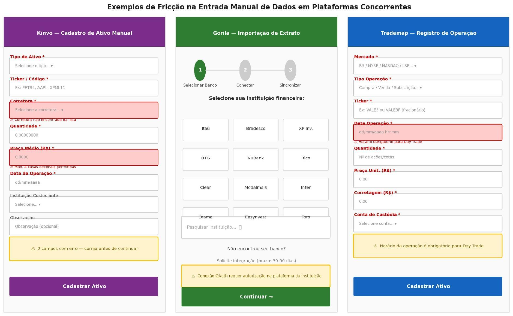

*Fonte: Elaborado pelos autores (2026), com base em capturas das plataformas analisadas.*

A Figura 6 ilustra exemplos concretos de atrito na entrada manual de dados em três plataformas concorrentes. No painel à esquerda (Kinvo), o cadastro manual de um ativo exige oito campos obrigatórios com validações rígidas que retornam erros inesperados. No painel central (Gorila), a importação de extrato demanda autorização OAuth em três etapas e depende de integração prévia com a instituição financeira — caso contrário, o usuário deve aguardar até 90 dias.

No painel à direita (Trademap), o registro de operação exige informações granulares como horário exato da negociação em operações de day trade. Em todos os casos, a ausência de um mecanismo padronizado de entrada gera barreiras que podem levar ao abandono do processo pelo usuário.

**Quadro 13 — Métodos de entrada de dados por classe de ativo**

| Classe de Ativo | Método Primário | Método Alternativo |
|---|---|---|
| Ações Brasil | Template XLSX (Líquidos) | Cadastro manual via formulário web |
| Ações Offshore | Template XLSX (Líquidos) | Cadastro manual via formulário web |
| Fundos de Investimento | Template XLSX (Líquidos) | Cadastro manual via formulário web |
| Tesouro Direto | Template XLSX (Líquidos) | Cadastro manual via formulário web |
| Private Equity | Template XLSX (PE/VC) — especializado | Formulário web estruturado |
| Venture Capital | Template XLSX (PE/VC) — especializado | Formulário web estruturado |
| Imóveis | Template XLSX (Imóveis) — especializado | Formulário web estruturado |

*Fonte: Elaborado pelos autores (2026).*

### 2.5.2 Visualizações Padrão de Mercado

A análise de concorrentes identificou visualizações que são expectativa de mercado e devem estar presentes no sistema. O dashboard principal apresentará uma visão consolidada do patrimônio com o patrimônio total consolidado, variação no período (dia, mês, ano, desde o início), gráfico de evolução patrimonial e alocação por classe de ativo em gráfico de pizza ou donut.

A alocação por classe de ativo apresentará a distribuição percentual entre as classes Renda Variável, Renda Fixa, Fundos, Internacional, Alternativos (PE/VC), Imóveis e Caixa. A alocação geográfica exibirá a exposição Brasil versus Offshore, com detalhamento por país quando aplicável. A alocação setorial, para a parcela em ações, exibirá a exposição por setor (Financeiro, Commodities, Tecnologia, Utilities, Consumo, entre outros).

A visualização de Performance vs Benchmark apresentará um gráfico comparando a rentabilidade da carteira contra benchmarks selecionados (CDI, IBOV, IPCA) ao longo do tempo. Um painel de métricas de risco exibirá os indicadores volatilidade, Sharpe Ratio e Maximum Drawdown.

## 2.6 RESTRIÇÕES LEGAIS E DE SEGURANÇA

O sistema tratará dados financeiros sensíveis, o que impõe obrigações legais e requisitos de segurança que devem ser considerados desde a concepção da arquitetura.

### 2.6.1 LGPD — Lei Geral de Proteção de Dados

A Lei nº 13.709/2018 (LGPD) estabelece regras para o tratamento de dados pessoais no Brasil (BRASIL, 2018). Dados financeiros vinculados a uma pessoa identificada são dados pessoais; embora não integrem o rol de dados pessoais sensíveis do art. 5º, II, da lei, seu potencial de dano em caso de vazamento justifica tratá-los com salvaguardas equivalentes. As principais obrigações aplicáveis ao sistema incluem:

- **Consentimento:** o sistema deve obter consentimento explícito do usuário para coletar e processar seus dados financeiros, com termo claro quanto à finalidade do tratamento;
- **Direito de acesso e portabilidade:** o usuário deve poder acessar todos os seus dados armazenados e exportá-los em formato estruturado (JSON, CSV) para portabilidade a outras plataformas;
- **Direito ao esquecimento:** o sistema deve implementar funcionalidade de exclusão completa dos dados do usuário mediante solicitação;
- **Segurança de dados:** medidas técnicas de segurança devem ser implementadas para proteger os dados contra acesso não autorizado, vazamento ou perda, incluindo log de acesso e auditoria.

### 2.6.2 Segurança de API e Autenticação

O sistema utilizará autenticação baseada em JWT (JSON Web Tokens) com refresh tokens para manter sessões seguras sem exigir login frequente. O controle de acesso será baseado em papéis (Role-Based Access Control — RBAC), com três perfis previstos: Administrador (acesso total ao sistema), Colaborador (gestor familiar autorizado pelo titular, com acesso às carteiras a ele vinculadas e sem acesso a configurações) e Cliente (acesso apenas aos próprios dados).

Dados sensíveis (valores financeiros, identificadores pessoais) serão criptografados em repouso utilizando AES-256 por meio da biblioteca `cryptography` (Fernet) do Python, e todas as comunicações utilizarão HTTPS/TLS. Será implementado *rate limiting* para limitar requisições por minuto/hora por usuário, prevenindo abuso.

Chaves de API e credenciais de acesso a serviços externos nunca serão armazenadas em código-fonte ou arquivos de configuração versionados — serão utilizadas variáveis de ambiente.

Quanto às credenciais, as senhas de acesso nunca são armazenadas em texto puro: são submetidas à função de derivação bcrypt (com *cost factor* 12), que aplica salt único por usuário, persistindo-se apenas o hash resultante (campo `senha_hash`). A verificação de login compara apenas os hashes, sem que a senha original trafegue ou seja recuperável.

Os identificadores pessoais (CPF), além de criptografados em repouso, são pseudonimizados (mascarados) na exibição e em relatórios. Todas as ações relevantes sobre os dados são registradas em uma trilha de auditoria (tabela `audit_log`: usuário, ação, entidade, timestamp e IP de origem), assegurando rastreabilidade e integridade das informações.

No plano da conformidade, a arquitetura adota a privacidade desde a concepção (*privacy by design*): no modelo local, os dados permanecem no ambiente do próprio usuário, minimizando a superfície de exposição.

O consentimento é coletado e registrado com timestamp e IP, e o sistema contempla os direitos do titular previstos na Lei nº 13.709/2018 (LGPD) — acesso, correção, eliminação e portabilidade —, observando os princípios de finalidade, minimização e segurança (BRASIL, 2018; ASSOCIAÇÃO BRASILEIRA DE NORMAS TÉCNICAS, 2013).

O acesso a cada recurso é mediado pelo controle baseado em papéis (RBAC), de modo que cada usuário acesse apenas o patrimônio que lhe é permitido (RN-013). Os registros de auditoria — que abrangem autenticação, importação, exportação e exclusão de dados — não expõem valores sensíveis e apoiam a rastreabilidade exigida pela LGPD e a apuração de eventuais incidentes (BRASIL, 2018; ASSOCIAÇÃO BRASILEIRA DE NORMAS TÉCNICAS, 2013).

---

# 3 METODOLOGIA

## 3.1 ABORDAGEM METODOLÓGICA

O desenvolvimento deste TCC adota uma abordagem mista, combinando pesquisa exploratória, pesquisa aplicada e desenvolvimento iterativo de software. A pesquisa exploratória é responsável pelo levantamento do estado da arte das plataformas concorrentes e pela identificação das lacunas de mercado, conforme apresentado nas seções 2.1 e 2.2. A pesquisa aplicada concretiza-se na escolha de tecnologias, metodologias financeiras e padrões de arquitetura adequados ao problema.

O desenvolvimento de software segue uma abordagem incremental e iterativa, baseada em princípios ágeis (SOMMERVILLE, 2018; PRESSMAN; MAXIM, 2016), com entregas modulares organizadas em fases conforme detalhado na seção 4.3.

Especificamente, o processo apoia-se em práticas iterativas e incrementais consagradas na literatura ágil, como as preconizadas pela Programação Extrema (BECK, 2004) e pelo Scrum (SCHWABER, 2004), com ciclos curtos de entrega e priorização contínua de requisitos.

O ciclo de vida adotado é composto pelas etapas de: (i) elicitação de requisitos, baseada em análise de concorrentes e modelagem de personas; (ii) modelagem do sistema, com elaboração de diagramas UML (casos de uso, classes, sequência, atividades, componentes, implantação), modelo entidade-relacionamento e fluxogramas BPMN dos principais processos de negócio; (iii) implementação incremental, com versionamento em Git; (iv) testes unitários e de integração para os módulos críticos de cálculo financeiro; e (v) documentação e apresentação da monografia.

## 3.2 LEVANTAMENTO E ELICITAÇÃO DE REQUISITOS

A elicitação de requisitos foi realizada por meio de três técnicas complementares: análise documental, benchmarking de concorrentes e brainstorming estruturado com profissionais do mercado financeiro. A análise documental envolveu o estudo de documentações públicas das plataformas analisadas, materiais técnicos da B3, CVM, ANBIMA e Tesouro Nacional, e bibliografia acadêmica sobre gestão de carteiras.

O benchmarking de concorrentes, conforme detalhado na seção 2.2, permitiu identificar funcionalidades consideradas essenciais pelo mercado, funcionalidades diferenciadoras e lacunas a serem preenchidas pelo sistema proposto. O brainstorming estruturado contribuiu para a definição de personas, jornadas de usuário e priorização das funcionalidades.

Os requisitos elicitados foram classificados em requisitos funcionais (RF) — apresentados em detalhe na seção 5.4 — e requisitos não funcionais (RNF) — apresentados na seção 5.5, organizados conforme as características de qualidade da norma ISO/IEC 25010. Para cada requisito, foram definidos código identificador, nome, descrição, ator, entradas, processamento, saídas, regras de negócio relacionadas, prioridade e complexidade.

A priorização seguiu o critério MoSCoW (Must have, Should have, Could have, Won't have), com foco no desenvolvimento das funcionalidades de prioridade Must — correspondentes à prioridade Alta do Quadro 7 — na primeira versão do sistema.

## 3.3 MODELAGEM UML E BPMN

A modelagem do sistema combinou as notações UML (Unified Modeling Language) e BPMN (Business Process Model and Notation), aplicadas conforme a natureza do artefato:

- **UML** — utilizada para a modelagem técnica e estrutural do sistema, contemplando: (a) diagramas de casos de uso, identificando os atores e suas interações; (b) diagrama de classes, descrevendo o modelo de domínio; (c) diagramas de sequência, ilustrando os fluxos de comunicação entre componentes nas operações críticas; (d) diagrama de atividades, detalhando o fluxo lógico do processo de importação via template; (e) diagrama de componentes, mostrando a separação em camadas; e (f) diagrama de implantação, descrevendo o ambiente físico de execução.
- **BPMN** — utilizada para a modelagem de processos de negócio, contemplando nove processos: (a) onboarding do cliente; (b) autenticação e controle de acesso; (c) importação de carteira via template padronizado; (d) cálculo de rentabilidade consolidada; (e) gestão de eventos em fundo PE/VC; (f) cadastro manual de ativo e registro de transação; (g) geração e exportação de relatórios; (h) atendimento a solicitações LGPD; e (i) administração de usuários e auditoria.

Os casos de uso são especificados em detalhe no capítulo 6, seguindo o template de Cockburn (2001) (caso completo): identificação, ator(es), pré-condições, disparador, fluxo principal, fluxos alternativos, exceções, pós-condições e regras de negócio relacionadas. Os fluxos BPMN são apresentados no capítulo 8.

## 3.4 ESTRATÉGIA DE VALIDAÇÃO E MÉTRICAS DE SUCESSO

A validação da proposta está estruturada em duas frentes. A validação técnica, conduzida ainda nesta etapa, apoia-se na análise comparativa com plataformas existentes e na verificação dos cálculos financeiros contra resultados de referência. A validação junto ao público-alvo está planejada para a etapa seguinte (TCC II) e prevê entrevistas e questionários com investidores que administram o próprio patrimônio, com o objetivo de confirmar empiricamente, sob a perspectiva dos usuários, o problema identificado na análise de mercado.

O sucesso da solução será aferido por indicadores objetivos, mensurados na etapa de validação: o tempo de consolidação de uma carteira; a quantidade de classes de ativos suportadas; a precisão dos cálculos de rentabilidade (TWR e MWR) frente a valores de referência; a redução do tempo dedicado ao acompanhamento patrimonial; e a satisfação dos usuários, coletada por questionário estruturado.

## 3.5 PLANO DE TESTES E CRITÉRIOS DE ACEITAÇÃO

O plano de testes contempla três níveis. Testes unitários cobrem as funções críticas de cálculo financeiro (conversão multi-moeda, TWR, MWR, TVPI e DPI) e de normalização de dados. Testes de integração verificam a ingestão via template e a comunicação com as APIs externas. Testes de aceitação, derivados dos casos de uso, confirmam que cada fluxo principal atende ao comportamento esperado.

Os critérios de aceitação são definidos por caso de uso e expressos em condições verificáveis. Por exemplo: a importação de um template válido deve consolidar todos os ativos sem perda de registros; os cálculos de rentabilidade devem coincidir com os valores de referência dentro de uma tolerância pré-definida; e operações sobre dados sensíveis devem respeitar o controle de acesso e os requisitos da LGPD.

---

# 4 PLANEJAMENTO

## 4.1 DEFINIÇÃO DE ESCOPO

O sistema contemplará as funcionalidades descritas no Quadro 14, organizadas por módulo e priorizadas conforme sua criticidade para o funcionamento do sistema.

**Quadro 14 — Funcionalidades do sistema por módulo e prioridade**

| Módulo | Funcionalidade | Descrição | Prioridade |
|---|---|---|---|
| Dashboard | Visão consolidada | Patrimônio total e variação | Alta |
| Dashboard | Evolução patrimonial | Gráfico de linha temporal | Alta |
| Dashboard | Alocação por classe | Gráfico pizza/donut | Alta |
| Dashboard | Alocação geográfica | Brasil vs Offshore | Alta |
| Dashboard | Performance vs benchmark | Comparação com CDI, IBOV | Alta |
| Carteira Líquida | Importação via template XLSX | Mecanismo principal de entrada | Alta |
| Carteira Líquida | Cadastro manual de ativos | Ações, fundos, títulos (alternativo) | Média |
| Carteira Líquida | Busca por ticker/CNPJ | Enriquecimento de preço via API | Alta |
| Carteira Líquida | Registro de transações | Compras, vendas, proventos | Alta |
| Carteira Líquida | Histórico de preços | Coleta automática diária (listados) | Alta |
| Carteira Ilíquida | Importação via template PE/VC | Mecanismo principal de entrada | Alta |
| Carteira Ilíquida | Cadastro PE/VC/RE manual | Fundos e ativos diretos (alternativo) | Média |
| Carteira Ilíquida | Atualização de NAV | Entrada manual com histórico | Alta |
| Carteira Ilíquida | Capital Calls | Registro de chamadas | Alta |
| Carteira Ilíquida | Distribuições | Registro de retornos | Alta |
| Carteira Ilíquida | Métricas PE/VC | MOIC, DPI, TVPI, IRR | Média |
| Consolidação | Cálculo TWR | Rentabilidade time-weighted | Alta |
| Consolidação | Cálculo MWR | Rentabilidade money-weighted | Alta |
| Consolidação | Conversão multi-moeda | BRL, USD, EUR | Alta |
| Consolidação | Benchmarks | Coleta de índices de referência | Alta |
| Relatórios | Extrato de rentabilidade | Mensal e anual | Média |
| Relatórios | Exportação PDF | Relatório formatado | Baixa |
| Relatórios | Exportação Excel | Dados para análise externa | Baixa |
| Administração | Cadastro de usuários | CRUD de clientes | Alta |
| Administração | Perfis de acesso | Admin, Colaborador, Cliente | Alta |
| Administração | Logs de auditoria | Registro de ações | Média |
| LGPD | Portabilidade de dados | Exportação JSON/CSV | Alta |
| LGPD | Direito ao esquecimento | Exclusão definitiva | Alta |

*Fonte: Elaborado pelos autores (2026).*

## 4.2 FORA DO ESCOPO

Os seguintes itens estão explicitamente fora do escopo deste trabalho e não serão implementados na versão inicial do sistema:

- **Uso institucional ou gestão de patrimônio de terceiros:** o sistema destina-se exclusivamente ao investidor pessoa física ou jurídica (PF/PJ) que administra o próprio patrimônio, não se aplicando a investidores institucionais, a escritórios de gestão de patrimônio de terceiros, a assessorias de investimento ou gestoras de recursos, nem a qualquer atividade de administração de carteiras de terceiros;
- **Execução de ordens:** o sistema não realizará compra ou venda de ativos e não haverá integração com corretoras para envio de ordens;
- **Cálculo de impostos:** não será implementada apuração de Imposto de Renda, come-cotas ou qualquer obrigação tributária;
- **Gestão de passivos:** dívidas, financiamentos e empréstimos não serão contemplados;
- **Aplicativo mobile:** o sistema será exclusivamente web; não haverá desenvolvimento de aplicativos nativos iOS ou Android;
- **Criptoativos:** ativos digitais como Bitcoin, Ethereum e demais criptomoedas não serão suportados nesta versão;
- **Integração Open Finance:** não haverá integração com o ecossistema Open Finance/Open Banking brasileiro;
- **Planejamento financeiro:** funcionalidades de projeção futura, simulação de aposentadoria ou planejamento patrimonial não serão implementadas.

## 4.3 CRONOGRAMA MACRO

O cronograma macro do projeto está organizado em seis fases, conforme apresentado no Quadro 15. A escolha do SQLite como banco de dados local em arquivo simplifica significativamente a Fase 2 (Infraestrutura), eliminando a necessidade de configuração de servidor de banco de dados e reduzindo a complexidade de deploy.

**Quadro 15 — Cronograma macro do TCC**

| Fase | Entrega | Período |
|---|---|---|
| 1 — Planejamento | Documento de escopo, requisitos detalhados, modelagem UML e BPMN, modelo de dados (MER + DDL) | Semanas 1–4 |
| 2 — Infraestrutura | Setup do ambiente Python, estrutura de pastas, configuração do SQLite local, criação dos templates XLSX padronizados | Semanas 5–6 |
| 3 — Módulo Líquido | Importação via template, enriquecimento via APIs (preço de tela), cadastro manual e dashboard básico | Semanas 7–10 |
| 4 — Módulo Ilíquido | PE, VC e RE com NAV manual, capital calls, distribuições e métricas (MOIC/DPI/TVPI) | Semanas 11–13 |
| 5 — Consolidação | Motor de consolidação, benchmarks, multi-moeda, relatórios e LGPD | Semanas 14–16 |
| 6 — TCC Final | Testes, documentação técnica, monografia e apresentação | Semanas 17–20 |

*Fonte: Elaborado pelos autores (2026).*

## 4.4 ANÁLISE DE RISCOS

Foram identificados riscos técnicos e de projeto que podem impactar o desenvolvimento. As mitigações propostas estão sintetizadas no Quadro 16.

**Quadro 16 — Riscos e mitigações do projeto**

| Risco | Prob. | Impacto | Mitigação |
|---|---|---|---|
| API da B3 com acesso restrito ou pago | Alta | Alto | Usar Yahoo Finance como fallback para ativos B3 listados |
| CVM sem endpoint REST estruturado | Média | Médio | Nesta versão, manter para os fundos o valor informado no template; a leitura dos dados abertos do Portal de Dados CVM (CSV) fica como trabalho futuro |
| Complexidade do modelo de dados ilíquidos | Média | Alto | Simplificar para NAV manual com histórico auditável via template |
| Scope creep (expansão não planejada) | Alta | Alto | Controle rígido do escopo definido neste documento |
| Dados offline/inconsistentes de cotações | Baixa | Médio | Cache local em SQLite e flag de dado não atualizado na UI |
| Concorrência no acesso ao SQLite | Baixa | Médio | Modo WAL (Write-Ahead Logging) habilitado; uso single-user no MVP |
| Curva de aprendizado em Streamlit para casos complexos | Média | Médio | Prototipação antecipada e estudo de exemplos oficiais |
| Variação cambial impactando cálculos | Baixa | Médio | Cache de taxas históricas BCB e fallback Open Exchange Rates |

*Fonte: Elaborado pelos autores (2026).*

---

# 5 ESPECIFICAÇÃO TÉCNICA

## 5.1 STACK TECNOLÓGICA

A seleção de tecnologias priorizou ferramentas com forte ecossistema para aplicações financeiras e de dados, facilidade de prototipação e disponibilidade de documentação. A escolha do SQLite como banco de dados local em arquivo, em substituição a soluções cliente-servidor como PostgreSQL, simplifica o deploy, elimina dependências de infraestrutura externa e atende ao perfil de uso single-user esperado para a versão inicial do sistema (SQLITE, 2026).

O Quadro 17 apresenta a stack escolhida.

**Quadro 17 — Stack tecnológica do sistema**

| Camada | Tecnologia | Justificativa |
|---|---|---|
| Frontend / UI | Streamlit | Prototipação rápida, nativo para dashboards de dados, integração Python |
| Backend / Lógica | Python 3.11+ | Ecossistema robusto para finanças (pandas, numpy, scipy) |
| Banco de Dados | SQLite 3.40+ | Banco em arquivo único, sem servidor, ideal para deploy local; suporte a transações ACID; WAL mode |
| ORM | SQLAlchemy 2.0 | Abstração do banco com suporte a migrações (Alembic) |
| Templates XLSX | openpyxl | Leitura e geração de templates padronizados (.xlsx) |
| Coleta — Cotações | yfinance | Ações, ETFs e demais ativos listados, no Brasil e no exterior |
| Coleta — Câmbio | Requests + API PTAX do BCB | Taxas de câmbio oficiais do Banco Central, obtidas por requisição HTTP |
| Agendamento | APScheduler | Coleta automática de preços ao fim do pregão (ativos listados) |
| Distribuição | Instalador para Windows (Inno Setup, com Python embutido) | Forma principal de entrega: instalação por usuário, sem privilégios de administrador e sem exigir Python na máquina |
| Containerização | Docker (opcional) | Alternativa de execução em ambiente padronizado e reproduzível |
| Autenticação | JWT (PyJWT) | Tokens seguros para sessões de usuário |
| Criptografia | cryptography (Fernet) | Criptografia AES-256 de campos sensíveis em repouso |

*Fonte: Elaborado pelos autores (2026).*

#### Justificativa das Escolhas Tecnológicas

A escolha do SQLite como sistema de gerenciamento de banco de dados decorre do modelo de implantação desta etapa de Produto Mínimo Viável (MVP): uma aplicação local, de instância única, executada no ambiente do próprio usuário.

O SQLite é um banco relacional embarcado, sem processo servidor, armazenado em um único arquivo e com suporte completo a transações ACID (DATE, 2004), o que elimina a necessidade de infraestrutura dedicada e reduz a configuração exigida do usuário final, em coerência com o requisito de privacidade local. Optou-se por não adotar PostgreSQL ou MySQL nesta fase porque ambos pressupõem um processo servidor cujo custo operacional não se justifica em um MVP local; a portabilidade futura, contudo, está preservada, pois toda a persistência é mediada pelo ORM SQLAlchemy (FOWLER, 2002), de modo que a migração para o PostgreSQL — indicado para um cenário multiusuário ou em nuvem — se restringe, essencialmente, à troca da *connection string* e à revisão de tipos específicos de dialeto.

A linguagem Python foi escolhida por concentrar, em um único ecossistema, todas as camadas do sistema (ingestão, normalização, cálculo e apresentação). Pesaram o ecossistema de bibliotecas para dados e finanças — em especial Pandas e OpenPyXL (McKINNEY, 2018), centrais para a ingestão via template —, a legibilidade e a velocidade de desenvolvimento adequadas a um MVP, e a familiaridade da equipe, fatores que reduzem o risco de execução.

Mais do que uma linguagem de propósito geral, o Python foi adotado por seu ecossistema consolidado de bibliotecas para dados e finanças quantitativas. A biblioteca Pandas oferece as estruturas DataFrame e Series e operações vetorizadas sobre séries temporais, apropriadas à manipulação de cotações históricas e ao cálculo dos retornos descritos na seção 2.4 (McKINNEY, 2018); a NumPy sustenta as operações numéricas de base.

A biblioteca OpenPyXL responde diretamente pela estratégia de ingestão por planilha. Ela permite ler e gravar arquivos .xlsx sem depender da instalação do Microsoft Excel, viabilizando tanto a geração dos templates padronizados — com cabeçalhos, listas de validação e múltiplas abas (Quadros 44 a 46) — quanto a leitura estruturada dos dados preenchidos pelo investidor.

Para o enriquecimento automático de preços, a biblioteca yfinance oferece acesso programático a cotações de ativos líquidos; já a biblioteca Requests é usada para consultar a PTAX na API de dados abertos do Banco Central, por meio de requisições HTTP. A opção por fontes públicas e gratuitas é coerente com o caráter acadêmico do trabalho.

A camada de apresentação foi construída com Streamlit por se tratar de uma aplicação centrada em dados (dashboards, tabelas e gráficos consolidados), e não de uma interface ricamente interativa. O Streamlit permite desenvolver aplicações de dados diretamente em Python, com integração imediata à camada de cálculo, dispensando uma stack de frontend separada, uma camada de API REST e um processo de build.

Frameworks como React ou Angular foram considerados, mas exigiriam um ecossistema JavaScript próprio e esforço desproporcional ao escopo de um MVP que não demanda uma Single Page Application. O trade-off assumido é a menor flexibilidade de personalização visual, aceitável neste estágio (SOMMERVILLE, 2018).

A autenticação foi projetada com JSON Web Tokens (JWT) visando à evolução do produto para um modelo multi-cliente: o JWT é stateless, dispensa o armazenamento de sessão no servidor e favorece a escalabilidade horizontal (MARTIN, 2019). Reconhece-se que, para um MVP estritamente local e de usuário único, sessões tradicionais baseadas em servidor seriam suficientes; a opção pelo JWT é, portanto, uma decisão de arquitetura voltada ao roadmap de implantação distribuída, e não uma exigência do estágio atual.

## 5.2 ARQUITETURA DO SISTEMA

A arquitetura do sistema é organizada em três grandes camadas lógicas, alinhadas ao pipeline de dados descrito na seção 2.3, mais uma camada transversal de integração externa:

- **Camada de Apresentação:** telas Streamlit para dashboard, importação, cadastros, relatórios e privacidade (LGPD);
- **Camada de Aplicação (Serviços):** controllers e serviços de domínio (`ImportController`, `DashboardController`, `PEController`, `AuthService`, `PrecoService`, `CambioService`, `RentabilidadeService`, `MetricasPEService`, `AlocacaoService`);
- **Camada de Persistência:** repositórios SQLAlchemy ORM sobre arquivo SQLite local (`carteira.db`) em volume persistente;
- **Camada de Integração:** clients HTTP para APIs externas (Yahoo Finance e PTAX do BCB), com cache local e manutenção do último valor conhecido em caso de falha.

A forma principal de entrega é um instalador para Windows, que instala a aplicação por usuário, sem privilégios de administrador, com o interpretador Python e as bibliotecas já embutidos. O atalho criado pelo instalador inicia um servidor local, acessível apenas pela própria máquina (127.0.0.1), e abre o sistema no navegador. O banco de dados, as chaves e os backups ficam em uma pasta de dados do usuário, separada da pasta do programa, de modo que atualizar a aplicação não os altera.

Como alternativas, a aplicação pode ser executada via Docker ou diretamente com Python, o que o uso de SQLite permite sem infraestrutura adicional. Em qualquer dessas formas, toda a aplicação roda em ambiente single-host, com o arquivo do banco de dados e os uploads de templates em armazenamento persistente.

Os diagramas de componentes e de implantação que ilustram esta arquitetura são apresentados no capítulo 6 (Figuras 13 e 14).

## 5.3 MODELO DE DADOS

O modelo de dados do sistema é relacional, persistido em SQLite e gerenciado via SQLAlchemy ORM (SQLALCHEMY, 2026). As entidades principais e seus atributos-chave são apresentadas no Quadro 18. A modelagem completa, com cardinalidades, e o script DDL são apresentados no capítulo 7.

**Quadro 18 — Entidades principais do modelo de dados**

| Entidade | Descrição | Atributos-chave |
|---|---|---|
| USUARIO | Conta de acesso ao sistema | id, email, senha_hash, perfil, data_criacao |
| CLIENTE | Investidor / dono da carteira | id, usuario_id, nome, cpf, perfil_risco, moeda_base, consentimento_lgpd |
| CARTEIRA | Agrupamento de ativos do cliente | id, cliente_id, nome, data_criacao |
| ATIVO | Cadastro mestre de ativos | id, ticker_canonico, nome, classe, moeda, mercado, tipo, possui_ticker_listado |
| ATIVO_ILIQUIDO | Especialização para PE/VC | ativo_id, sub_classe, gestor, commitment, paid_in_capital, dry_powder |
| ATIVO_IMOVEL | Especialização para imóveis diretos (RE) | ativo_id, endereco, valor_de_mercado, aluguel_mensal, despesas_mensais, area_m2, data_avaliacao |
| ASSET_MAPPING | Mapeamento de tickers entre fontes | ticker_source, ticker_canonical, fonte, asset_type |
| POSICAO | Holdings do cliente por ativo | id, carteira_id, ativo_id, quantidade, preco_medio, valor_financeiro, data_inicial |
| TRANSACAO | Compras, vendas e proventos | id, posicao_id, tipo, data, quantidade, preco, taxas |
| EVENTO_PE | Capital calls, distribuições e NAV | id, ativo_id, data_evento, tipo_evento, valor, status, nav_unidade |
| PRECO_HISTORICO | Série temporal de preços | id, ativo_id, data, preco_fechamento, volume, fonte |
| TAXA_CAMBIO | Taxas históricas de câmbio | id, data, moeda_origem, moeda_destino, taxa |
| BENCHMARK | Índices de referência | id, codigo, nome, tipo, moeda |
| BENCHMARK_VALOR | Valores históricos dos benchmarks | id, benchmark_id, data, valor |
| AUDIT_LOG | Registro de auditoria | id, usuario_id, data_hora, acao, entidade, entidade_id, dados_anteriores, dados_novos |

*Fonte: Elaborado pelos autores (2026).*

## 5.4 REQUISITOS FUNCIONAIS

Os requisitos funcionais do sistema são apresentados no Quadro 19. Cada requisito recebe um código único (RF-XXX) e é descrito em termos do comportamento esperado do sistema, ator(es) envolvido(s), entradas, processamento, saídas, regras de negócio relacionadas, prioridade (MoSCoW) e complexidade estimada.

**Quadro 19 — Requisitos funcionais do sistema**

| Código | Nome | Descrição | Prior. |
|---|---|---|---|
| RF-001 | Realizar login | O sistema deve permitir que usuários autentiquem-se com e-mail e senha. Atores: Cliente, Colaborador, Admin. RN-001. | Must |
| RF-002 | Criar conta | O sistema deve permitir criação de conta com e-mail, nome, senha e aceitação do termo LGPD. Cria também registro em CLIENTE com carteira padrão. | Must |
| RF-003 | Recuperar senha | O sistema deve permitir recuperação de senha por meio de link enviado ao e-mail cadastrado. | Should |
| RF-004 | Importar carteira via template (líquidos) | O sistema deve permitir importação de posições em ativos líquidos via template XLSX padronizado, com validação estrutural e semântica, preview e confirmação. RN-002, RN-003, RN-008. | Must |
| RF-005 | Importar carteira via template (PE/VC) | O sistema deve permitir importação de posições em ativos ilíquidos via template XLSX especializado com capital calls, distribuições e NAVs. RN-004, RN-005. | Must |
| RF-006 | Importar carteira via template (imóveis) | O sistema deve permitir importação de imóveis diretos via template XLSX com valor de mercado, renda mensal e despesas. | Must |
| RF-007 | Cadastrar ativo manualmente | O sistema deve permitir cadastro manual de ativo via formulário web (alternativo ao template). | Should |
| RF-008 | Buscar preço de mercado | O sistema deve buscar preço de mercado via API externa para ativos com ticker listado e persistir em PRECO_HISTORICO. RN-006, RN-007. | Must |
| RF-009 | Registrar transação | O sistema deve permitir registro de compras, vendas e proventos sobre uma posição existente. | Must |
| RF-010 | Atualizar NAV | O sistema deve permitir atualização manual de NAV de ativos ilíquidos com histórico auditável. | Must |
| RF-011 | Registrar capital call | O sistema deve permitir registro de chamadas de capital com status pendente/pago, validando o limite do commitment. RN-004. | Must |
| RF-012 | Registrar distribuição | O sistema deve permitir registro de distribuições recebidas, classificadas por tipo (retorno de capital, ganho, rendimento). | Must |
| RF-013 | Coletar preços agendado | O sistema deve executar coleta diária automática de preços de ativos listados, fora do horário de pregão. RN-007. | Should |
| RF-014 | Converter moedas | O sistema deve converter ativos para a moeda base do usuário utilizando taxas históricas. RN-009. | Must |
| RF-015 | Calcular rentabilidade TWR | O sistema deve calcular rentabilidade time-weighted por ativo individual. RN-010. | Must |
| RF-016 | Calcular rentabilidade MWR | O sistema deve calcular rentabilidade money-weighted (IRR) consolidada da carteira. RN-011. | Must |
| RF-017 | Calcular métricas PE/VC | O sistema deve calcular MOIC, DPI e TVPI para cada ativo ilíquido. RN-012. | Must |
| RF-018 | Comparar com benchmark | O sistema deve comparar rentabilidade da carteira com benchmarks (CDI, IBOV, IPCA, S&P 500, IFIX). | Must |
| RF-019 | Exibir dashboard consolidado | O sistema deve exibir patrimônio total, variação no período e composição da carteira. | Must |
| RF-020 | Exibir alocação por classe | O sistema deve exibir gráfico de alocação por classe de ativo (donut/pizza). | Must |
| RF-021 | Exibir alocação geográfica | O sistema deve exibir distribuição Brasil vs Offshore com detalhamento por país. | Should |
| RF-022 | Exibir evolução patrimonial | O sistema deve exibir gráfico de evolução do patrimônio ao longo do tempo. | Must |
| RF-023 | Exportar relatório PDF/Excel | O sistema deve permitir exportação de relatórios em PDF e Excel. | Could |
| RF-024 | Gerenciar usuários | O sistema deve permitir que administradores realizem CRUD de usuários. | Must |
| RF-025 | Definir perfis de acesso | O sistema deve suportar perfis Admin, Colaborador e Cliente (RBAC). RN-013. | Must |
| RF-026 | Registrar logs de auditoria | O sistema deve registrar ações sensíveis em AUDIT_LOG para fins de auditoria. | Should |
| RF-027 | Exportar dados (LGPD) | O sistema deve permitir exportação completa dos dados do cliente em JSON ou CSV (portabilidade LGPD). RN-014. | Must |
| RF-028 | Excluir dados (LGPD) | O sistema deve permitir exclusão definitiva dos dados do cliente, com anonimização de registros retidos por obrigação legal. RN-015. | Must |

*Fonte: Elaborado pelos autores (2026).*

## 5.5 REQUISITOS NÃO FUNCIONAIS

Os requisitos não funcionais (RNF) descrevem características de qualidade do sistema. Foram organizados conforme as características de qualidade da norma ISO/IEC 25010 (ISO/IEC, 2011), que substituiu a antiga ISO/IEC 9126. O Quadro 20 apresenta os RNFs categorizados por característica de qualidade.

**Quadro 20 — Requisitos não funcionais (ISO/IEC 25010)**

| Código | Característica ISO 25010 | Descrição |
|---|---|---|
| RNF-001 | Compatibilidade | O sistema deve ser compatível com Chrome, Firefox, Edge e Safari (duas últimas versões). |
| RNF-002 | Usabilidade | O sistema deve ser responsivo, utilizável em telas de desktop (≥ 1280 px) e tablets (≥ 768 px). |
| RNF-003 | Eficiência de desempenho | O dashboard deve carregar em menos de 3 segundos para carteiras com até 100 posições. |
| RNF-004 | Segurança (confidencialidade) | Dados sensíveis devem ser criptografados em repouso com AES-256 (cryptography/Fernet). |
| RNF-005 | Segurança (confidencialidade e integridade) | Todas as comunicações devem utilizar HTTPS/TLS 1.2 ou superior. |
| RNF-006 | Confiabilidade (disponibilidade) | A coleta automática de preços deve executar diariamente entre 19h e 22h (horário de Brasília). |
| RNF-007 | Confiabilidade (recuperabilidade) | O sistema deve reter histórico de preços por no mínimo 5 anos. |
| RNF-008 | Confiabilidade (tolerância a falhas) | Backups automáticos do arquivo SQLite devem ser realizados diariamente. |
| RNF-009 | Portabilidade | O sistema deve ser distribuído como instalador para Windows, sem exigir Python previamente instalado, e deve ser implantável também via Docker e em modo standalone com Python. |
| RNF-010 | Manutenibilidade (analisabilidade) | Endpoints e módulos internos devem ser documentados (docstrings + arquitetura). |
| RNF-011 | Confiabilidade (disponibilidade) | O sistema deve aplicar rate limiting (60 req/min por usuário) para prevenir abuso. |
| RNF-012 | Conformidade | O sistema deve atender aos requisitos da Lei nº 13.709/2018 (LGPD). |

*Fonte: Elaborado pelos autores (2026), com base em ISO/IEC (2011).*

## 5.6 CATÁLOGO DE REGRAS DE NEGÓCIO

As regras de negócio (RN) representam invariantes e validações de domínio que devem ser respeitadas por toda implementação. Cada RN é referenciada nos requisitos funcionais correspondentes e em casos de uso específicos.

**Quadro 21 — Catálogo de Regras de Negócio (RN)**

| Código | Descrição |
|---|---|
| RN-001 | E-mail é identificador único do usuário; senha deve atender política mínima (≥ 8 caracteres, com letras e números). Após 5 tentativas falhas, a conta é bloqueada por 15 minutos. |
| RN-002 | Toda importação de template XLSX deve passar por duas etapas de validação: estrutural (colunas obrigatórias, tipos) e semântica (valores válidos, datas coerentes, regras de domínio). |
| RN-003 | Em caso de erro estrutural no template, a importação é abortada integralmente. Em caso de erro semântico em linhas específicas, o cliente pode optar por importar apenas as linhas válidas. |
| RN-004 | Em fundos de PE/VC, a soma das chamadas de capital com status 'pago' não pode exceder o commitment total do investidor naquele fundo (dry_powder ≥ 0). |
| RN-005 | Toda distribuição PE/VC deve estar vinculada a um fundo previamente cadastrado com paid_in_capital > 0. |
| RN-006 | O atributo possui_ticker_listado do ATIVO determina se o sistema busca preço de mercado via API externa. Para ativos com possui_ticker_listado=true, o preço de tela é persistido em PRECO_HISTORICO e usado em marcação a mercado. |
| RN-007 | Para ativos sem ticker listado, o valor financeiro da posição é calculado pelo preço médio informado no template multiplicado pela quantidade, ou pelo valor financeiro diretamente informado quando aplicável. |
| RN-008 | Toda posição importada deve ser associada a uma carteira do cliente autenticado. Não é permitido importar posições para carteiras de outros usuários. |
| RN-009 | A conversão de moeda utiliza a taxa de câmbio histórica da data de referência da posição. Em caso de ausência de taxa para a data, aplica-se forward fill (última taxa conhecida anterior). |
| RN-010 | O cálculo de TWR considera subperíodos delimitados por fluxos de caixa (aportes/resgates), aplicando produto geométrico dos retornos. |
| RN-011 | O cálculo de MWR/IRR é realizado por método iterativo (Newton-Raphson) sobre os fluxos de caixa da carteira; valor inicial sugerido: 0,10 (10% a.a.). |
| RN-012 | Métricas PE/VC são recalculadas automaticamente a cada inserção de evento (capital call, distribuição ou NAV update). |
| RN-013 | O perfil ADMIN tem acesso a todas as carteiras. COLABORADOR tem acesso somente às carteiras dos clientes vinculados a ele. CLIENTE tem acesso apenas à própria carteira. |
| RN-014 | A solicitação de portabilidade LGPD exige reautenticação. O arquivo gerado tem link de uso único com validade de 24 horas. |
| RN-015 | A exclusão LGPD remove dados pessoais identificáveis. Dados retidos por obrigação legal (ex.: logs de auditoria) são anonimizados (substituição do usuario_id pela constante 'EXCLUIDO_LGPD'). |

*Fonte: Elaborado pelos autores (2026).*

## 5.7 MATRIZ DE RASTREABILIDADE

A matriz de rastreabilidade (Quadro 22) permite verificar a cobertura entre requisitos funcionais, casos de uso, entidades persistidas e interfaces de usuário, garantindo que cada requisito tenha cobertura na modelagem e na implementação.

**Quadro 22 — Matriz de Rastreabilidade RF × UC × Tabela × Tela**

| RF | UC | Entidades | Tela / Componente |
|---|---|---|---|
| RF-001 | UC-02 | USUARIO | Tela de Login |
| RF-002 | UC-01 | USUARIO, CLIENTE, CARTEIRA | Tela de Cadastro |
| RF-003 | UC-03 | USUARIO | Tela de Recuperação de Senha |
| RF-004 | UC-04 | POSICAO, TRANSACAO, ATIVO, ASSET_MAPPING, PRECO_HISTORICO | Tela de Importação |
| RF-005 | UC-04 | POSICAO, ATIVO_ILIQUIDO, EVENTO_PE | Tela de Importação |
| RF-006 | UC-04 | POSICAO, ATIVO_IMOVEL | Tela de Importação |
| RF-007 | UC-05 | POSICAO, ATIVO | Tela de Cadastro Manual |
| RF-008 | UC-07 | PRECO_HISTORICO, ASSET_MAPPING | Serviço PrecoService (background) |
| RF-009 | UC-06 | TRANSACAO | Tela de Transações |
| RF-010 | UC-11 | EVENTO_PE (NAV_UPDATE) | Tela do Fundo PE/VC |
| RF-011 | UC-09 | EVENTO_PE (CAPITAL_CALL), ATIVO_ILIQUIDO | Tela do Fundo PE/VC |
| RF-012 | UC-10 | EVENTO_PE (DISTRIBUICAO) | Tela do Fundo PE/VC |
| RF-013 | — | PRECO_HISTORICO | Scheduler (APScheduler) |
| RF-014 | UC-12 | TAXA_CAMBIO | Dashboard (transparente ao usuário) |
| RF-015 | UC-13 | POSICAO, TRANSACAO, PRECO_HISTORICO | Dashboard |
| RF-016 | UC-13 | POSICAO, TRANSACAO, EVENTO_PE | Dashboard |
| RF-017 | UC-15 | EVENTO_PE, ATIVO_ILIQUIDO | Tela do Fundo PE/VC |
| RF-018 | UC-14 | BENCHMARK, BENCHMARK_VALOR | Dashboard |
| RF-019 | UC-12 | POSICAO, PRECO_HISTORICO | Dashboard |
| RF-020 | UC-12 | POSICAO, ATIVO | Dashboard |
| RF-021 | UC-12 | POSICAO, ATIVO | Dashboard |
| RF-022 | UC-12 | POSICAO, TRANSACAO, PRECO_HISTORICO | Dashboard |
| RF-023 | UC-16 | POSICAO, TRANSACAO | Tela de Relatórios |
| RF-024 | UC-19 | USUARIO, CLIENTE | Tela de Administração |
| RF-025 | UC-19 | USUARIO (campo perfil) | Tela de Administração |
| RF-026 | UC-20 | AUDIT_LOG | Tela de Auditoria |
| RF-027 | UC-17 | Todas (joins) | Tela de Privacidade |
| RF-028 | UC-18 | Todas (delete em cascata + anonimização) | Tela de Privacidade |

*Fonte: Elaborado pelos autores (2026).*

## 5.8 INTEGRAÇÃO, CONFIABILIDADE DOS DADOS E ESCALABILIDADE

A obtenção automática de cotações depende de APIs externas, o que impõe cuidados de integração. As fontes utilizadas são públicas e gratuitas, mas estão sujeitas a limites de requisição, indisponibilidade temporária e mudanças de contrato. Por isso, o enriquecimento de preços é tratado como complementar: o valor informado pelo usuário via template permanece como fonte primária, e as APIs são acionadas apenas para atualização.

Como contingência, as respostas das APIs são armazenadas em cache local, o que permite operar mesmo quando uma fonte fica indisponível. A arquitetura em camadas isola o acesso externo na camada de ingestão, de modo que a troca de uma fonte por outra não afeta as demais camadas. Os custos permanecem nulos nesta versão, por se restringirem a serviços gratuitos.

A confiabilidade dos dados é tratada na camada de normalização. Registros inconsistentes ou incompletos são sinalizados ao usuário antes da consolidação, e divergências entre fontes são resolvidas por uma ordem de precedência configurável, que prioriza o dado informado manualmente. Lacunas em séries históricas por feriados ou suspensões de negociação são supridas pela repetição do último valor válido.

Para ativos com nomenclaturas distintas entre plataformas, o sistema adota identificadores canônicos (ticker, CNPJ ou código interno) e mantém uma tabela de mapeamento que associa as diferentes denominações a um mesmo ativo, evitando a duplicação de posições.

A arquitetura é dimensionada para uso individual, adequado ao escopo desta versão. Para cenários com centenas ou milhares de usuários, a evolução prevista contempla a migração do SQLite para um banco cliente-servidor (PostgreSQL), o uso da autenticação stateless por JWT — que favorece a escalabilidade horizontal — e a adoção de processamento assíncrono e cache para absorver grande volume de consultas (BASS; CLEMENTS; KAZMAN, 2021).

---

# 6 MODELAGEM UML

Este capítulo apresenta a modelagem do sistema utilizando a notação UML (Unified Modeling Language) versão 2.5 (OMG, 2017). São contemplados os diagramas estruturais (classes, componentes, implantação) e comportamentais (casos de uso, sequência, atividades), cobrindo as principais visões necessárias para o desenvolvimento do sistema.

## 6.1 DIAGRAMA DE CASOS DE USO

O diagrama de casos de uso apresenta uma visão geral das funcionalidades do sistema agrupadas por pacote funcional, identificando os atores (Cliente, Colaborador — gestor familiar —, Administrador e a API Externa como ator de sistema) e suas interações. A Figura 7 ilustra essa visão.

**Figura 7 — Diagrama de Casos de Uso (visão geral)**

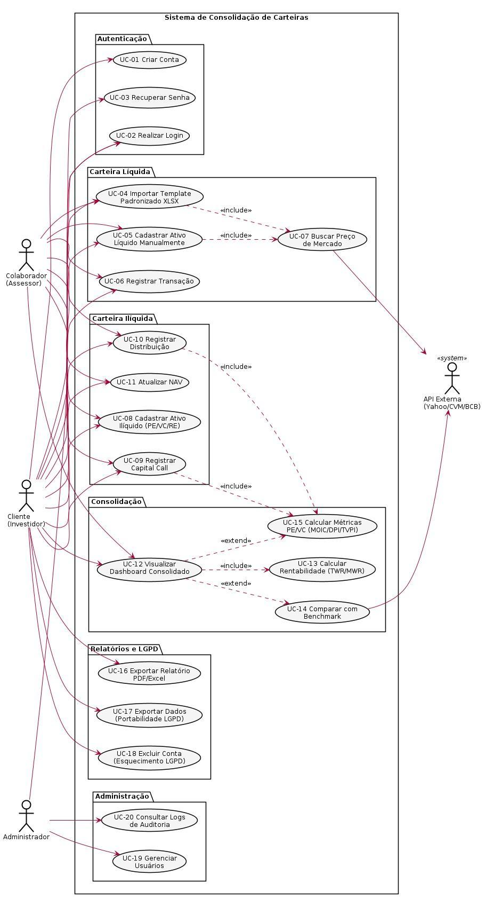

*Fonte: Elaborado pelos autores (2026).*

Os atores do sistema são definidos como:

- **Cliente (Investidor):** usuário final do sistema, responsável por importar e visualizar sua própria carteira;
- **Colaborador (Gestor Familiar):** membro do núcleo familiar autorizado pelo titular a visualizar e auxiliar na gestão da carteira do próprio investidor; corresponde ao perfil COLABORADOR do controle de acesso (RN-013);
- **Administrador:** responsável pela gestão de usuários, configurações globais e auditoria;
- **API Externa (ator de sistema):** Yahoo Finance e PTAX do BCB — consumidos pelo sistema para enriquecimento de preços e taxas de câmbio.

## 6.2 ESPECIFICAÇÃO DETALHADA DOS CASOS DE USO

Os casos de uso são especificados a seguir no formato Cockburn (caso completo), contemplando identificação, ator, pré-condições, disparador, fluxo principal, fluxos alternativos, exceções, pós-condições e regras de negócio relacionadas. A numeração corresponde ao Diagrama de Casos de Uso (Figura 7) e à Matriz de Rastreabilidade (Quadro 22). Fluxos alternativos (FA) descrevem caminhos bem-sucedidos distintos do principal; exceções (EX) descrevem situações em que o objetivo do ator não é alcançado.

### 6.2.1 UC-01 — Criar Conta

**Quadro 23 — Especificação do caso de uso UC-01 (Criar Conta)**

| Item | Conteúdo |
|---|---|
| Ator principal | Cliente |
| Pré-condições | Usuário não autenticado. E-mail não cadastrado previamente. |
| Disparador | Usuário clica em "Criar conta" na tela de login. |
| Fluxo principal | 1. Sistema exibe formulário com campos: nome, e-mail, CPF (opcional), senha, confirmação de senha, moeda base, perfil de risco e aceite do termo LGPD. 2. Usuário preenche e submete. 3. Sistema valida formato dos campos, coincidência das senhas e força da senha (RN-001). 4. Sistema verifica se o e-mail já está cadastrado. 5. Sistema cria, em transação única, registro em USUARIO (perfil = CLIENTE), CLIENTE (CPF cifrado em repouso) e CARTEIRA padrão "Carteira Principal". 6. Sistema registra o consentimento LGPD com timestamp. 7. Sistema registra CRIAR_CONTA em AUDIT_LOG e orienta o usuário a autenticar-se. |
| Fluxos alternativos | Não se aplica (não há fluxo alternativo bem-sucedido distinto para este caso de uso). |
| Exceções | EX-01 (E-mail já cadastrado): sistema exibe "Já existe uma conta com este e-mail" e sugere a recuperação de senha (UC-03). EX-02 (Aceite LGPD não marcado): sistema bloqueia a submissão e informa que o consentimento é obrigatório. EX-03 (Senha fraca ou senhas divergentes): sistema exibe as regras de força mínima e solicita nova senha. |
| Pós-condição | Conta criada; carteira padrão disponível; consentimento registrado. |
| RN relacionadas | RN-001 |

*Fonte: Elaborado pelos autores (2026).*

### 6.2.2 UC-02 — Realizar Login

**Quadro 24 — Especificação do caso de uso UC-02 (Realizar Login)**

| Item | Conteúdo |
|---|---|
| Ator principal | Cliente, Colaborador, Administrador |
| Pré-condições | Conta previamente criada e ativa. |
| Disparador | Usuário acessa a aplicação. |
| Fluxo principal | 1. Sistema exibe formulário com campos: e-mail e senha. 2. Usuário submete. 3. Sistema verifica se a conta está bloqueada por tentativas falhas (RN-001). 4. Sistema valida as credenciais comparando a senha com o hash bcrypt armazenado. 5. Sistema zera o contador de tentativas, registra o último acesso e emite token JWT. 6. Sistema registra LOGIN em AUDIT_LOG. 7. Sistema carrega as carteiras visíveis ao perfil (RN-013) e redireciona ao dashboard. |
| Fluxos alternativos | FA-01 (Esqueci minha senha): usuário aciona UC-03. |
| Exceções | EX-01 (Credenciais inválidas): sistema exibe mensagem genérica, incrementa o contador e informa as tentativas restantes. EX-02 (Quinta tentativa falha): sistema bloqueia a conta por 15 minutos e registra LOGIN_FALHA (RN-001). EX-03 (Conta bloqueada ou desativada): sistema recusa o acesso mesmo com a senha correta e informa o tempo restante de bloqueio. |
| Pós-condição | Usuário autenticado com token JWT válido; carteira inicial selecionada. |
| RN relacionadas | RN-001, RN-013 |

*Fonte: Elaborado pelos autores (2026).*

### 6.2.3 UC-03 — Recuperar Senha

**Quadro 25 — Especificação do caso de uso UC-03 (Recuperar Senha)**

| Item | Conteúdo |
|---|---|
| Ator principal | Cliente, Colaborador, Administrador |
| Atores secundários | Serviço de e-mail |
| Pré-condições | Conta previamente criada com e-mail válido. |
| Disparador | Usuário clica em "Esqueci minha senha" na tela de login. |
| Fluxo principal | 1. Sistema exibe formulário solicitando o e-mail cadastrado. 2. Usuário informa o e-mail e submete. 3. Sistema exibe mensagem genérica de que, se o e-mail existir, um link foi enviado — sem revelar se a conta existe. 4. Sistema gera token de redefinição de uso único, com validade de 30 minutos e o envia por e-mail. 5. Usuário acessa o link e informa a nova senha e a confirmação. 6. Sistema valida o token, aplica a política de senha (RN-001) e substitui o hash armazenado. 7. Sistema invalida o token, zera tentativas falhas, remove bloqueio vigente e registra a operação em AUDIT_LOG. 8. Sistema redireciona à tela de login. |
| Fluxos alternativos | Não se aplica (não há fluxo alternativo bem-sucedido distinto para este caso de uso). |
| Exceções | EX-01 (Token expirado ou já utilizado): sistema informa que o link não é mais válido e oferece nova solicitação. EX-02 (Nova senha fora da política): sistema exibe as regras e mantém a senha anterior. EX-03 (Falha no envio do e-mail): sistema registra a falha e orienta o usuário a tentar novamente mais tarde. |
| Pós-condição | Senha redefinida; token consumido; conta desbloqueada. |
| RN relacionadas | RN-001 |
| Observação | Prioridade Should (RF-003). Não implementado no MVP por depender de serviço de envio de e-mail. |

*Fonte: Elaborado pelos autores (2026).*

### 6.2.4 UC-04 — Importar Carteira via Template Padronizado XLSX

**Quadro 26 — Especificação do caso de uso UC-04 (Importar Carteira via Template Padronizado XLSX)**

| Item | Conteúdo |
|---|---|
| Ator principal | Cliente, Colaborador |
| Atores secundários | API Externa (Yahoo Finance) |
| Pré-condições | Usuário autenticado. Carteira selecionada. Template XLSX preenchido. |
| Disparador | Usuário acessa a tela "Importar carteira" e seleciona o arquivo. |
| Fluxo principal | 1. Sistema disponibiliza os templates por classe de ativo (Líquidos, PE/VC, Imóveis). 2. Usuário baixa o template apropriado e preenche offline. 3. Usuário seleciona o tipo de template, faz upload do arquivo XLSX e aciona "Validar arquivo". 4. Sistema realiza validação estrutural: presença, nome e ordem das abas e colunas (RN-002). 5. Sistema realiza validação semântica linha a linha: obrigatoriedade, tipos, domínios, coerência quantidade × preço × valor, datas e moeda × mercado; no template PE/VC, avalia RN-004 e RN-005 em ordem cronológica. 6. Para cada linha válida, sistema normaliza o ticker via ASSET_MAPPING e consolida linhas repetidas do mesmo ativo por preço médio ponderado. 7. Para ativos com possui_ticker_listado = verdadeiro, sistema consulta a API externa e obtém o preço de mercado (RN-006). 8. Para ativos sem ticker listado, sistema adota o preço médio e o valor financeiro informados (RN-007). 9. Sistema exibe preview com linhas lidas, válidas e rejeitadas, a lista de problemas por linha e coluna, os ajustes automáticos aplicados e o diferencial entre preço médio e preço de mercado. 10. Usuário revisa e confirma a importação das linhas válidas. 11. Sistema persiste atomicamente em ATIVO, POSICAO, TRANSACAO e PRECO_HISTORICO, e grava IMPORTACAO_LOG. 12. Sistema registra IMPORTAR_TEMPLATE em AUDIT_LOG. |
| Fluxos alternativos | FA-01 (API externa indisponível): sistema mantém o preço médio do template como referência, sinaliza a posição como "preço desatualizado" e prossegue. FA-02 (Linhas com aviso): ajustes automáticos (por exemplo, consolidação de duplicatas) são exibidos e o usuário pode prosseguir. FA-03 (Ativo já existente na carteira): sistema soma as quantidades e recalcula o preço médio ponderado em vez de duplicar a posição. |
| Exceções | EX-01 (Erro estrutural): sistema aborta a importação do arquivo inteiro e lista as abas ou colunas divergentes (RN-003). EX-02 (Linhas com erro semântico): linhas afetadas ficam de fora; usuário pode importar apenas as válidas (RN-003). EX-03 (Arquivo ilegível ou não XLSX): sistema recusa o arquivo e orienta a baixar o template novamente. EX-04 (Carteira não pertence ao usuário): sistema recusa a operação (RN-008). |
| Pós-condição | Posições importadas disponíveis no dashboard; importação registrada em IMPORTACAO_LOG e AUDIT_LOG. |
| RN relacionadas | RN-002, RN-003, RN-004, RN-005, RN-006, RN-007, RN-008 |

*Fonte: Elaborado pelos autores (2026).*

### 6.2.5 UC-05 — Cadastrar Ativo Líquido Manualmente

**Quadro 27 — Especificação do caso de uso UC-05 (Cadastrar Ativo Líquido Manualmente)**

| Item | Conteúdo |
|---|---|
| Ator principal | Cliente, Colaborador |
| Atores secundários | API Externa (Yahoo Finance) |
| Pré-condições | Usuário autenticado. Carteira selecionada. |
| Disparador | Usuário aciona "Cadastrar ativo" na carteira. |
| Fluxo principal | 1. Sistema exibe formulário com campos: ticker ou CNPJ, nome, classe, mercado, moeda, quantidade, preço médio, data de aquisição, setor e observação. 2. Usuário preenche e submete. 3. Sistema aplica as mesmas validações semânticas do template de líquidos: domínios, valores positivos, data não futura e coerência moeda × mercado. 4. Sistema normaliza o ticker via ASSET_MAPPING e localiza ou cria o registro em ATIVO. 5. Sistema define possui_ticker_listado conforme a classe e o mercado (RN-006). 6. Sistema inclui UC-07 para obter o preço de mercado, quando listado. 7. Sistema cria a POSICAO ou consolida com a existente por preço médio ponderado, e grava TRANSACAO de compra. 8. Sistema registra a ação em AUDIT_LOG e retorna à carteira atualizada. |
| Fluxos alternativos | FA-01 (Ativo não listado): sistema adota o preço informado como referência de marcação (RN-007). FA-02 (Ativo já existe na carteira): sistema consolida quantidade e preço médio em vez de criar nova posição. |
| Exceções | EX-01 (Campo obrigatório ausente ou fora do domínio): sistema destaca o campo e impede a submissão. EX-02 (Moeda incoerente com o mercado): sistema informa a moeda esperada (por exemplo, B3 = BRL). |
| Pós-condição | Posição criada ou consolidada; preço de referência disponível. |
| RN relacionadas | RN-006, RN-007, RN-008 |
| Observação | Prioridade Should (RF-007). Alternativa ao template; não implementado no MVP. |

*Fonte: Elaborado pelos autores (2026).*

### 6.2.6 UC-06 — Registrar Transação

**Quadro 28 — Especificação do caso de uso UC-06 (Registrar Transação)**

| Item | Conteúdo |
|---|---|
| Ator principal | Cliente, Colaborador |
| Pré-condições | Usuário autenticado. Posição existente na carteira. |
| Disparador | Usuário seleciona a posição e aciona "Registrar transação". |
| Fluxo principal | 1. Sistema exibe formulário com campos: tipo (compra, venda ou provento), data, quantidade, preço unitário e taxas. 2. Usuário preenche e submete. 3. Sistema valida valores positivos, data não futura e, em vendas, quantidade não superior à posição. 4. Sistema grava TRANSACAO vinculada à posição. 5. Em compras, sistema soma a quantidade e recalcula o preço médio ponderado; em vendas, reduz a quantidade mantendo o preço médio; em proventos, mantém a posição e registra a entrada de caixa. 6. Sistema atualiza o valor financeiro da posição e registra a ação em AUDIT_LOG. |
| Fluxos alternativos | FA-01 (Venda total): quantidade chega a zero e a posição permanece no histórico com quantidade nula, preservando as transações. |
| Exceções | EX-01 (Venda acima da quantidade disponível): sistema rejeita e informa a quantidade em carteira. EX-02 (Data anterior à aquisição inicial): sistema rejeita e informa a data inicial da posição. |
| Pós-condição | Transação registrada; quantidade e preço médio atualizados; fluxo de caixa disponível para o cálculo de MWR (UC-13). |
| RN relacionadas | RN-011 |

*Fonte: Elaborado pelos autores (2026).*

### 6.2.7 UC-07 — Buscar Preço de Mercado

**Quadro 29 — Especificação do caso de uso UC-07 (Buscar Preço de Mercado)**

| Item | Conteúdo |
|---|---|
| Ator principal | Sistema (caso de uso incluído por UC-04, UC-05 e UC-12) |
| Atores secundários | API Externa (Yahoo Finance) |
| Pré-condições | Ativo com possui_ticker_listado = verdadeiro (RN-006). |
| Disparador | Inclusão por outro caso de uso, ou acionamento de "Atualizar cotações" no dashboard. |
| Fluxo principal | 1. Sistema verifica o cache local em PRECO_HISTORICO; se houver preço de fonte externa dentro da janela de validade, devolve-o sem consultar a API. 2. Sistema converte o ticker canônico no símbolo da fonte externa via ASSET_MAPPING ou pela regra de sufixo por mercado. 3. Sistema consulta a API uma única vez; qualquer falha é tratada pela exceção EX-01. 4. Sistema persiste o fechamento mais recente em PRECO_HISTORICO com fonte identificada. 5. Sistema devolve preço e data ao caso de uso chamador. |
| Fluxos alternativos | FA-01 (Cache válido): preço devolvido do cache, sem chamada externa. |
| Exceções | EX-01 (API indisponível, limite excedido ou símbolo não encontrado): sistema mantém o último preço conhecido, sinaliza a posição como desatualizada e prossegue sem interromper o chamador. EX-02 (Ativo não listado): sistema não consulta a API e aplica RN-007. |
| Pós-condição | PRECO_HISTORICO atualizado ou último preço conhecido preservado, com indicação da fonte. |
| RN relacionadas | RN-006, RN-007 |

*Fonte: Elaborado pelos autores (2026).*

### 6.2.8 UC-08 — Cadastrar Ativo Ilíquido (PE/VC/RE)

**Quadro 30 — Especificação do caso de uso UC-08 (Cadastrar Ativo Ilíquido (PE/VC/RE))**

| Item | Conteúdo |
|---|---|
| Ator principal | Cliente, Colaborador |
| Pré-condições | Usuário autenticado. Carteira selecionada. |
| Disparador | Usuário aciona "Cadastrar fundo" ou importa a aba Fundos do template PE/VC (UC-04). |
| Fluxo principal | 1. Sistema exibe formulário com campos: identificador do fundo, nome, gestor, subclasse (Private Equity, Venture Capital ou Real Estate), moeda, commitment, data de início e data de encerramento prevista. 2. Usuário preenche e submete. 3. Sistema valida commitment positivo, data de início não futura e data de encerramento posterior ao início. 4. Sistema cria ATIVO com possui_ticker_listado = falso e ATIVO_ILIQUIDO com paid_in_capital = 0 e dry_powder = commitment. 5. Sistema cria POSICAO com valor financeiro inicial nulo, a ser marcado pelos eventos. 6. Sistema registra a ação em AUDIT_LOG e exibe a tela do fundo. |
| Fluxos alternativos | FA-01 (Fundo já cadastrado): sistema atualiza commitment, gestor e data de encerramento em vez de duplicar. |
| Exceções | EX-01 (Identificador duplicado no mesmo arquivo): sistema rejeita a segunda ocorrência e indica a linha original. EX-02 (Data de encerramento anterior ao início): sistema rejeita e informa a inconsistência. |
| Pós-condição | Fundo disponível para registro de eventos (UC-09, UC-10, UC-11) e cálculo de métricas (UC-15). |
| RN relacionadas | RN-007, RN-008 |

*Fonte: Elaborado pelos autores (2026).*

### 6.2.9 UC-09 — Registrar Capital Call em Fundo PE/VC

**Quadro 31 — Especificação do caso de uso UC-09 (Registrar Capital Call em Fundo PE/VC)**

| Item | Conteúdo |
|---|---|
| Ator principal | Cliente, Colaborador |
| Pré-condições | Fundo PE/VC previamente cadastrado (UC-08). Commitment definido. |
| Disparador | Usuário acessa a tela do fundo e escolhe "Capital call" em "Registrar evento". |
| Fluxo principal | 1. Sistema exibe formulário com campos: data, valor, status (PENDENTE ou PAGO) e observação. 2. Usuário preenche e submete. 3. Sistema valida valor positivo e data não anterior ao início do fundo. 4. Se status = PAGO, sistema verifica que a soma das chamadas pagas mais o valor não excede o commitment (RN-004). 5. Sistema persiste em EVENTO_PE com tipo = CAPITAL_CALL. 6. Sistema recalcula paid_in_capital, dry_powder e NAV em ATIVO_ILIQUIDO e reflete o NAV na POSICAO (RN-012). 7. Sistema recalcula DPI, RVPI, TVPI e IRR (UC-15). 8. Sistema registra REGISTRAR_EVENTO_PE em AUDIT_LOG e atualiza a tela com o evento e as métricas. |
| Fluxos alternativos | FA-01 (Status = PENDENTE): paid_in_capital não é alterado; o dry powder é reduzido; o evento aguarda confirmação posterior. Datas futuras são aceitas apenas neste status. |
| Exceções | EX-01 (Valor excede o commitment): sistema rejeita e informa o valor ainda disponível para chamada. EX-02 (Data anterior ao início do fundo): sistema rejeita e informa a data de início. |
| Pós-condição | Evento registrado; métricas PE/VC atualizadas; ação auditada. |
| RN relacionadas | RN-004, RN-012 |

*Fonte: Elaborado pelos autores (2026).*

### 6.2.10 UC-10 — Registrar Distribuição

**Quadro 32 — Especificação do caso de uso UC-10 (Registrar Distribuição)**

| Item | Conteúdo |
|---|---|
| Ator principal | Cliente, Colaborador |
| Pré-condições | Fundo PE/VC previamente cadastrado. Ao menos um capital call com status PAGO (RN-005). |
| Disparador | Usuário acessa a tela do fundo e escolhe "Distribuição" em "Registrar evento". |
| Fluxo principal | 1. Sistema exibe formulário com campos: data, valor, tipo (retorno de capital, ganho ou rendimento) e observação. 2. Usuário preenche e submete. 3. Sistema valida valor positivo, data não futura e não anterior ao início do fundo. 4. Sistema verifica que o fundo possui capital integralizado (RN-005). 5. Sistema persiste em EVENTO_PE com tipo = DISTRIBUICAO e status = RECEBIDO. 6. Sistema recalcula as métricas do fundo (RN-012), incluindo DPI e IRR (UC-15). 7. Sistema registra REGISTRAR_EVENTO_PE em AUDIT_LOG e atualiza a tela. |
| Fluxos alternativos | Não se aplica (não há fluxo alternativo bem-sucedido distinto para este caso de uso). |
| Exceções | EX-01 (Fundo sem capital integralizado): sistema rejeita a distribuição e explica a regra (RN-005). EX-02 (Data futura): sistema rejeita: distribuições registram fato consumado. |
| Pós-condição | Distribuição registrada; DPI, TVPI e IRR atualizados; fluxo de caixa disponível para o MWR consolidado. |
| RN relacionadas | RN-005, RN-012 |

*Fonte: Elaborado pelos autores (2026).*

### 6.2.11 UC-11 — Atualizar NAV

**Quadro 33 — Especificação do caso de uso UC-11 (Atualizar NAV)**

| Item | Conteúdo |
|---|---|
| Ator principal | Cliente, Colaborador |
| Pré-condições | Fundo PE/VC previamente cadastrado. |
| Disparador | Usuário acessa a tela do fundo e escolhe "NAV update" em "Registrar evento", tipicamente ao receber a carta trimestral do gestor. |
| Fluxo principal | 1. Sistema exibe formulário com campos: data de referência, NAV total da participação, NAV por cota (opcional) e observação. 2. Usuário preenche e submete. 3. Sistema valida valor positivo e data não futura nem anterior ao início do fundo. 4. Sistema persiste em EVENTO_PE com tipo = NAV_UPDATE e status = RECEBIDO, preservando os NAVs anteriores como histórico auditável. 5. Sistema adota o NAV mais recente como valor de marcação da posição e recalcula RVPI, TVPI e IRR (RN-012). 6. Sistema registra ATUALIZAR_NAV em AUDIT_LOG e atualiza a tela e a curva J. |
| Fluxos alternativos | FA-01 (Fundo sem nenhum NAV informado): sistema marca a posição pelo capital líquido integralizado (paid-in menos distribuições) até que um NAV seja registrado. |
| Exceções | EX-01 (Data futura): sistema rejeita: a marcação refere-se a data de referência já ocorrida. |
| Pós-condição | NAV registrado com histórico; posição remarcada; métricas atualizadas. |
| RN relacionadas | RN-012 |

*Fonte: Elaborado pelos autores (2026).*

### 6.2.12 UC-12 — Visualizar Dashboard Consolidado

**Quadro 34 — Especificação do caso de uso UC-12 (Visualizar Dashboard Consolidado)**

| Item | Conteúdo |
|---|---|
| Ator principal | Cliente, Colaborador |
| Atores secundários | API Externa (preços e câmbio) |
| Pré-condições | Usuário autenticado. Carteira com pelo menos uma posição cadastrada. |
| Disparador | Usuário acessa o dashboard ou altera o período de análise. |
| Fluxo principal | 1. Sistema recupera as posições ativas da carteira selecionada. 2. Sistema verifica o cache de preços; para ativos listados com cache expirado, inclui UC-07. 3. Sistema obtém as taxas de câmbio da data de referência, com forward fill (RN-009). 4. Sistema marca cada posição por uma regra única: listado → quantidade × último preço; fundo PE/VC → último NAV; imóvel → última avaliação; não listado → preço médio (RN-006, RN-007). 5. Sistema converte todas as posições para a moeda base do cliente. 6. Sistema inclui UC-13 (TWR e MWR), UC-14 (benchmarks) e UC-15 (métricas PE/VC). 7. Sistema calcula alocações por classe, liquidez, região e moeda. 8. Sistema renderiza: patrimônio consolidado, proporção líquido/ilíquido, custo e resultado, indicadores de rentabilidade e risco, gráficos de alocação, evolução patrimonial e comparativo com benchmarks, e tabela de posições. |
| Fluxos alternativos | FA-01 (Carteira vazia): sistema exibe orientação para importar um template (UC-04). FA-02 (Período sem histórico suficiente): sistema exibe patrimônio e alocação e informa que a rentabilidade não pôde ser apurada. |
| Exceções | EX-01 (Falha na API de preços): sistema utiliza o último preço conhecido e sinaliza "preço desatualizado". EX-02 (Cotação de câmbio ausente para uma moeda): sistema exibe alerta identificando a moeda e mantém os valores dessa moeda sem conversão, em vez de somá-los silenciosamente. |
| Pós-condição | Dashboard exibido com a data de referência e a origem dos preços. |
| RN relacionadas | RN-006, RN-007, RN-009, RN-010, RN-011, RN-012, RN-013 |

*Fonte: Elaborado pelos autores (2026).*

### 6.2.13 UC-13 — Calcular Rentabilidade (TWR/MWR)

**Quadro 35 — Especificação do caso de uso UC-13 (Calcular Rentabilidade (TWR/MWR))**

| Item | Conteúdo |
|---|---|
| Ator principal | Sistema (incluído por UC-12) |
| Pré-condições | Posições com histórico de preços e transações no período. Taxas de câmbio disponíveis para as datas envolvidas. |
| Disparador | Inclusão por UC-12 com um período definido. |
| Fluxo principal | 1. Sistema constrói a série mensal de patrimônio em moeda base, remarcando cada posição pelo último preço, NAV ou avaliação até cada data. 2. Sistema reúne os fluxos do investidor no período: compras, vendas e proventos (TRANSACAO) e capital calls e distribuições (EVENTO_PE), convertidos pela taxa da data de cada fluxo. 3. Sistema apura o retorno de cada subperíodo pelo Dietz modificado, ponderando cada fluxo pelo tempo em que ficou investido, e encadeia os retornos geometricamente: TWR = Π(1 + Rᵢ) − 1 (RN-010). 4. Sistema unitiza a carteira (série de cota base 100) e, sobre ela, calcula volatilidade anualizada, máximo drawdown e índice de Sharpe com o CDI como taxa livre de risco. 5. Sistema resolve o MWR/IRR pelo método de Newton-Raphson com chute inicial de 10% a.a., sobre os fluxos mais o patrimônio final como entrada; em caso de não convergência, aplica bisseção (RN-011). 6. Sistema calcula o TWR individual de cada ativo listado sobre sua série de preços, na moeda do ativo. 7. Sistema devolve os indicadores ao UC-12. |
| Fluxos alternativos | FA-01 (Todos os fluxos com o mesmo sinal): sistema devolve MWR indefinido ("n/d") em vez de um número sem significado. |
| Exceções | EX-01 (Menos de dois pontos na série): sistema informa histórico insuficiente e não apura rentabilidade. |
| Pós-condição | TWR, TWR anualizado, MWR, volatilidade, drawdown e Sharpe disponíveis para o período. |
| RN relacionadas | RN-009, RN-010, RN-011 |

*Fonte: Elaborado pelos autores (2026).*

### 6.2.14 UC-14 — Comparar com Benchmark

**Quadro 36 — Especificação do caso de uso UC-14 (Comparar com Benchmark)**

| Item | Conteúdo |
|---|---|
| Ator principal | Sistema (estende UC-12) |
| Atores secundários | API Externa (séries de índices) |
| Pré-condições | TWR da carteira apurado (UC-13). Séries de BENCHMARK_VALOR cobrindo o período. |
| Disparador | Extensão de UC-12 quando há benchmarks disponíveis para o período. |
| Fluxo principal | 1. Sistema identifica os benchmarks catalogados: CDI, IBOVESPA, IPCA, S&P 500 e IFIX. 2. Sistema obtém o valor-índice de cada benchmark na data inicial e na final, com forward fill. 3. Sistema calcula o retorno de cada benchmark como valor final / valor inicial − 1. 4. Sistema compara com o TWR da carteira e classifica cada benchmark como superado ou não, com a diferença em pontos percentuais. 5. Sistema devolve o comparativo ao UC-12, que o exibe em gráfico de barras e tabela. |
| Fluxos alternativos | FA-01 (Benchmark sem cobertura no período): sistema omite esse benchmark do comparativo em vez de exibir valor parcial. |
| Exceções | EX-01 (Nenhum benchmark com cobertura): sistema informa indisponibilidade para o período. |
| Pós-condição | Comparativo carteira × benchmarks exibido. |
| RN relacionadas | RN-010 |

*Fonte: Elaborado pelos autores (2026).*

### 6.2.15 UC-15 — Calcular Métricas PE/VC (MOIC/DPI/TVPI)

**Quadro 37 — Especificação do caso de uso UC-15 (Calcular Métricas PE/VC (MOIC/DPI/TVPI))**

| Item | Conteúdo |
|---|---|
| Ator principal | Sistema (incluído por UC-09, UC-10, UC-11; estende UC-12) |
| Pré-condições | Fundo com eventos registrados em EVENTO_PE. |
| Disparador | Inserção de qualquer evento no fundo (RN-012) ou carregamento do dashboard. |
| Fluxo principal | 1. Sistema soma os capital calls com status PAGO (paid-in) e os PENDENTES. 2. Sistema soma as distribuições com status RECEBIDO. 3. Sistema adota o NAV do último NAV_UPDATE; na ausência, o capital líquido integralizado. 4. Sistema calcula dry_powder = commitment − paid-in − pendentes. 5. Sistema calcula DPI = distribuições / paid-in; RVPI = NAV / paid-in; TVPI = (distribuições + NAV) / paid-in. Sob a convenção adotada, MOIC coincide com TVPI. 6. Sistema calcula o IRR do fundo pelo método de RN-011, com as chamadas pagas como saídas e as distribuições e o NAV final como entradas. 7. Sistema materializa paid_in_capital, dry_powder e nav_atual em ATIVO_ILIQUIDO e reflete o NAV na POSICAO. |
| Fluxos alternativos | FA-01 (Fundo sem capital integralizado): DPI, RVPI e TVPI são zero e o IRR é indefinido; o dry powder é igual ao commitment. |
| Exceções | EX-01 (Eventos cancelados): são ignorados em todos os somatórios. |
| Pós-condição | Métricas materializadas no fundo e disponíveis no quadro geral e no dashboard. |
| RN relacionadas | RN-004, RN-005, RN-011, RN-012 |

*Fonte: Elaborado pelos autores (2026).*

### 6.2.16 UC-16 — Exportar Relatório Excel/CSV

**Quadro 38 — Especificação do caso de uso UC-16 (Exportar Relatório Excel/CSV)**

| Item | Conteúdo |
|---|---|
| Ator principal | Cliente, Colaborador |
| Pré-condições | Usuário autenticado. Carteira com pelo menos uma posição. |
| Disparador | Usuário acessa "Relatórios" e escolhe o formato. |
| Fluxo principal | 1. Sistema apura o snapshot da carteira na moeda base e exibe a prévia das posições. 2. Usuário escolhe Excel (.xlsx) ou CSV. 3. Em Excel, sistema monta pasta de trabalho com quatro abas: Resumo (patrimônio, custo, alocações, indicadores e benchmarks), Posições, Fundos ilíquidos e Imóveis. 4. Em CSV, sistema serializa as posições com separador ";" e codificação UTF-8 com BOM, legível diretamente no Excel em português. 5. Sistema disponibiliza o download com a data de referência no nome do arquivo. |
| Fluxos alternativos | FA-01 (Carteira sem fundos ou sem imóveis): as abas correspondentes são omitidas do Excel. |
| Exceções | EX-01 (Carteira vazia): sistema informa que não há posições para exportar. |
| Pós-condição | Arquivo gerado e entregue ao usuário. |
| RN relacionadas | RN-013 |
| Observação | Prioridade Could (RF-023). O formato PDF permanece como evolução. |

*Fonte: Elaborado pelos autores (2026).*

### 6.2.17 UC-17 — Exportar Dados (Portabilidade LGPD)

**Quadro 39 — Especificação do caso de uso UC-17 (Exportar Dados (Portabilidade LGPD))**

| Item | Conteúdo |
|---|---|
| Ator principal | Cliente (titular dos dados) |
| Pré-condições | Usuário autenticado. |
| Disparador | Usuário acessa "Privacidade e dados" e escolhe "Exportar meus dados". |
| Fluxo principal | 1. Sistema solicita reautenticação com senha (e 2FA, se habilitado) (RN-014). 2. Usuário escolhe o formato: JSON (dossiê completo) ou CSV (pacote com planilhas separadas). 3. Sistema coleta todos os dados associados ao titular — cadastro, carteiras, posições, transações, fundos e eventos, imóveis, importações e trilha de auditoria — por junções entre as tabelas. 4. Sistema decifra o CPF para entrega em claro ao titular. 5. Sistema gera o arquivo e emite link de download de uso único com validade de 24 horas (RN-014). 6. Sistema registra EXPORTAR_LGPD em AUDIT_LOG. 7. Usuário baixa o arquivo; o link é consumido. |
| Fluxos alternativos | FA-01 (Usuário cancela antes da geração): sistema descarta a solicitação sem registrar em AUDIT_LOG. |
| Exceções | EX-01 (Reautenticação falha): sistema cancela a solicitação. EX-02 (Link expirado ou já utilizado): sistema recusa o download e orienta nova solicitação. |
| Pós-condição | Arquivo gerado e entregue; solicitação registrada; link consumido. |
| RN relacionadas | RN-014 |

*Fonte: Elaborado pelos autores (2026).*

### 6.2.18 UC-18 — Excluir Conta (Esquecimento LGPD)

**Quadro 40 — Especificação do caso de uso UC-18 (Excluir Conta (Esquecimento LGPD))**

| Item | Conteúdo |
|---|---|
| Ator principal | Cliente (titular dos dados) |
| Pré-condições | Usuário autenticado. |
| Disparador | Usuário acessa "Privacidade e dados" e escolhe "Excluir minha conta". |
| Fluxo principal | 1. Sistema exibe aviso de que a ação é irreversível e informa o que é retido por obrigação legal. 2. Sistema solicita reautenticação com senha (e 2FA, se habilitado). 3. Sistema exige confirmação explícita: digitação da palavra EXCLUIR e marcação de ciência. 4. Sistema anonimiza os registros retidos por obrigação legal (AUDIT_LOG), substituindo o vínculo com o titular por "EXCLUIDO_LGPD" (RN-015). 5. Sistema executa, em transação única, a exclusão de EVENTO_PE, ATIVO_ILIQUIDO, ATIVO_IMOVEL, ativos exclusivos do titular, POSICAO, TRANSACAO, IMPORTACAO_LOG, CARTEIRA, CLIENTE e USUARIO; ativos listados, por serem cadastro compartilhado, permanecem. 6. Sistema registra EXCLUIR_LGPD em AUDIT_LOG sob o identificador anonimizado. 7. Sistema revoga a sessão JWT, encerra a sessão e exibe o resumo do que foi removido. |
| Fluxos alternativos | FA-01 (Cliente desiste): em qualquer etapa antes da execução, o cliente pode cancelar. |
| Exceções | EX-01 (Reautenticação falha): sistema cancela a solicitação. EX-02 (Confirmação incorreta): sistema não executa e mantém a conta. |
| Pós-condição | Dados pessoais e patrimônio excluídos; auditoria anonimizada; sessão encerrada. |
| RN relacionadas | RN-015 |

*Fonte: Elaborado pelos autores (2026).*

### 6.2.19 UC-19 — Gerenciar Usuários

**Quadro 41 — Especificação do caso de uso UC-19 (Gerenciar Usuários)**

| Item | Conteúdo |
|---|---|
| Ator principal | Administrador |
| Pré-condições | Usuário autenticado com perfil ADMIN (RN-013). |
| Disparador | Administrador acessa "Administração", aba "Usuários". |
| Fluxo principal | 1. Sistema lista as contas com e-mail, nome, perfil, situação, data de criação, último acesso e bloqueio vigente. 2. Administrador seleciona a conta e define perfil (ADMIN, COLABORADOR ou CLIENTE), situação (ativa ou desativada) e, se necessário, remoção do bloqueio por tentativas falhas. 3. Sistema verifica as salvaguardas: o administrador não pode rebaixar o próprio perfil na sessão corrente, nem remover o último administrador ativo. 4. Sistema aplica a alteração em USUARIO. 5. Sistema registra ALTERAR_USUARIO em AUDIT_LOG com os dados anteriores e os novos. 6. Sistema atualiza a listagem. |
| Fluxos alternativos | FA-01 (Vincular cliente a colaborador): administrador define o colaborador responsável, o que passa a governar a visibilidade da carteira (RN-013). |
| Exceções | EX-01 (Perfil não autorizado): sistema recusa o acesso à tela. EX-02 (Tentativa de rebaixar o próprio perfil ou remover o último admin): sistema recusa e explica a salvaguarda. |
| Pós-condição | Conta atualizada; alteração auditada com estado anterior e novo. |
| RN relacionadas | RN-001, RN-013 |

*Fonte: Elaborado pelos autores (2026).*

### 6.2.20 UC-20 — Consultar Logs de Auditoria

**Quadro 42 — Especificação do caso de uso UC-20 (Consultar Logs de Auditoria)**

| Item | Conteúdo |
|---|---|
| Ator principal | Administrador |
| Pré-condições | Usuário autenticado com perfil ADMIN (RN-013). |
| Disparador | Administrador acessa "Administração", aba "Auditoria". |
| Fluxo principal | 1. Sistema exibe filtros: janela de tempo (7, 30, 90 ou 365 dias) e tipos de ação. 2. Administrador define os filtros. 3. Sistema consulta AUDIT_LOG, ordenado do mais recente ao mais antigo, limitado a 500 registros. 4. Sistema exibe data e hora, usuário, ação, entidade e resumo dos dados registrados. 5. Registros de contas excluídas aparecem com o usuário identificado como "(anonimizado)" (RN-015). |
| Fluxos alternativos | FA-01 (Sem registros na janela): sistema informa a ausência e sugere ampliar o período. |
| Exceções | EX-01 (Perfil não autorizado): sistema recusa o acesso à tela. |
| Pós-condição | Trilha de auditoria consultada; nenhuma alteração de dados. |
| RN relacionadas | RN-013, RN-015 |

*Fonte: Elaborado pelos autores (2026).*

## 6.3 DIAGRAMA DE CLASSES

O diagrama de classes apresenta o modelo de domínio do sistema, incluindo entidades principais, atributos, métodos e relacionamentos. A Figura 8 destaca a herança entre a classe abstrata ATIVO e suas especializações ATIVO_LIQUIDO e ATIVO_ILIQUIDO, bem como as agregações entre CLIENTE, CARTEIRA e POSICAO.

**Figura 8 — Diagrama de Classes do Domínio**

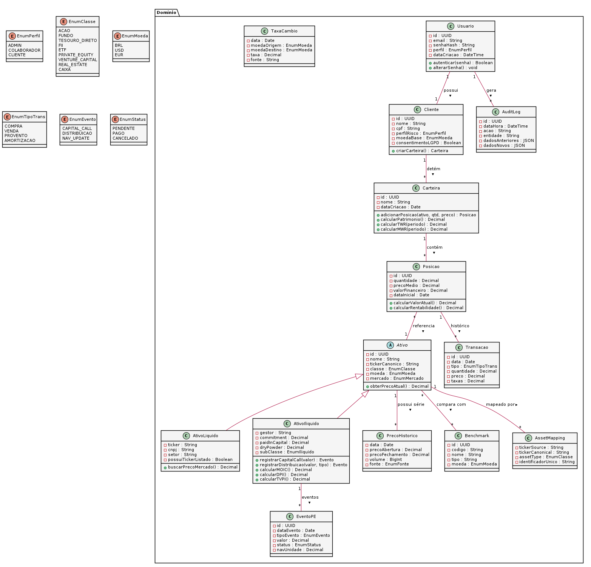

*Fonte: Elaborado pelos autores (2026).*

## 6.4 DIAGRAMAS DE SEQUÊNCIA

Os diagramas de sequência ilustram a colaboração temporal entre os componentes do sistema nas operações mais críticas. São apresentados três cenários: importação via template, registro de capital call e renderização do dashboard.

### 6.4.1 Importação via Template

A Figura 9 ilustra o fluxo de mensagens trocadas durante a importação de uma carteira via template XLSX, evidenciando o ponto de decisão sobre a busca de preço de mercado para ativos com ticker listado.

**Figura 9 — Diagrama de Sequência: Importação via Template**

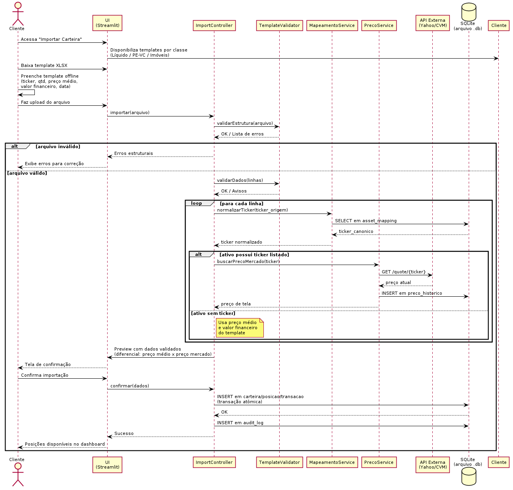

*Fonte: Elaborado pelos autores (2026).*

### 6.4.2 Registrar Capital Call

A Figura 10 ilustra o fluxo de mensagens durante o registro de um capital call em um fundo PE/VC, incluindo a validação contra o dry powder e o recálculo das métricas MOIC/DPI/TVPI quando o evento é marcado como pago.

**Figura 10 — Diagrama de Sequência: Registrar Capital Call**

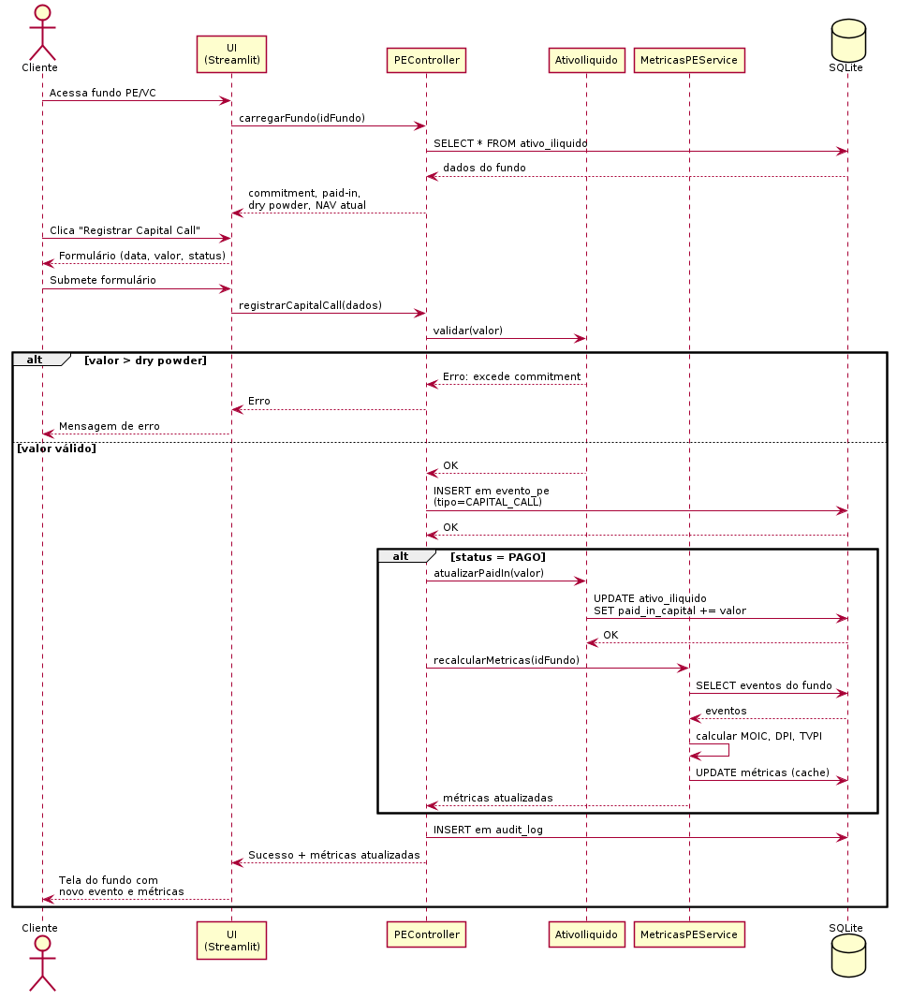

*Fonte: Elaborado pelos autores (2026).*

### 6.4.3 Dashboard Consolidado

A Figura 11 mostra a sequência de operações realizada quando o cliente acessa o dashboard, incluindo a verificação de cache de preços, conversão multi-moeda, cálculo de rentabilidade e composição do payload final.

**Figura 11 — Diagrama de Sequência: Dashboard Consolidado**

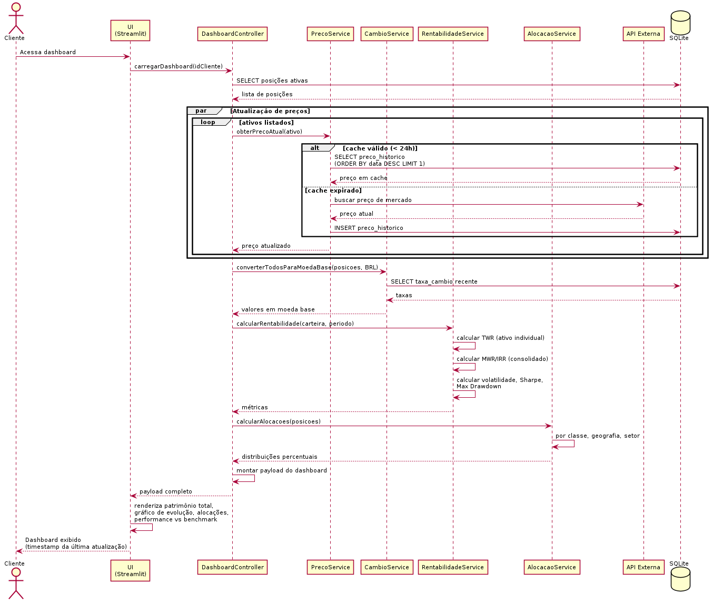

*Fonte: Elaborado pelos autores (2026).*

## 6.5 DIAGRAMA DE ATIVIDADES

O diagrama de atividades complementa o diagrama de sequência da importação, focando no fluxo lógico do processo do ponto de vista do cliente e do sistema, com explicitação das ramificações condicionais e do loop sobre as linhas do template. A Figura 12 apresenta esse fluxo.

**Figura 12 — Diagrama de Atividades: Importação via Template**

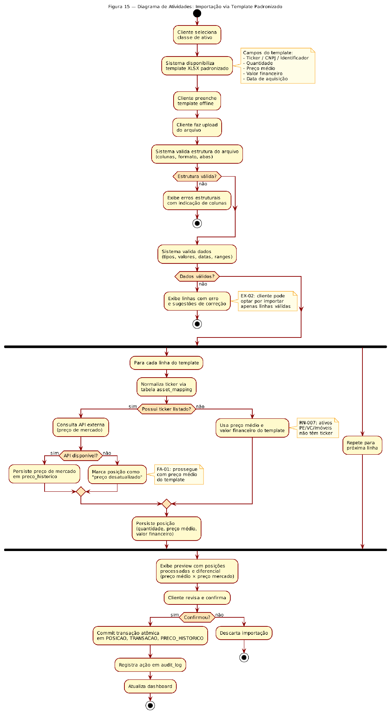

*Fonte: Elaborado pelos autores (2026).*

## 6.6 DIAGRAMA DE COMPONENTES

O diagrama de componentes apresenta a organização interna do software em pacotes/módulos e suas dependências. A separação em camadas (Apresentação, Aplicação, Domínio, Persistência e Integração Externa) facilita a manutenção e o isolamento de responsabilidades. A Figura 13 ilustra essa organização.

**Figura 13 — Diagrama de Componentes**

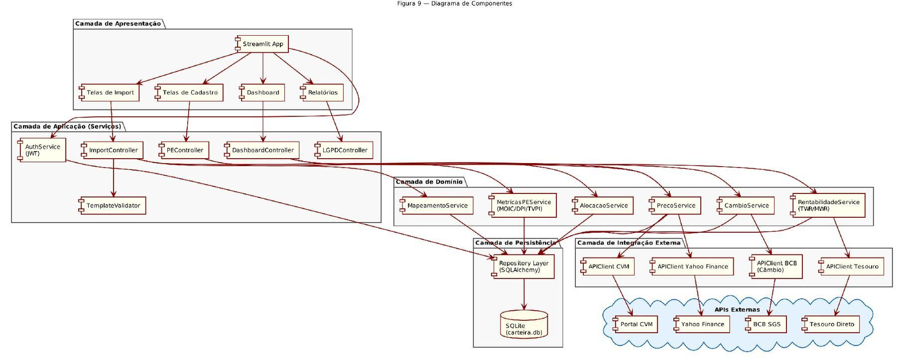

*Fonte: Elaborado pelos autores (2026).*

## 6.7 DIAGRAMA DE IMPLANTAÇÃO

O diagrama de implantação descreve o ambiente físico de execução do sistema. O modelo adotado é single-host: toda a aplicação roda em um único servidor (que pode ser uma VPS, um servidor on-premises ou mesmo a máquina do próprio usuário), com o banco SQLite em volume persistente. As únicas dependências externas são as APIs de mercado utilizadas para enriquecimento de preço de tela. Na entrega desta versão, feita pelo instalador para Windows (seção 5.2), esse host é a máquina do próprio usuário, e o servidor atende somente a conexões locais. A Figura 14 ilustra essa topologia.

**Figura 14 — Diagrama de Implantação**

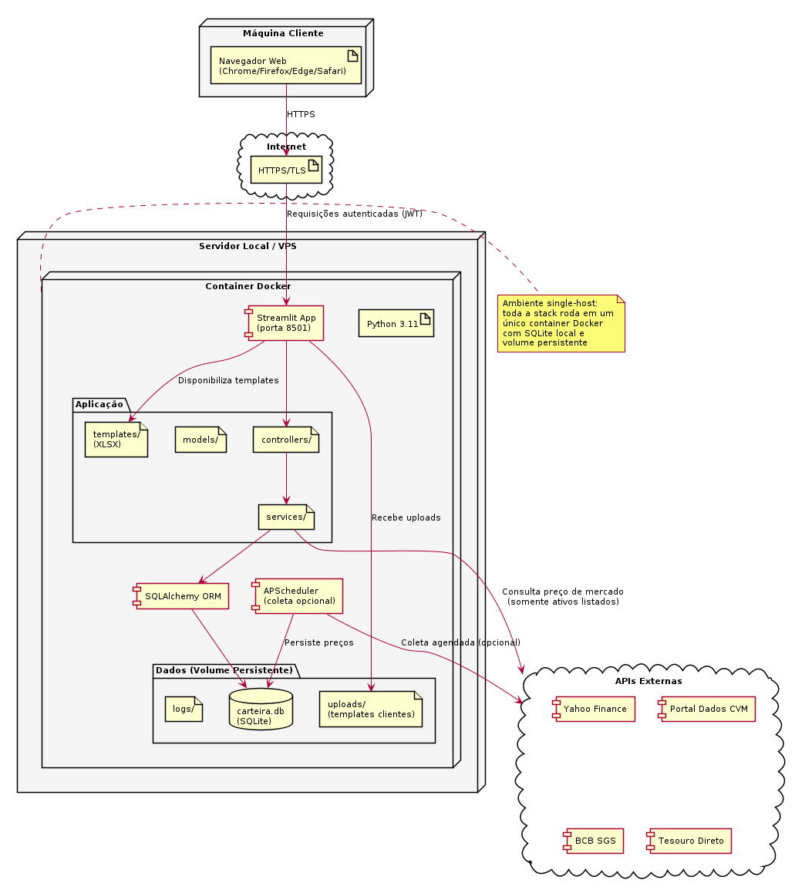

*Fonte: Elaborado pelos autores (2026).*

---

# 7 MODELO DE DADOS

Este capítulo apresenta o modelo de dados completo do sistema, contemplando o Modelo Entidade-Relacionamento (MER), o dicionário de dados e a indicação do script DDL (Data Definition Language) para implementação em SQLite, disponibilizado como artefato externo (arquivo `schema.sql`) e descrito no Apêndice A.

## 7.1 MODELO ENTIDADE-RELACIONAMENTO

O MER apresentado na Figura 15 detalha as 15 entidades do sistema, seus atributos com tipos de dados, chaves primárias (PK) e estrangeiras (FK), restrições NOT NULL (representadas com asterisco) e os relacionamentos com suas cardinalidades. O modelo segue a terceira forma normal (3FN), evitando redundâncias e dependências transitivas.

**Figura 15 — Modelo Entidade-Relacionamento (MER)**

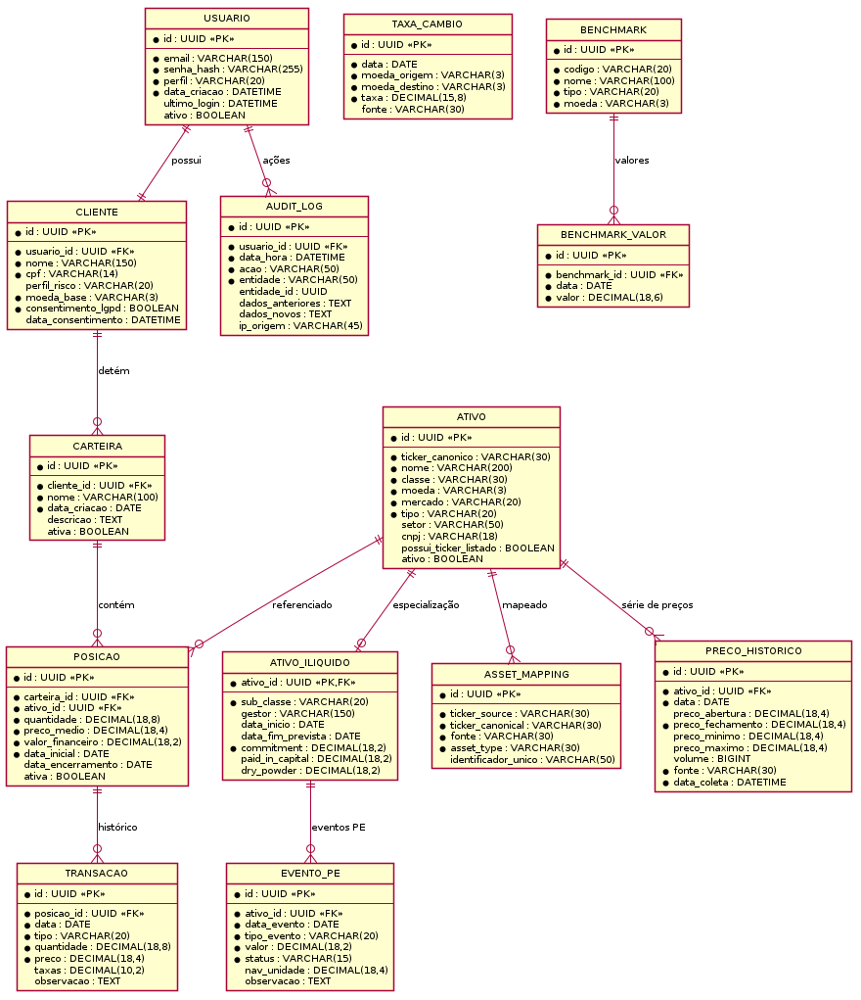

*Fonte: Elaborado pelos autores (2026).*

Os principais relacionamentos do modelo são:

- **USUARIO 1:1 CLIENTE** — cada usuário do sistema corresponde a um cliente investidor;
- **CLIENTE 1:N CARTEIRA** — um cliente pode ter múltiplas carteiras (por exemplo, carteira pessoal e carteira da PJ);
- **CARTEIRA 1:N POSICAO** — uma carteira contém múltiplas posições em ativos;
- **ATIVO 1:N POSICAO** — um mesmo ativo pode aparecer em posições de múltiplos clientes;
- **POSICAO 1:N TRANSACAO** — uma posição possui histórico de transações (compras, vendas, proventos);
- **ATIVO 1:0..1 ATIVO_ILIQUIDO** — relacionamento de especialização (apenas ativos ilíquidos possuem registro estendido);
- **ATIVO_ILIQUIDO 1:N EVENTO_PE** — fundo PE/VC tem múltiplos eventos (capital calls, distribuições, NAV updates);
- **ATIVO 1:0..1 ATIVO_IMOVEL** — relacionamento de especialização para imóveis diretos (Real Estate), cujo registro armazena endereço, valor de mercado, aluguel mensal, despesas mensais, área e data de avaliação (seção 7.2);
- **ATIVO 1:N PRECO_HISTORICO** — série temporal de preços do ativo;
- **BENCHMARK 1:N BENCHMARK_VALOR** — série temporal dos valores do benchmark;
- **USUARIO 1:N AUDIT_LOG** — ações realizadas pelo usuário ficam registradas.

## 7.2 DICIONÁRIO DE DADOS

O Quadro 43 detalha o dicionário de dados da entidade USUARIO, como exemplo do nível de detalhamento aplicado a cada entidade do modelo. O dicionário completo das demais entidades segue o mesmo padrão e está disponível na documentação técnica anexa ao projeto.

**Quadro 43 — Dicionário de Dados (entidade USUARIO)**

| Atributo | Tipo | Restrições | Descrição |
|---|---|---|---|
| id | TEXT (UUID) | PK, NOT NULL | Identificador único do usuário (UUID v4). |
| email | VARCHAR(150) | UNIQUE, NOT NULL | E-mail de login do usuário. |
| senha_hash | VARCHAR(255) | NOT NULL | Hash bcrypt da senha (cost factor 12). |
| perfil | VARCHAR(20) | NOT NULL, CHECK | Perfil do usuário: ADMIN, COLABORADOR ou CLIENTE. |
| data_criacao | DATETIME | NOT NULL, DEFAULT CURRENT_TIMESTAMP | Data e hora de criação da conta. |
| ultimo_login | DATETIME | NULL | Data e hora do último login bem-sucedido. |
| ativo | BOOLEAN | NOT NULL, DEFAULT 1 | Indica se a conta está ativa (não desabilitada/excluída). |
| tentativas_falhas | INTEGER | NOT NULL, DEFAULT 0 | Contador de tentativas de login falhas consecutivas. |
| bloqueado_ate | DATETIME | NULL | Data/hora até a qual a conta está bloqueada (RN-001). |

*Fonte: Elaborado pelos autores (2026).*

Os ativos imobiliários diretos, cujos dados são capturados pelo template de imóveis (seção 9.3), são persistidos na entidade ATIVO_IMOVEL, especialização de ATIVO dedicada a essa classe em paralelo à especialização ATIVO_ILIQUIDO, usada para Private Equity e Venture Capital. Além da chave estrangeira `ativo_id` (referência a ATIVO), a tabela armazena as colunas `endereco` (texto), `valor_de_mercado` (numérico), `aluguel_mensal` (numérico), `despesas_mensais` (numérico), `area_m2` (numérico) e `data_avaliacao` (data), garantindo o registro do valor de mercado, da renda de aluguel, das despesas e da localização de cada imóvel. As reavaliações periódicas de valor de mercado são versionadas em PRECO_HISTORICO, preservando, tal como nas demais classes, um histórico patrimonial auditável.

## 7.3 SCRIPT DDL (SQLITE)

O script completo de criação do banco de dados (DDL) em SQLite — incluindo tabelas, chaves primárias e estrangeiras, índices e restrições de integridade — é disponibilizado como artefato externo de implementação (arquivo `schema.sql`), conforme indicado no Apêndice A, de modo a separar o texto acadêmico do código-fonte do sistema. A estrutura lógica correspondente está documentada no MER (Figura 15) e no dicionário de dados (seção 7.2).

---

# 8 FLUXOS DE PROCESSO (BPMN)

Este capítulo apresenta os processos de negócio do sistema modelados em BPMN 2.0 (Business Process Model and Notation) (OMG, 2013). Os nove processos cobrem todas as interações do usuário previstas nos casos de uso UC-01 a UC-20, agrupadas por jornada. Em todos os diagramas, a separação em raias (Cliente, Sistema e, quando aplicável, API Externa) explicita os pontos de transferência de controle; tarefas de usuário trazem o marcador de pessoa, tarefas de serviço externo trazem o marcador de engrenagem e fundo destacado; gateways exclusivos (×) representam decisões e gateways paralelos (+) representam atividades concorrentes. Os arquivos-fonte em XML BPMN 2.0 acompanham o trabalho como artefatos suplementares e podem ser abertos em editores como Camunda Modeler ou bpmn.io.

## 8.1 ONBOARDING DO CLIENTE

O processo de onboarding cobre desde o acesso à página de cadastro até a disponibilização dos templates XLSX. O gateway "Dados válidos?" concentra as três exceções do UC-01 — e-mail duplicado, aceite LGPD ausente e senha fraca — e devolve o controle ao cliente para correção, sem criar registros parciais. A criação de USUARIO, CLIENTE e CARTEIRA ocorre em transação única, e o registro do consentimento com timestamp atende à Lei nº 13.709/2018.

**Figura 16 — BPMN: Onboarding do Cliente (UC-01)**

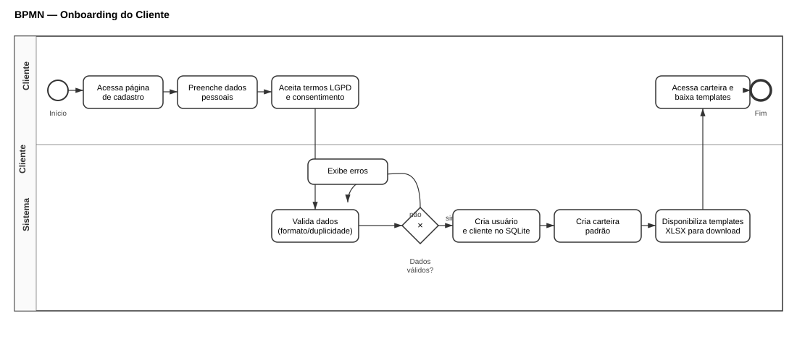

*Fonte: Elaborado pelos autores (2026).*

## 8.2 AUTENTICAÇÃO E CONTROLE DE ACESSO

O processo de autenticação integra o login (UC-02), a recuperação de senha (UC-03) e o controle de tentativas da RN-001. A verificação de bloqueio antecede a comparação do hash, de modo que a senha correta não destrava uma conta bloqueada. O ramo inferior da raia Sistema modela o contador de falhas: a quinta tentativa bloqueia a conta por quinze minutos; as anteriores devolvem o controle ao usuário com a informação de tentativas restantes. A mensagem de erro é genérica, para não revelar a existência do e-mail. Após o sucesso, o sistema carrega apenas as carteiras visíveis ao perfil (RN-013).

**Figura 17 — BPMN: Autenticação e Controle de Acesso (UC-02, UC-03, RN-001, RN-013)**

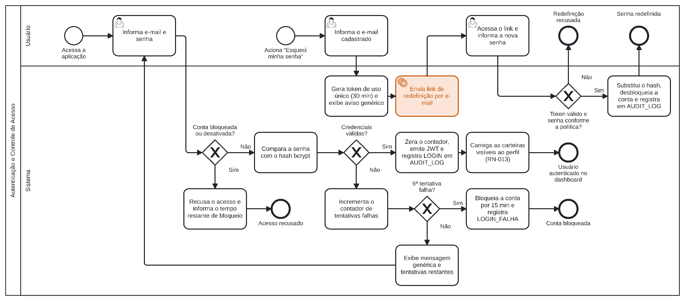

*Fonte: Elaborado pelos autores (2026).*

## 8.3 IMPORTAÇÃO DE CARTEIRA VIA TEMPLATE PADRONIZADO

Processo central do sistema, evidencia a validação em duas etapas da RN-002. O primeiro gateway decide entre abortar o arquivo inteiro (erro estrutural) e prosseguir com a validação linha a linha; o segundo decide, por ativo, entre consultar a API externa para obter o preço de mercado (ticker listado, RN-006) e adotar o preço médio do template (RN-007). O preview reúne linhas válidas, rejeitadas e o diferencial de preço, e nada é persistido antes da confirmação do usuário. Uma falha da API não interrompe o processo: o último preço conhecido é mantido e a posição é sinalizada.

**Figura 18 — BPMN: Importação de Carteira via Template Padronizado (UC-04, UC-07)**

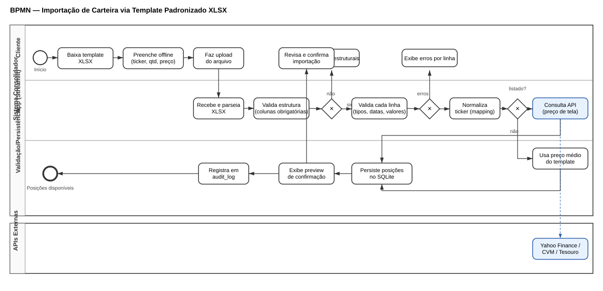

*Fonte: Elaborado pelos autores (2026).*

## 8.4 CÁLCULO DE RENTABILIDADE CONSOLIDADA

Descreve as atividades executadas quando o cliente acessa o dashboard. O gateway paralelo evidencia que a atualização de preços e o carregamento das taxas de câmbio são independentes e podem ocorrer concorrentemente; o gateway "Cache de preço expirado?" evita chamadas externas desnecessárias. Após a junção, as atividades de cálculo são sequenciais por dependência de dados: a marcação e a conversão à moeda base (RN-009) precedem TWR, MWR e risco (RN-010, RN-011), que precedem a comparação com benchmarks e as métricas PE/VC (RN-012).

**Figura 19 — BPMN: Cálculo de Rentabilidade Consolidada (UC-12 a UC-15)**

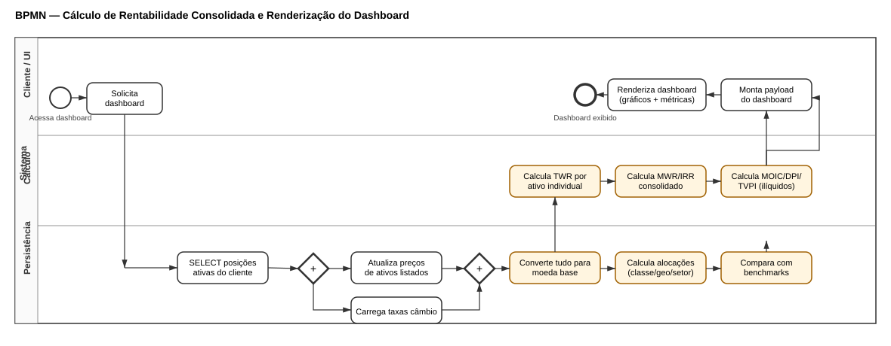

*Fonte: Elaborado pelos autores (2026).*

## 8.5 GESTÃO DE EVENTOS EM FUNDO PE/VC

Reúne os três eventos de um fundo ilíquido — capital call (UC-09), distribuição (UC-10) e atualização de NAV (UC-11) — em um único processo, pois compartilham a mesma estrutura: entrada de dados, validação da regra específica e recálculo das métricas (UC-15, RN-012). Dois gateways encadeados encaminham cada tipo à sua validação: RN-004 para chamadas, RN-005 para distribuições e a coerência de data e valor para o NAV. A rejeição devolve o formulário ao usuário informando o limite violado, e a aceitação grava o evento e o audita.

**Figura 20 — BPMN: Gestão de Eventos em Fundo PE/VC (UC-08 a UC-11, UC-15)**

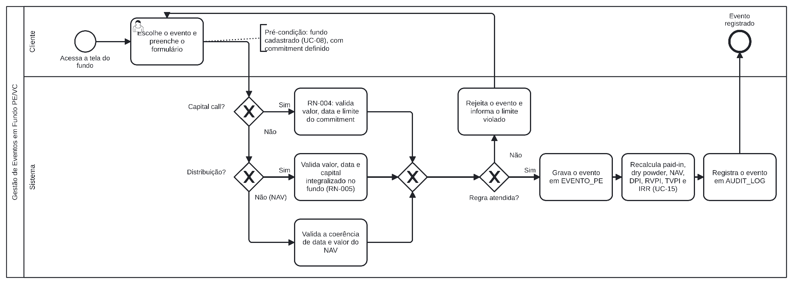

*Fonte: Elaborado pelos autores (2026).*

## 8.6 CADASTRO MANUAL DE ATIVO E REGISTRO DE TRANSAÇÃO

Modela a alternativa ao template: o cadastro manual de um ativo (UC-05 e UC-08) e o registro de transações sobre posições existentes (UC-06). O ramo superior reutiliza a normalização por ASSET_MAPPING e a decisão de consultar a API (UC-07) já presentes na importação, garantindo que o mesmo ativo seja consolidado e não duplicado. O ramo inferior valida a quantidade disponível para venda e a data antes de gravar a transação e atualizar quantidade e preço médio.

**Figura 21 — BPMN: Cadastro Manual de Ativo e Registro de Transação (UC-05, UC-06, UC-08)**

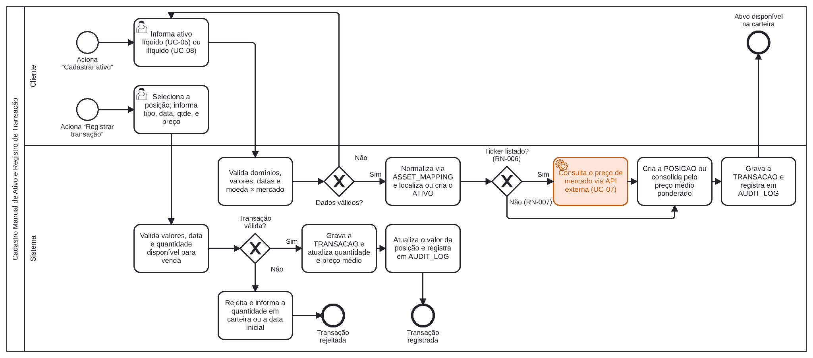

*Fonte: Elaborado pelos autores (2026).*

## 8.7 GERAÇÃO E EXPORTAÇÃO DE RELATÓRIOS

Processo simples que parte do snapshot consolidado da carteira e o serializa no formato escolhido: pasta de trabalho Excel com quatro abas ou arquivo CSV. Os valores saem convertidos para a moeda base, com indicação da moeda de origem quando relevante. O PDF, previsto no RF-023 com prioridade Could, é evolução planejada.

**Figura 22 — BPMN: Geração e Exportação de Relatórios (UC-16)**

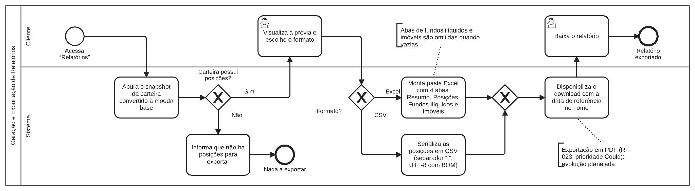

*Fonte: Elaborado pelos autores (2026).*

## 8.8 ATENDIMENTO A SOLICITAÇÃO LGPD

Cobre as duas solicitações LGPD atendidas pelo sistema: portabilidade (UC-17) e esquecimento (UC-18). Ambos os caminhos partem de um gateway exclusivo após a reautenticação do titular (RN-014). O ramo de portabilidade coleta os dados por junções, gera o arquivo, emite link de uso único com validade de 24 horas e audita a solicitação. O ramo de exclusão exige confirmação explícita e, em seguida, anonimiza a auditoria retida por obrigação legal (RN-015), apaga o patrimônio e o cadastro em cascata e revoga a sessão.

**Figura 23 — BPMN: Atendimento a Solicitação LGPD (UC-17, UC-18)**

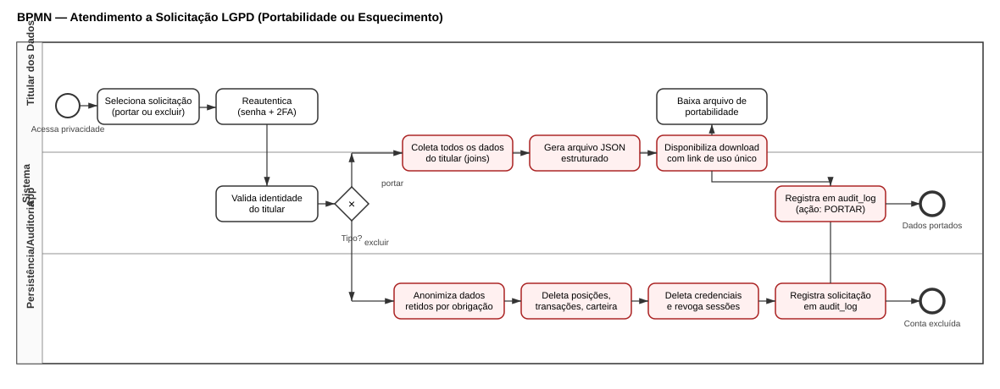

*Fonte: Elaborado pelos autores (2026).*

## 8.9 ADMINISTRAÇÃO DE USUÁRIOS E AUDITORIA

Modela as tarefas exclusivas do perfil ADMIN: gestão de contas (UC-19) e consulta à trilha de auditoria (UC-20). A verificação de perfil (RN-013) ocorre antes de qualquer tela ser exibida. Na gestão de contas, duas salvaguardas impedem que o administrador rebaixe o próprio perfil na sessão corrente ou remova o último administrador ativo; toda alteração é auditada com o estado anterior e o novo. Na auditoria, as contas excluídas por solicitação LGPD aparecem anonimizadas.

**Figura 24 — BPMN: Administração de Usuários e Auditoria (UC-19, UC-20)**

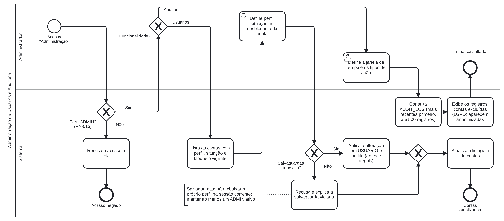

*Fonte: Elaborado pelos autores (2026).*

---

# 9 TEMPLATES PADRONIZADOS

O sistema disponibiliza três templates padronizados em formato XLSX como mecanismo principal de ingestão de dados. Cada template é especializado para uma classe de ativos e contém abas distintas para cabeçalho (instruções), dados (linhas a preencher) e validações (listas pré-definidas).

Esta seção detalha a estrutura de cada template, indicando as colunas obrigatórias, opcionais, tipos esperados e regras de validação. Os três templates são entregues como artefatos suplementares deste trabalho (arquivos `Template_Ativos_Liquidos.xlsx`, `Template_PE_VC.xlsx` e `Template_Imoveis.xlsx`), preenchidos com dados ilustrativos e sintéticos para fins de validação acadêmica.

## 9.1 TEMPLATE ATIVOS LÍQUIDOS

Destinado a ações (Brasil e Offshore), ETFs, fundos de investimento e títulos do Tesouro Direto. Estes ativos possuem ticker listado e, após importação, o sistema enriquecerá automaticamente cada posição com preço de mercado via API externa.

**Quadro 44 — Estrutura do Template Padronizado XLSX (Líquidos)**

| Coluna | Tipo | Obrig. | Descrição |
|---|---|---|---|
| ticker_ou_cnpj | Texto | Sim | Ticker do ativo (ex.: PETR4, AAPL) ou CNPJ do fundo (sem máscara). |
| nome | Texto | Não | Nome do ativo (preenchido automaticamente se vazio). |
| classe | Lista | Sim | ACAO, ETF, FUNDO, TESOURO_DIRETO, FII, RENDA_FIXA. |
| mercado | Lista | Sim | B3, NYSE, NASDAQ, LSE, EURONEXT. |
| moeda | Lista | Sim | BRL, USD, EUR. |
| quantidade | Numérico (8 dec) | Sim | Quantidade de cotas/ações da posição. |
| preco_medio | Numérico (4 dec) | Sim | Preço médio de aquisição na moeda do ativo. |
| valor_financeiro | Numérico (2 dec) | Sim | Valor financeiro total investido = quantidade × preço médio. |
| data_aquisicao | Data (dd/mm/aaaa) | Sim | Data da aquisição inicial da posição. |
| setor | Texto | Não | Setor da empresa (preenchido automaticamente para ativos listados). |
| observacao | Texto | Não | Observação livre para registro pessoal do cliente. |

*Fonte: Elaborado pelos autores (2026).*

Para todos os ativos deste template, o campo `possui_ticker_listado` da entidade ATIVO será definido como verdadeiro, e o sistema buscará o preço de mercado via API externa ao final da importação (RN-006).

## 9.2 TEMPLATE PRIVATE EQUITY / VENTURE CAPITAL

Destinado a fundos de PE e VC. Diferentemente do template de líquidos, este modelo é multi-aba: a primeira aba contém o cadastro dos fundos e suas características; a segunda aba contém os eventos (capital calls, distribuições e atualizações de NAV).

**Quadro 45 — Estrutura do Template Padronizado XLSX (PE/VC)**

| Coluna | Tipo | Obrig. | Descrição |
|---|---|---|---|
| identificador_fundo | Texto | Sim | Identificador único do fundo (gerado pelo cliente, ex.: FUND-VC-001). |
| nome_fundo | Texto | Sim | Nome completo do fundo. |
| gestor | Texto | Sim | Gestora responsável pelo fundo (ex.: Astella Investimentos). |
| sub_classe | Lista | Sim | PRIVATE_EQUITY, VENTURE_CAPITAL, REAL_ESTATE. |
| moeda | Lista | Sim | BRL, USD, EUR. |
| commitment | Numérico (2 dec) | Sim | Valor total comprometido pelo investidor. |
| data_inicio | Data (dd/mm/aaaa) | Sim | Data do primeiro aporte (initial close). |
| data_fim_prevista | Data (dd/mm/aaaa) | Não | Data prevista para encerramento do fundo (geralmente 10 anos). |
| data_evento | Data (dd/mm/aaaa) | Sim* | Aba Eventos: data do evento. |
| tipo_evento | Lista | Sim* | Aba Eventos: CAPITAL_CALL, DISTRIBUICAO, NAV_UPDATE. |
| valor_evento | Numérico (2 dec) | Sim* | Aba Eventos: valor monetário do evento. |
| status | Lista | Sim* | Aba Eventos: PENDENTE, PAGO, RECEBIDO, CANCELADO. |
| nav_unidade | Numérico (4 dec) | Não* | Aba Eventos: NAV por cota (apenas para NAV_UPDATE). |

*Fonte: Elaborado pelos autores (2026).*

Nota: \* Campos da aba Eventos.

## 9.3 TEMPLATE IMÓVEIS

Destinado a imóveis diretos (residenciais ou comerciais). Os FIIs (Fundos Imobiliários) são tratados pelo template de Líquidos, pois possuem ticker listado em bolsa.

**Quadro 46 — Estrutura do Template Padronizado XLSX (Imóveis)**

| Coluna | Tipo | Obrig. | Descrição |
|---|---|---|---|
| identificador_imovel | Texto | Sim | Identificador do imóvel (ex.: IMV-001, gerado pelo cliente). |
| nome_descritivo | Texto | Sim | Descrição do imóvel (ex.: Apartamento Centro - Curitiba). |
| tipo_imovel | Lista | Sim | RESIDENCIAL, COMERCIAL, INDUSTRIAL, RURAL. |
| endereco | Texto | Não | Endereço completo (uso interno do cliente). |
| data_aquisicao | Data (dd/mm/aaaa) | Sim | Data da escritura/aquisição. |
| valor_aquisicao | Numérico (2 dec) | Sim | Valor pago na aquisição. |
| valor_mercado_atual | Numérico (2 dec) | Sim | Estimativa do valor de mercado atual. |
| data_avaliacao | Data (dd/mm/aaaa) | Sim | Data da última avaliação do valor de mercado. |
| renda_mensal | Numérico (2 dec) | Não | Renda mensal de aluguel (se aplicável). |
| despesas_mensais | Numérico (2 dec) | Não | Despesas mensais (IPTU, condomínio, manutenção). |
| moeda | Lista | Sim | BRL, USD, EUR. |

*Fonte: Elaborado pelos autores (2026).*

---

# 10 PROTÓTIPOS DE INTERFACE (WIREFRAMES)

Este capítulo apresenta os wireframes (protótipos de baixa fidelidade) das principais telas do sistema. Os wireframes têm como objetivo validar a organização visual, hierarquia de informações e fluxos de navegação antes do desenvolvimento da interface final em Streamlit.

> **Nota:** todos os dados financeiros, nomes de ativos, tickers e valores exibidos nos wireframes e nos quadros de exemplo deste trabalho são meramente ilustrativos e gerados de forma sintética (fictícia), sem relação com carteiras reais de investidores ou com bases de dados de instituições financeiras.

## 10.1 TELA DE LOGIN E PRIVACIDADE LGPD

A Figura 25 apresenta, à esquerda, a tela de login (acesso público) e, à direita, a tela de privacidade do usuário autenticado, onde o titular pode exercer todos os seus direitos previstos pela LGPD: consentimento, acesso, portabilidade, correção, limitação de tratamento e esquecimento.

**Figura 25 — Wireframe: Tela de Login e Privacidade (LGPD)**

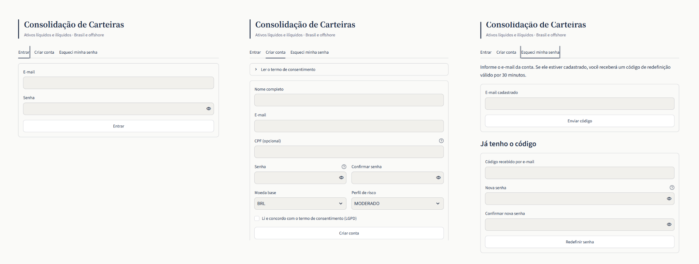

*Fonte: Elaborado pelos autores (2026).*

## 10.2 TELA DE IMPORTAÇÃO DE CARTEIRA

A Figura 26 apresenta a tela de importação organizada em três passos sequenciais: (1) download do template apropriado por classe de ativo, (2) upload do arquivo preenchido, e (3) preview com validação visual (linhas OK em verde, com aviso em amarelo, com erro em vermelho). Esta visualização permite ao cliente identificar e tratar problemas antes da confirmação definitiva da importação.

**Figura 26 — Wireframe: Tela de Importação de Carteira**

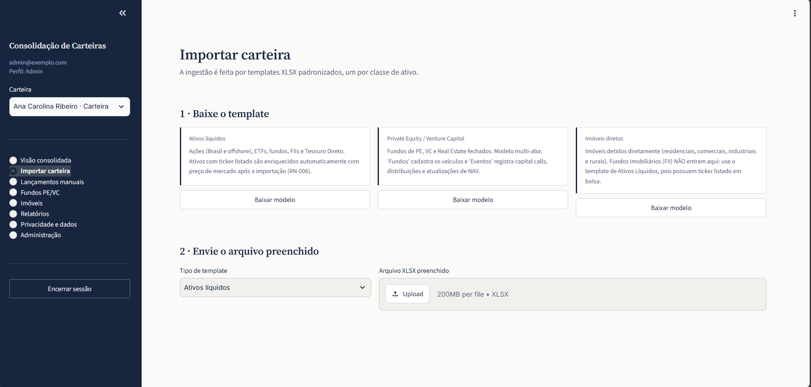

*Fonte: Elaborado pelos autores (2026).*

## 10.3 DASHBOARD PRINCIPAL

A Figura 27 apresenta o dashboard principal, organizado em quatro cards de KPI no topo (Patrimônio Total, Rentabilidade MWR, Volatilidade Anual e Maximum Drawdown), e três painéis de visualização: Evolução Patrimonial (gráfico de linha temporal), Performance vs Benchmarks (multi-linha) e Alocação por Classe + Alocação Geográfica (donut e barras horizontais).

**Figura 27 — Wireframe: Dashboard Principal**

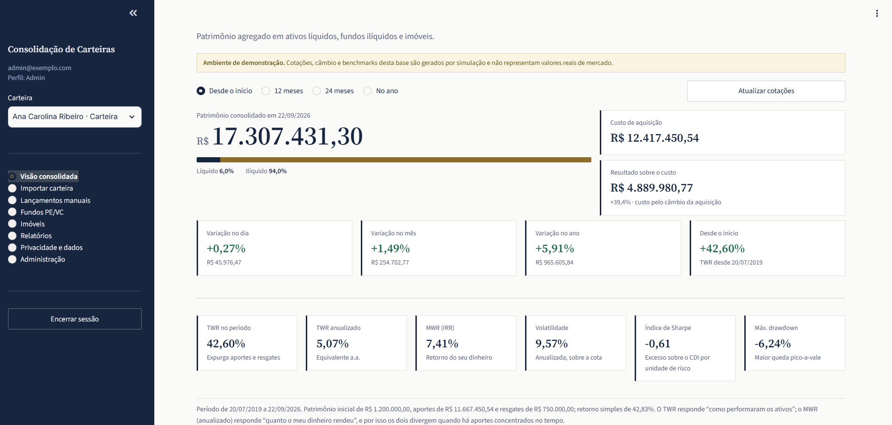

*Fonte: Elaborado pelos autores (2026).*

## 10.4 TELA DO FUNDO PE/VC

A Figura 28 apresenta a tela específica de um fundo PE/VC, com cards de KPI (Commitment, Paid-In, Dry Powder, NAV Atual, Distribuições), painel de métricas PE/VC (MOIC, DPI, TVPI, IRR, J-Curve, Anos do Fundo), histórico cronológico de eventos (capital calls, distribuições e atualizações de NAV) e gráfico J-Curve mostrando o fluxo de caixa acumulado.

**Figura 28 — Wireframe: Tela de Fundo PE/VC**

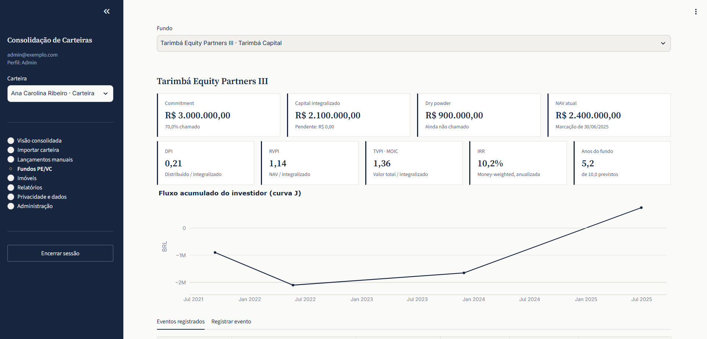

*Fonte: Elaborado pelos autores (2026).*

---

# 11 CONSIDERAÇÕES FINAIS

Este Trabalho de Conclusão de Curso apresentou a proposta de desenvolvimento de um sistema de consolidação de carteiras de investimentos capaz de integrar ativos líquidos e ilíquidos, domésticos e offshore, em uma visão patrimonial unificada.

O estudo das plataformas concorrentes evidenciou três lacunas relevantes no mercado brasileiro: a ausência de suporte completo a ativos ilíquidos como Private Equity e Venture Capital, a limitação na consolidação multi-moeda com taxas históricas e a inacessibilidade das plataformas profissionais (B2B) para investidores individuais. O sistema proposto foi concebido para endereçar essas lacunas, respondendo ao problema formulado na introdução por meio de uma arquitetura em camadas, de um modelo de ingestão padronizado e de um motor de cálculo que distingue as métricas adequadas a cada classe de ativo.

Do ponto de vista arquitetural, três decisões estratégicas marcam a proposta: (i) o uso de templates padronizados em XLSX como mecanismo principal de ingestão, oferecendo ao cliente um caminho estruturado e auditável para informar suas posições; (ii) o uso de APIs externas (Yahoo Finance e PTAX do BCB) restrito ao enriquecimento de preços de mercado para ativos com ticker listado e à obtenção de taxas de câmbio, mantendo a soberania do cliente sobre seus dados primários; e (iii) a adoção do SQLite como banco de dados local em arquivo, que simplifica o deploy e a manutenção e atende aos requisitos transacionais da versão monousuário.

A arquitetura em camadas (Apresentação, Aplicação, Domínio, Persistência e Integração Externa), combinada à stack tecnológica baseada em Python, Streamlit e SQLite, distribuída por instalador para Windows e, opcionalmente, por Docker (DOCKER INC., 2026), possibilita um equilíbrio adequado entre prototipação rápida e robustez técnica.

A escolha das metodologias TWR e MWR para cálculo de rentabilidade, complementadas pelas métricas específicas de PE/VC (MOIC, DPI e TVPI), busca aderência às práticas consolidadas da indústria financeira. As decisões de segurança e privacidade — JWT, RBAC, AES-256 via Fernet e adequação à LGPD — orientam o tratamento dos dados financeiros dos usuários em conformidade com a legislação.

A modelagem detalhada apresentada nos capítulos 6, 7 e 8 (UML, MER, DDL e BPMN) e os wireframes do capítulo 10 constituem a base técnica para a execução do projeto nas fases subsequentes do cronograma. A matriz de rastreabilidade (Quadro 22) e o catálogo de regras de negócio (Quadro 21) facilitam a verificação contínua de cobertura entre requisitos, implementação e testes.

Como evolução futura, sugere-se: (i) integração com o ecossistema Open Finance para coleta automática de posições, reduzindo a dependência do template como única via de entrada; (ii) suporte a criptoativos, com integração às principais exchanges; (iii) desenvolvimento de aplicativo mobile com sincronização local-nuvem; (iv) ampliação do motor de cálculo com módulo de apuração tributária (Imposto de Renda e come-cotas); (v) inclusão de funcionalidades de planejamento financeiro e projeção patrimonial baseadas em métodos como Monte Carlo; e (vi) migração opcional para PostgreSQL em cenários multi-tenant onde a concorrência de escrita justifique a complexidade adicional. Na camada de integração, registram-se ainda como trabalhos futuros: a coleta de cotas de fundos pelo Portal de Dados Abertos da CVM e de preços e taxas de títulos públicos pelo Tesouro Direto; a coleta real das séries de benchmarks (CDI, IBOV, IPCA, S&P 500 e IFIX), que na demonstração desta versão são simuladas e identificadas com a fonte SIMULADO; e mecanismos de resiliência nas coletas, como retry com backoff e circuit breaker. Tais expansões, no entanto, encontram-se fora do escopo desta primeira versão e poderão ser endereçadas em trabalhos subsequentes.

Reconhecem-se, ainda, as limitações desta etapa: a necessidade do sistema foi inferida de análise documental e comparativa, sem validação empírica junto ao público-alvo, prevista para o TCC II (seção 3.4); a análise de plataformas baseou-se em funcionalidades anunciadas publicamente, sujeitas a alteração; a ingestão depende do preenchimento manual de templates; o enriquecimento de preços depende de fontes gratuitas, sujeitas a limites de uso e mudanças de contrato; e a arquitetura monousuário em SQLite exigirá migração em cenários multiusuário (seção 5.8).

Espera-se que o sistema proposto possa contribuir para a maturidade do mercado brasileiro de gestão patrimonial, oferecendo aos investidores pessoa física uma ferramenta fundamentada em boas práticas da engenharia de software e da indústria financeira.

---

# REFERÊNCIAS

AMAZON WEB SERVICES. **O que é uma API?** [S. l.]: AWS, 2026. Disponível em: https://aws.amazon.com/pt/what-is/api/. Acesso em: 15 maio 2026.

ANBIMA. **Consolidado histórico de fundos de investimento**. Rio de Janeiro: ANBIMA, 2026. Disponível em: https://www.anbima.com.br/pt_br/informar/estatisticas/fundos-de-investimento/fi-consolidado-historico.htm. Acesso em: 15 maio 2026.

ASSAF NETO, Alexandre. **Mercado financeiro**. 14. ed. São Paulo: Atlas, 2021.

ASSOCIAÇÃO BRASILEIRA DE NORMAS TÉCNICAS. **NBR ISO/IEC 27002**: tecnologia da informação — técnicas de segurança — código de prática para controles de segurança da informação. Rio de Janeiro: ABNT, 2013.

B3 — BRASIL, BOLSA, BALCÃO. **Dados de mercado**. São Paulo: B3, 2026. Disponível em: https://www.b3.com.br/pt_br/market-data-e-indices/. Acesso em: 15 maio 2026.

BANCO CENTRAL DO BRASIL. **Sistema Gerenciador de Séries Temporais (SGS)**. Brasília, DF: BCB, 2026. Disponível em: https://www3.bcb.gov.br/sgspub/. Acesso em: 15 maio 2026.

BASS, Len; CLEMENTS, Paul; KAZMAN, Rick. **Software architecture in practice**. 4. ed. Boston: Addison-Wesley, 2021.

BECK, Kent. **Programação extrema (XP) explicada**: acolha as mudanças. Porto Alegre: Bookman, 2004.

BODIE, Zvi; KANE, Alex; MARCUS, Alan J. **Investimentos**. 10. ed. Porto Alegre: AMGH, 2015.

BRASIL. **Lei nº 13.709, de 14 de agosto de 2018**. Lei Geral de Proteção de Dados Pessoais (LGPD). Brasília, DF: Presidência da República, 2018. Disponível em: https://www.planalto.gov.br/ccivil_03/_ato2015-2018/2018/lei/l13709.htm. Acesso em: 15 maio 2026.

COCKBURN, Alistair. **Writing effective use cases**. Boston: Addison-Wesley, 2001.

CVM — COMISSÃO DE VALORES MOBILIÁRIOS. **Portal de Dados Abertos**. Rio de Janeiro: CVM, 2026. Disponível em: https://dados.cvm.gov.br/. Acesso em: 15 maio 2026.

DAMODARAN, Aswath. **Avaliação de investimentos**: ferramentas e técnicas para a determinação do valor de qualquer ativo. 2. ed. Rio de Janeiro: Qualitymark, 2012.

DATE, C. J. **Introdução a sistemas de bancos de dados**. 8. ed. Rio de Janeiro: Elsevier, 2004.

DOCKER INC. **Docker documentation**. [S. l.]: Docker Inc., 2026. Disponível em: https://docs.docker.com/. Acesso em: 15 maio 2026.

FOWLER, Martin. **Patterns of enterprise application architecture**. Boston: Addison-Wesley, 2002.

GORILA. **Plataforma de consolidação de investimentos**. [S. l.]: Gorila, 2026. Disponível em: https://www.gorila.com.br/. Acesso em: 15 maio 2026.

GRINOLD, Richard C.; KAHN, Ronald N. **Active portfolio management**: a quantitative approach for producing superior returns and controlling risk. 2. ed. New York: McGraw-Hill, 1999.

ISO/IEC. **ISO/IEC 25010:2011**: systems and software engineering — systems and software quality requirements and evaluation (SQuaRE) — system and software quality models. Geneva: ISO, 2011.

KINVO. **Plataforma de consolidação de investimentos**. [S. l.]: Kinvo, 2026. Disponível em: https://www.kinvo.com.br/. Acesso em: 15 maio 2026.

MARKOWITZ, Harry. Portfolio selection. **The Journal of Finance**, [s. l.], v. 7, n. 1, p. 77-91, 1952.

MARTIN, Robert C. **Arquitetura limpa**: o guia do artesão para estrutura e design de software. Rio de Janeiro: Alta Books, 2019.

McKINNEY, Wes. **Python para análise de dados**: tratamento de dados com Pandas, NumPy e IPython. 2. ed. São Paulo: Novatec, 2018.

METRICK, Andrew; YASUDA, Ayako. **Venture capital and the finance of innovation**. 2. ed. Hoboken: Wiley, 2011.

OMG — OBJECT MANAGEMENT GROUP. **Business Process Model and Notation (BPMN)**: version 2.0.2. [S. l.]: OMG, 2013. Disponível em: https://www.omg.org/spec/BPMN/2.0.2/. Acesso em: 15 maio 2026.

OMG — OBJECT MANAGEMENT GROUP. **Unified Modeling Language (UML)**: version 2.5.1. [S. l.]: OMG, 2017. Disponível em: https://www.omg.org/spec/UML/2.5.1/. Acesso em: 15 maio 2026.

PANDAS DEVELOPMENT TEAM. **pandas documentation**. [S. l.]: NumFOCUS, 2026. Disponível em: https://pandas.pydata.org/docs/. Acesso em: 15 maio 2026.

PRESSMAN, Roger S.; MAXIM, Bruce R. **Engenharia de software**: uma abordagem profissional. 8. ed. Porto Alegre: AMGH, 2016.

SCHWABER, Ken. **Agile project management with Scrum**. Redmond: Microsoft Press, 2004.

SMARTBRAIN. **Plataforma profissional de gestão patrimonial**. [S. l.]: SmartBrain, 2026. Disponível em: https://www.smartbrain.com.br/. Acesso em: 15 maio 2026.

SOMMERVILLE, Ian. **Engenharia de software**. 10. ed. São Paulo: Pearson Education do Brasil, 2018.

SQLALCHEMY. **SQLAlchemy documentation**. [S. l.]: SQLAlchemy, 2026. Disponível em: https://www.sqlalchemy.org/. Acesso em: 15 maio 2026.

SQLITE. **SQLite documentation**. [S. l.]: SQLite Consortium, 2026. Disponível em: https://www.sqlite.org/docs.html. Acesso em: 15 maio 2026.

STATUS INVEST. **Plataforma de análise fundamentalista e carteira**. [S. l.]: Status Invest, 2026. Disponível em: https://statusinvest.com.br/. Acesso em: 15 maio 2026.

STREAMLIT. **Streamlit documentation**. [S. l.]: Snowflake, 2026. Disponível em: https://docs.streamlit.io/. Acesso em: 15 maio 2026.

TESOURO NACIONAL. **Tesouro Direto**. Brasília, DF: Tesouro Nacional, 2026. Disponível em: https://www.tesourodireto.com.br/. Acesso em: 15 maio 2026.

TRADEMAP. **Plataforma de consolidação e acompanhamento em tempo real**. [S. l.]: TradeMap, 2026. Disponível em: https://trademap.com.br/. Acesso em: 15 maio 2026.

YAHOO FINANCE. **yfinance**: Python library. [S. l.]: GitHub, 2026. Disponível em: https://github.com/ranaroussi/yfinance. Acesso em: 15 maio 2026.
